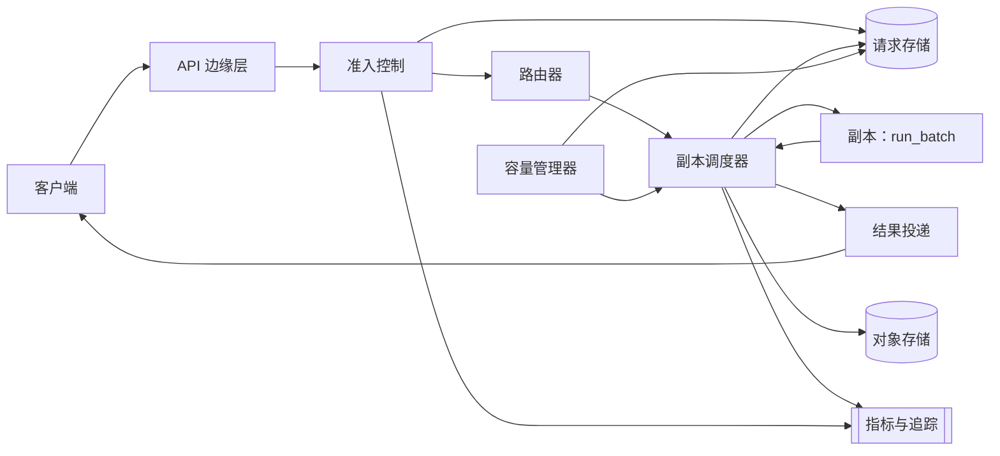

# 带批处理的 LLM 推理 API

[English](README.md) · [中文](README.zh.md)

<!-- meta:begin -->
| 题型 | 优先级 | 难度 | 岗位 | 考点 | 形式 | 轮次 |
| --- | --- | --- | --- | --- | --- | --- |
| 系统设计 | ★★★★★ | 困难 | SWE · MLE · Infra Eng | batching, kv-cache, gpu-scheduling, admission-control, capacity-planning | 55 分钟 | 技术电面 · 现场面（VO） |
<!-- meta:end -->

## 题目

设计部署在一组 GPU 模型副本前面的公开 API 与*调度器*（dispatcher），这组副本服务于同一个大语言模型。一个*副本*（replica）是模型的一份运行中的拷贝，绑定在一组固定的 GPU 上，同一时刻最多执行一个*批次*（batch）——批次是一组被打包进同一次前向传播（forward pass）、一起处理的请求。基础设计中，每个副本都对外暴露同样固定的接口：

```py
def run_batch(prompts: list[str], max_output_tokens: int) -> list[str]:
    """Runs one inference batch on this replica and blocks until it returns."""
```

- `1 <= len(prompts) <= 64`；调用会为每一个输入恰好返回一条补全字符串，顺序与输入一致。
- 这次调用固定耗时 **100 ms**，与 64 个槽位（slot）实际填了多少无关。
- `max_output_tokens` 每次调用最多为 512。如果一个请求的补全会超出这个长度，就必须把已经生成的部分重新折叠进上下文、再次提交，从上一次调用停下的地方继续生成，而这次续写同样要再付出一次固定的 100 ms。
- 一个副本同一时刻只接受一次 `run_batch` 调用；第二次调用会阻塞，直到第一次返回为止。基础设计中一个副本对应一块 GPU；下面 (e) 部分的追问会改变这一点。

调度器是客户端与副本池之间的一切：它把单个请求组装成批次（受最大批次大小和最长等待时间的约束），把每个批次路由给某个副本，再把批次输出列表中属于每个请求的那一份，返回给发出该请求的调用方。

流量由两类请求混合构成。*实时*（real-time）请求是交互式的——有真人在等待，调用是同步或流式的，目标是端到端延迟的 95 分位数（p95）不超过 **500 ms**。*离线*（offline）请求作为批处理任务（batch job）的一部分提交，没有单个请求级别的延迟目标，只有一个以分钟为单位的任务级完成 SLA；它们的作用是在实时流量的空当里用吞吐型工作占满 GPU。峰值时系统每秒收到 **10,000** 个请求，其中 80%（8,000/s）是实时请求，20%（2,000/s）是离线请求。无论哪一类，平均一个请求携带 **300 个输入 token**、生成 **200 个输出 token**。每个副本服务一对 `(model, model_version)`；副本池同时容纳多个模型和多个版本，一个模型已经冷却（cold）的副本可以重新加载（reload）为另一个模型，代价是数十秒量级的加载时间。

范围内：调度器的批处理策略、副本池前的负载均衡与准入控制（admission control）；调度器视角下 KV cache 与可选前缀缓存（prefix cache）的内存核算（每 token 的字节数、命中率、淘汰策略——不涉及注意力核函数本身）；隔离实时与离线流量；以及一个追问——固定一个独立的 8 卡 GPU 池，由一个大模型（每批需要全部 8 块 GPU）和一个小模型（每批只需要 1 块 GPU）共用。范围外：模型内部机制（注意力、采样、分词——`run_batch` 是一个遵守上述接口约定的黑盒）、鉴权本身（假设每个请求到达时都已经带有验证过的 `tenant_id`，并且限流档位已经确定），以及训练。

要产出：

1. 需求与规模估算：峰值所需的副本数——假设每个批次都满载的理论下限，以及按实时池和离线池拆分后实际配置的机群规模——给定模型配置下 KV cache 每 token 的字节数，以及 500 ms SLO 内部的排队延迟预算。
2. 数据模型与核心 API：同步调用、流式调用，以及异步批处理任务提交。
3. 架构图，以及沿着它对一个请求的完整走查（walk-through）。
4. 深入话题：(a) 批处理策略，以及理论最大吞吐量与实际达到的吞吐量之间的差距——批次填充率（fill）、排队、最长等待时间（max-wait）的权衡，以及作为下一步的连续、token 级批处理（continuous batching）；(b) 负载均衡信号与准入控制——按租户的限流、有界队列、负载卸放（load shedding）、带幂等键（idempotency key）的重试、取消与超时，以及流式传输如何在固定批次接口之上工作；(c) KV cache 与前缀缓存——什么时候值得用、按序列计算的内存算术，以及淘汰策略；(d) 隔离实时与离线流量——SLO、容量规划、可观测性（observability）；(e) 一个追问，固定一个独立的 8 卡 GPU 池，由一个批次需要全部 8 块 GPU 的大模型和一个批次只需要 1 块 GPU 的小模型共用，两者的批次执行时间相等——调度与派发策略，以及它的利用率代价。每一项都要至少比较两种方案，说明会选择哪一种，并给出代价。

## 参考解答

<details>
<summary>展开参考解答</summary>

动手设计之前有两点值得先确认：峰值时实时流量与离线流量各占多少，以及 `run_batch` 固定的 100 ms 开销是与 `max_output_tokens` 无关，还是只与 64 个槽位实际填了多少无关。这份设计假设峰值时实时与离线的比例是 80/20，并把这 100 ms 理解为一次固定长度解码步骤（decode pass，上限 512 个 token）的开销——与占用率无关，但如果生成长度长到需要再来一次调用，就不再是同一次开销。占用率之所以不影响这个开销，是因为一次解码步骤的瓶颈在于把全部权重从 GPU 显存里读一遍，而不在于这一批的算术量：在这个规模下，矩阵乘法本身留有余量，足够容纳显存读取之外的计算，所以多一个请求消耗的是这份余量，而不是额外的墙钟时间——直到批次大到让这一步转为计算受限（compute-bound）为止。

### 需求与规模

**请求速率。** 峰值为 $10{,}000$ 次请求/秒；按 80/20 拆分，实时为 $8{,}000$/秒，离线为 $2{,}000$/秒。

**理论下限。** 每个副本同一时刻只跑一个批次——相当于每个副本一个*槽位*（这里 $C = 1$；当一个批次跨越不止一块 GPU 时，(e) 部分会重新讨论这一点）。在 100% 填充率下，一个副本每秒能完成 $64 / 0.1 = 640$ 个请求，所以要满足全部 $10{,}000$/秒的需求，至少需要

```math
\left\lceil \frac{10{,}000 \times 0.1}{64 \times 1} \right\rceil = \lceil 15.625 \rceil = 16 \text{ 个副本。}
```

这个下限并不是应该按照它来配置的目标：它几乎没有留下任何聚合层面的备用容量（$16$ 个副本合计提供 $16 \times 640 = 10{,}240$ 次/秒的能力，对应 $10{,}000$/秒的需求；只要有一个副本因健康检查失败或滚动重启（rolling restart）而掉线，容量就会跌到 $15 \times 640 = 9{,}600$/秒，低于需求，排队延迟会在该副本恢复之前无限增长），而且即便所有副本都保持健康，让每个副本都跑在 $\rho = 625/640 \approx 97.7\%$ 的利用率（即 $16$ 个副本平分负载时的水平）上，虽然能让批次几乎总是满的，却会推高尾延迟：下面的离散事件仿真显示，在这个利用率下 p99 接近 290 ms、最大值接近 390 ms，仅在一切正常时才落在 500 ms 以内，完全没有为比泊松分布更突发（burstier）的到达过程留出余量。

**实时池。** 实际配置以每个副本 75% 的平均批次填充率为目标（64 个槽位中的 48 个），(a) 说明只要有任何积压，一个较短的 `max_wait` 就能做到这一点。在 75% 填充率下，一个副本每秒能完成 $48 / 0.1 = 480$ 个请求，所以原始需求是 $8{,}000 / 480 \approx 16.7$ 个副本；加上应对滚动发布和负载不均的 20% 余量，$8{,}000 \times 1.2 / 480 = 20$，正好 20 个副本。20 个副本下，实际负载是每个副本 $8{,}000 / 20 = 400$/秒——$\rho = 62.5\%$——仿真证实平均填充率 40/64（62.5%），等待时间 p50 为 150 ms、p95 为 195 ms、p99 为 199 ms，最大值约 201 ms：即便再加上约 25 ms 的边缘、准入与网络开销，也落在 500 ms 的 SLO 以内，为真实流量额外的突发性留出约 275 ms 余量。

**离线池。** 由于没有单个请求级别的延迟目标，离线调度器可以把 `max_wait` 设得很长（这里取 400 ms），让批次几乎每次都是靠达到大小上限而关闭，所以配置目标是 100% 填充率：原始需求为 $2{,}000 / 640 = 3.125$ 个副本，$2{,}000 \times 1.2 / 640 = 3.75$，向上取整为 **4 个副本**。4 个副本下，实际负载为每个副本 $500$/秒（$\rho = 78.1\%$）；仿真证实平均填充率为 64.0/64（$\approx 100\%$），p50 为 162 ms、p95 为 226 ms、p99 为 243 ms——相对于以分钟为单位的任务 SLA，这些数字都无关紧要。

**峰值机群规模。** 在给定的流量占比下，这个模型共需要 $20 + 4 = 24$ 个副本（24 块 GPU）——比 16 个副本的理论下限高 50%，这完全可以由实时池刻意压低的利用率（为保护尾延迟）加上两个池共用的 20% 运维余量来解释；离线池单独来看，已经只比自己的下限多一个副本。

**KV cache 每 token 的字节数。** 取一个有代表性的模型配置：40 个 Transformer 层，模型宽度 $d_{\text{model}} = 5{,}120$，8 个键/值头（key/value head），每个头维度为 128（分组查询注意力，grouped-query attention，即 $5{,}120 / 128 = 40$ 个查询头，每 5 个共享其中一个 KV 头），权重和 KV 条目都以 bf16 存储（每元素 2 字节）。按标准的 $12 \times n_{\text{layers}} \times d_{\text{model}}^2$ 近似公式，参数量为 $12 \times 40 \times 5{,}120^2 \approx 12.6\text{B}$（约 126 亿），权重因此占用约 $12.6\text{B} \times 2 \approx 25.2$ GB。一个键/值缓存条目为每一层、每一个 KV 头各存一个 key 向量和一个 value 向量：

```math
\text{bytes/token} = 2 \times n_{\text{layers}} \times n_{\text{kv\_heads}} \times \text{head\_dim} \times \text{bytes/elem}
= 2 \times 40 \times 8 \times 128 \times 2 = 163{,}840 \approx 0.164 \text{ MB。}
```

（如果用完整的多头注意力，40 个 KV 头而不是 8 个，这个数字会乘以 5，变成 0.82 MB/token——分组查询注意力正是让缓存保持这么小的原因。）在一块 80 GB 的 GPU 上，扣除 25.2 GB 的权重和 5 GB 用于激活值与运行时开销的预留，还剩约 49.8 GB 可以用于 KV 条目。一个平均长度的序列（300 输入 + 200 输出 = 500 个 token）在其完整长度下需要 $500 \times 163{,}840 \approx 81.9$ MB 的缓存，所以这部分可用内存池理论上能同时容纳约 $49.8\text{ GB} / 81.9\text{ MB} \approx 608$ 条平均长度的序列——差不多是 64 这个批次上限的 9.5 倍，所以 KV 显存并不是这个设计里限制批次大小的因素（真正的限制是计算量和固定延迟接口）；(c) 部分会把这部分富余用在前缀缓存上。

**排队延迟预算。** 在 500 ms 的实时 SLO 里，大约 25 ms 花在批处理层之外（边缘/TLS、鉴权、准入、响应传输），剩下约 475 ms 留给调度器内部的时间加上 100 ms 的执行本身。实时池仿真得到的 p99 是 199 ms，用掉的还不到这 475 ms 的一半——这份余量正是这份设计花在余量本身、而不是花在最大化填充率上的部分。

### 数据模型与 API

**InferenceRequest（推理请求）**——`request_id`、`tenant_id`、`idempotency_key`、`model`、`model_version`、`mode`（`sync | stream | async_batch`）、`priority_class`（`realtime | offline`）、`prompt_text`、`max_output_tokens`、`status`（`queued | batched | running | succeeded | failed | cancelled`）、`cancel_requested`、`replica_id`、`batch_id`、`queued_at`、`dispatched_at`、`completed_at`、`output_text`、`output_tokens`、`failure_reason`。

**Batch（批次，内部实体）**——每一次派发的 `run_batch` 调用对应一行，用于可观测性与重放（replay）：`batch_id`、`replica_id`、`model_version`、`request_ids`（有序）、`formed_at`、`dispatched_at`、`completed_at`、`fill`（= `len(request_ids)`）。

**RateBudget（限流预算，按租户）**——`tenant_id`、`tier`（`free | standard | enterprise`）、`sustained_qps`、`burst_qps`、`tokens_available`、`last_refill_at`。

核心接口：

1. `POST /v1/generate`——同步调用。`{model, model_version?, prompt, max_output_tokens, idempotency_key}` → `200 {request_id, output_text, output_tokens}`；携带一个已经见过的 `idempotency_key` 的重试调用，会直接返回存好的结果，而不会重新执行一次。`429`（租户超出限流预算）或 `503`（该池已准入但尚未处理的队列已满）都带 `Retry-After`。
2. 带 `"mode": "stream"` 的 `POST /v1/generate`——打开一个服务端推送事件（Server-Sent Events，SSE）连接：先发一个带排队位置估计的 `queued` 事件，然后在副本的批次调用返回后，发一个携带完整输出的 `result` 事件，或者一个 `error` 事件。这不是逐 token 的流式输出——参见 (b)。
3. `POST /v1/batches`——异步调用。`{model, model_version, requests: [{prompt, max_output_tokens, idempotency_key}, ...]}` → `202 {batch_job_id, status: "queued", request_count}`；其中每一个请求都是普通的 `InferenceRequest` 行，只是标记了 `priority_class = offline`。
4. `GET /v1/batches/{batch_job_id}`——`{status, requests_completed, requests_failed, result_uri}`，用于轮询；一旦任务里的每个请求都到达终态，`result_uri` 就会被设置。
5. `POST /v1/generate/{request_id}/cancel`——幂等（idempotent）。如果请求还在一个尚未关闭的批次里等待，就直接把它从批次里移除；如果它已经被划入一个发往某个副本的批次，就只能设置 `cancel_requested`，因为一次正在执行的 `run_batch` 调用无法被部分中止——调度器会在下一个批次边界丢弃它的输出，而不是把结果返回给调用方。返回处理后的 `status`。
6. `GET /v1/generate/{request_id}`——返回状态，以及在 `succeeded` 之后的结果——供丢失了同步响应或 SSE 连接的客户端使用。

### 架构



一次同步的实时请求提交到达 API 边缘层，边缘层完成鉴权后交给准入控制。如果 `(tenant_id, idempotency_key)` 是已经见过的组合，立刻返回存好的结果。否则，准入控制检查该租户的限流预算，向存储写入一行 `queued` 状态的 `InferenceRequest`——这是请求状态唯一权威的地方——写入成功之后才确认收到请求，这样两步之间发生的崩溃，就不会让客户端误以为某个请求存在，而存储里其实完全没有它的记录。路由器根据 (b) 中的负载信号，为请求的 `(model, model_version)` 在实时池内挑选一个副本；该副本的调度器把请求追加到正在组装的批次里，并按 (a) 中按大小或按时间的规则关闭这个批次。批次一旦关闭，调度器就调用 `run_batch` 并阻塞固定的 100 ms；调用返回后，调度器按位置把输出列表逐一分发回批次里的每个调用方，把每个请求标记为 `succeeded` 并附上其输出，结果投递环节要么直接返回同步的 HTTP 响应，要么发出 SSE 的 `result` 事件。离线请求则通过 `POST /v1/batches` 到达：准入控制把它拆分成同样的按请求存储行，标记 `priority_class = offline`，并把每一个都按上面同样的方式路由到离线池——只是那里的调度器是需求与规模一节离线部分所描述的那个；完成的输出写入对象存储，批处理任务自身的状态由它所包含的各个请求的状态汇总得到，而不是靠一个一直保持着的连接。容量管理器与这条路径并行持续运行，监控每个池的队列深度和每个副本的利用率，据此伸缩副本数量，并在可能的情况下提前把冷却的模型重新加载到刚刚空出来的副本上，抢在需求到来之前完成。

### 深入话题

**(a) 批处理策略，以及实际吞吐量与理论吞吐量之间的差距。** 一个批次的*填充率*（fill）是它实际用掉的 `max_batch_size` 槽位所占的比例。调度器采用一个*按大小或按时间*（size-or-time）的策略：一个正在组装的批次，只要达到 `max_batch_size` 就立刻关闭；或者从它收到第一个请求起过了 `max_wait`，*并且*此时副本正空闲、可以接收它，也会关闭。如果到了这个截止时间副本仍在忙着处理上一个批次，正在组装的批次就继续吸收新到达的请求，而不提前关闭——反正副本在能接手之前，提前把批次截断也不会带来任何好处。

- *固定时钟刷新*（每隔 `max_wait` 就刷新一次，不管副本状态如何）：被否决。如果 `max_wait` 比 100 ms 的执行时间还短——而这正是压低单个请求等待时间所需要的——批次关闭的速度就会快于副本能消化的速度，只要到达率为正，待处理队列就会无限增长；下面的离散事件仿真去掉了“副本感知”的延迟关闭机制来重现这一点，结果在仅仅 5 秒的到达突发里，等待时间就已经膨胀到超过 10 秒，而同样的到达率下，所选策略给出的等待时间还在一秒以内。
- *带副本感知延迟关闭的按大小或按时间策略*（选定）：只要副本有任何积压，计时器就不再是限制性约束——正在组装的批次会持续吸收到达的请求，直到副本忙完为止，在稳态下这恰好就是一个 100 ms 周期。这使得实际填充率直接跟随利用率，$\text{fill} \approx \rho \times 64$，与具体选了多短的 `max_wait` 无关，只要它短于 100 ms 就行；这时 `max_wait` 唯一的作用，是限定副本真正空闲（负载轻、没有积压）时一个请求最多要等多久——而这恰恰是短 `max_wait` 对吞吐量影响最小、对延迟影响最大的那种情形。这也是为什么实时池 20 ms 的 `max_wait` 和离线池 400 ms 的 `max_wait`，各自都能得到前面给出的那个填充率，而不需要互相调校。

这个策略的排队代价是有界且简单的：一旦副本饱和到计时器几乎不再起作用的程度，一个请求的等待时间至多是当前正在跑的批次的剩余时间（最多 100 ms）加上它自己所在批次 100 ms 的执行时间——这正好对应仿真在所有测过的、利用率低于约 85% 的场景下测到的 150 ms 均值和约 200 ms 的 p99。超越这种“整批一起返回”接口的*下一步*是**连续批处理**（continuous batching）：不再是一次 `run_batch` 调用返回一条完整的补全，而是每次调用把批次里每一个活跃的序列都推进一个解码步（一个 token），这样一个序列可以在槽位一空出来就加入，也可以在自己结束的那一刻立刻离开，而不必等整个静态批次一起跑完。这去掉了这份设计所接受的两项代价——一个短序列和一个长序列共享同一个批次时，拖住它的只是那些仍在运行的序列，而不是整个批次固定的槽位数量要从头重新生成一遍；而且想要真正逐 token 输出的客户端，也不再需要 (b) 中描述的分块变通方案。

**(b) 负载均衡与准入控制。**

*负载均衡信号。* 把每个请求都均匀随机或轮询（round-robin）路由到某个副本，忽略了一个事实：即使长期平均负载相等，突发到达也会让各个副本的队列深度不同，结果一个请求可能落在一个已经积压的副本上，而另一个更空闲的副本却没有被用上。*两次随机选择*（power of two choices，选定）：路由器从目标池里随机抽取两个副本，把请求发给其中待处理批次更短的那个——这既避免了轮询对负载的无视，也避免了“总是挑全局最短队列”在大量并发路由决策下引发的羊群效应（herd effect）。代价：每次路由决策都需要对两个副本做一次廉价、接近实时的队列深度读取，而不是零次。

*限流。* 每个租户按档位持有一个令牌桶（token bucket）——免费档：持续 5 请求/秒，突发 20；标准档和企业档：按合同设定更高的持续和突发上限——令牌持续补充，并在准入时检查。如果一个请求会让令牌数降到零以下，就返回 `429`，其中的 `Retry-After` 是根据补充速率算出来的，而不是一个固定延迟，这样客户端退避的时长就和它透支预算的程度成正比。

*有界队列与负载卸放。* 准入控制还会把每个池里“已准入但尚未完成”的总数，限制在大约两个批次周期的容量之内（对实时池而言是 $20 \times 64 \times 2 = 2{,}560$）；超过这个上限后，新请求会被直接卸放（shed）而不是继续排队——返回带一个短的、带抖动的 `Retry-After` 的 `503`——并且从优先级最低的档位开始卸放，这样一波免费档流量就不会把付费租户的请求挤到 SLO 之外。*无界*队列被否决，因为一旦超过这个上限，多等下去也换不来一个还有用的答案，只会换来一个过时的答案，而它一旦真的被派发，仍然要占用一整个批次槽位的代价。

*重试与幂等性。* 每个请求都带有一个客户端选定的 `idempotency_key`；存储对 `(tenant_id, idempotency_key)` 强制一个几分钟 TTL 的唯一性约束，这样一个因为响应丢失（而不是明确失败）而重试的客户端，拿到的会是原来那次的结果，而不必再付出——也不会被再计费——一次生成的代价。

*取消与超时。* 一个还在组装中的批次里的请求，取消时只需直接从待处理列表里移除。一个已经在某次派发出去的批次里的请求无法在调用过程中被抽出来，所以这时取消只是设置一个标记，调度器在批次返回时检查这个标记，丢弃该槽位的输出、不再返回给调用方——但那个槽位的 GPU 时间已经花掉了，因为 `run_batch` 完全没有“部分批次”这个概念。一个请求如果等待超过了一个固定的准入超时（这个超时设在 SLO 之下，超过它就意味着答案送到时已经迟了），就会在准入阶段直接判定失败，根本不会被派发。

*在整批返回的接口上做流式传输。* 给实时调用方提供流式连接有两种办法：*分块重复提交*——把每次调用的 `max_output_tokens` 限得很低（比如 20），不断把越来越长的序列重新提交去拿下一块，每返回一块就转发一块——能做出打字机效果，但每一块都要再付一次固定的 100 ms，对一个 200 token 的回复来说，GPU 成本大约是单次调用的 10 倍；作为常规策略被否决。*在流式传输层之上一次性返回*（选定）：立刻打开 SSE 连接，但要等唯一的一次 `run_batch` 调用返回之后，才把完整结果作为一个 `result` 事件发出去——没有增量文字，但也没有额外的 GPU 开销，而对典型约 150 ms 的等待来说，这点用户体验上的代价很小。要在不付出 10 倍代价的前提下做到真正的逐 token 流式输出，需要 (a) 中的连续批处理接口。

**(c) KV cache 与前缀缓存。** 在同一个序列内部，KV cache 保存了之前每一个 token 的 key 和 value 向量，这样每一步新的解码就可以直接对它们做注意力计算，而不必重新算一遍整个前缀——这部分计算已经被这份设计里固定的 `run_batch` 调用算进了它 100 ms 的开销里。*分页注意力*（paged attention）是在内存里保存这份缓存的标准做法：不再为每个序列预留一段连续的、按最坏长度分配的缓冲区（这会为池里所有比最长序列短的序列都浪费掉填充用的内存），而是把缓存按固定大小的块（比如每块 16 个 token）从每个副本共享的一个内存池里分配，再像页表（page table）一样按序列建立索引。这样既省去了填充造成的浪费，又能让一个块被引用计数、并以写时复制（copy-on-write）的方式，在共享同一个 token 前缀的多个序列之间共享——这正是*前缀缓存*（prefix cache）之所以可能的原因：复用为多个请求共有的提示词前缀算好的 KV 块，让后面每一个从头开始就逐 token 匹配这段前缀的请求，都跳过这部分的重新计算。

值不值得用前缀缓存，是一个命中率和内存的问题，而不是默认就该开启的选项。设想一个租户的所有请求，在各自的用户提问之前，都共享一段 150 个 token 的系统前言（占 300 token 平均输入的一半）：为这段前缀常驻一个缓存条目要花 $150 \times 163{,}840 \approx 24.6$ MB。从上面算出的约 49.8 GB 富余内存（本身已经是 64 槽位批次上限所需的约 9.5 倍）里拨出 1 GB 专门给前缀条目使用，最多能同时常驻 $1\text{ GB} / 24.6\text{ MB} \approx 40$ 个不同的前缀——对付几个高频系统提示词绰绰有余，但撑不住任意多个。命中率取决于路由：如果没有在 (b) 的负载均衡器里加上前缀感知的信号，同一段前缀落到的每个副本都会各自独立地重新计算一遍，因为一个缓存条目只存在于某一个副本自己的 GPU 显存里，不是全局共享的。如果请求之间很少共享前缀——比如提示词高度个性化，或者共享部分之前还带着时间戳之类逐请求不同的文本，破坏了逐 token 的匹配——那么前缀缓存只会带来淘汰记录的开销，换来一个接近零的命中率，并不值得加上；这是一个正当的结论，而不是图省事，应该像这里一样靠一次估算得出，而不是不假思索地假定它有用或没用。值得加上淘汰机制时的做法：对块做带引用计数的 LRU——仍被某个在途序列引用的块永远不会被淘汰；在没有被引用的块中间（已经结束的序列留下的缓存，或者暂时没有持有者的前缀条目），当新序列需要空间时，最久未使用的块最先被回收。

**(d) 隔离实时流量与离线流量。** *单一副本池、每个请求带一个优先级字段*的方案被考虑过，但被否决：一个离线请求一旦已经加入了正在组装的批次，调度器就没有办法为了一个刚到达的实时请求把它抢占出来，因为那样会违反同一模型版本、一次只处理一个调用的接口约定，结果实时请求仍然可能排在一个离线规模的批次后面。*两个独立的副本池*（选定），各自有自己的调度器参数——实时池以 75% 的目标填充率和 20 ms 的 `max_wait` 调校，离线池以接近 100% 的填充率和 400 ms 的 `max_wait` 调校——从物理上杜绝了这种情况：一个实时请求永远不会被路由到一个可能被离线批次占用的副本上。代价：两个池要各自独立做容量规划和自动扩缩容，而且任何一个池里本该空闲的 GPU，即使另一个池正在积压，也不能直接借用，只能重新分配（这是一个分钟级的操作，不是瞬时的）。

*SLO。* 实时：端到端延迟 p95 ≤ 500 ms，p99 ≤ 900 ms 作为次要目标，可用性 99.9%。离线：在不超过已配置离线吞吐量 1.5 倍的负载下，95% 的提交任务在提交后 5 分钟内完成；没有单个请求级别的目标。

*容量规划与自动扩缩容。* 上面 20/4 的副本拆分是峰值流量下的基线；容量管理器根据每个池各自的队列深度和每个副本的利用率来扩缩容，而不只是看原始 QPS，因为平均输出长度的变化会改变每个副本实际达到的吞吐量，却不改变请求速率。由于拉起一个新的 GPU 副本——申请实例、拉取容器镜像、加载模型权重——耗时是分钟量级的，自动扩缩容没法作为应对突发峰值的第一道防线：(b) 中的有界准入队列和按档位负载卸放，负责在新容量还没上线之前先扛住这波突发，而容量管理器则为每个活跃模型保留一小批已经加载好、处于空闲状态的常驻副本（warm floor），正是为了让需求的阶跃不必等一次完整的冷加载。如果机群的很大一部分一次性失去（区域性故障、一次糟糕的发布），同一套准入控制会优先收紧免费档，代价是直接卸放免费档请求，而不是让它们排在一个容量不到平时一半的池后面，以此保护付费实时流量的 SLO。

*可观测性。* 按池、按模型版本分别监控：队列深度和已准入但尚未派发的数量；批次填充率的分布（用来发现设得太短的 `max_wait`，或者客户端群体没有像预期那样填满批次）；p50/p95/p99 延迟，拆分成准入等待、批次组装等待和执行三部分；副本利用率和每个副本的错误率（用来在负载均衡把流量盲目路由开之前，先发现某个变慢或出故障的副本）；按租户档位统计的 `429`/`503` 比率；如果在跑前缀缓存的话，还有它的命中率。请求经过的每一跳都应该在日志里带上 `request_id`，这样一个慢请求或失败请求的链路，就能清楚地显示出它把时间花在了准入、排队、执行三者中的哪一个上。

**(e) 追问：一个由大模型和小模型共用的 8 卡 GPU 池。** 固定一个独立的 8 卡 GPU 池，服务两个批次延迟相同的模型：*小*模型的一个批次需要 1 块 GPU，*大*模型的一个批次一次性需要全部 8 块，不能用更少的 GPU 启动，运行期间也不能和任何其他东西共用一块 GPU——这是一个团体调度（gang-scheduling）的要求，而不是 8 个各自独立的单卡槽位。

- *一个共享的 FIFO 队列*：否决。排在队头的一个大模型请求，会挡住它后面所有的小模型请求，直到恰好有 8 块 GPU 同时空闲——在任何小模型负载下，这都可能要等任意长的时间——它可能饿死（starve）它后面的整条队列，而不只是排自己的队。
- *两个队列，按瞬时 QPS 比较来派发*：把两个模型的批次组装分开了，但”谁的 QPS 更高就派发谁”并不是一条能回答”大批次已就绪、同时又有空闲容量”这一时刻该怎么办的调度规则，也没说清楚是什么阻止了小请求源源不断地、恰好频繁到让几块 GPU 始终有那么几块忙着，导致 8 块永远凑不齐同时空闲。
- *老化触发的原子式预留，搭配一段有界的排空*（选定）：小批次一旦形成就立刻派发到任意一块空闲的 GPU 上，最多同时用满全部 8 块。一个大批次一旦形成就启动一个计时器；一旦它已经等了 `aging` 这么久，而这时整个池还没有完全空闲，调度器就停止再接受*新*的小批次——已经在跑的批次仍然正常跑完——并在全部 8 块 GPU 同时空闲的那一刻立刻启动大批次。这样大模型的等待时间被限定在 `aging` 加上再多一次小批次的执行时间（100 ms）之内，小请求的等待时间被限定在一次大批次运行（100 ms）加上排空它前面已经排队的东西之内；下面的仿真按这些到达率把两条队列都跑到结束，证实两者都不会无限增长。

*利用率代价*其实是两件不同的事，只有其中一件是这个策略本身造成的。每一次大批次派发都会把全部 8 块 GPU 预留满整整 100 ms，不管它自己的槽位实际用了多少——这份预留代价是需要跨整个池做团体调度的模型本身固有的，不是调度效率的问题。这个策略本身真正付出的，是*排空*（drain）代价：在排空期间提前跑完小批次的 GPU 不会立刻开始新工作，而是闲置着等最慢的那个仍在跑的小批次结束，池才能把全部 8 块一起交给大批次。`aging` = 100 ms 时，排空期间的这份闲置代价约占全部 GPU-秒的 8.4%；把 `aging` 提高到 300 ms 能把它降到约 6.4%——排空次数更少、摊得更匀——但会让两个模型的 p99 等待时间都多出大约四分之一。这个旋钮是在用尾延迟换利用率，而不是在两个模型之间做取舍，也都不会把闲置时间压到零，因为那需要提前知道哪个正在跑的小批次会最后一个结束。

### 追问

- 让新 GPU 副本更快地就绪：像 (d) 中那样，为每个活跃模型保留一小批已经加载好的常驻副本（warm floor），而不是严格从零开始扩容；权重从一个快速的本地或同机缓存里加载，而不是每次启动都从较慢的对象存储里拉取；把一大批新副本的健康检查注册错开时间，避免它们在同一瞬间一起宣布就绪——从而一起被路由到。
- 一旦设计演进到连续批处理，预填充（prefill，编码提示词）和解码（decode，逐个生成 token）在计算和内存上的特征就会变得不同；生产系统常常把它们放在各自独立的副本池里跑，这样一次长提示词的预填充突发，就不会卡住同一块 GPU 上其他序列正在进行的解码步骤。
- 两个内容确实不同的请求发生了 `idempotency_key` 碰撞（一个客户端的 bug，而不是一次重试），这种情况在存储层面和一次正常重试是分不清的；把请求体的哈希值也存进记录里，在同一个 key 被复用、但内容不同时返回 `409`，就能捕捉到这种情况。
- 一个不活跃模型的冷启动，会和常驻副本抢 GPU；容量管理器应该权衡一个模型最近的请求速率，和重新加载它会从其他模型那里占走多少副本，再决定要不要淘汰某个副本。

<details>
<summary>估算核对（可运行）</summary>

```python
import heapq
import math
import random
import statistics as stats

B_MAX, T_BATCH = 64, 0.1

# ---- request rate and theoretical floor ----
qps_peak = 10_000
qps_rt, qps_offline = 8_000, 2_000
assert qps_rt + qps_offline == qps_peak

theoretical_floor = math.ceil(qps_peak * T_BATCH / B_MAX)
assert theoretical_floor == 16
assert 16 * (B_MAX / T_BATCH) == 10_240 > qps_peak            # spare aggregate capacity, healthy
assert 15 * (B_MAX / T_BATCH) == 9_600 < qps_peak              # one replica down: capacity < demand

# ---- real-time pool ----
target_fill_rt = 0.75
throughput_per_replica_rt = target_fill_rt * B_MAX / T_BATCH   # 480/s
raw_rt = qps_rt / throughput_per_replica_rt
assert round(raw_rt, 1) == 16.7
n_rt = math.ceil(raw_rt * 1.2)
assert n_rt == 20
realized_rate_rt = qps_rt / n_rt
assert realized_rate_rt == 400.0
assert round(realized_rate_rt * T_BATCH / B_MAX, 3) == 0.625    # realized utilization

# ---- offline pool ----
target_fill_offline = 1.0
throughput_per_replica_offline = target_fill_offline * B_MAX / T_BATCH   # 640/s
raw_offline = qps_offline / throughput_per_replica_offline
assert round(raw_offline, 3) == 3.125
n_offline = math.ceil(raw_offline * 1.2)
assert n_offline == 4
realized_rate_offline = qps_offline / n_offline
assert realized_rate_offline == 500.0
assert round(realized_rate_offline * T_BATCH / B_MAX, 5) == 0.78125

fleet = n_rt + n_offline
assert fleet == 24
assert round(fleet / theoretical_floor, 2) == 1.5

# ---- KV-cache bytes per token, from a stated model configuration ----
n_layers, d_model, n_kv_heads, head_dim, bytes_per_elem = 40, 5_120, 8, 128, 2
n_query_heads = d_model // head_dim
assert n_query_heads == 40 and n_query_heads // n_kv_heads == 5

params = 12 * n_layers * d_model ** 2
assert params == 12_582_912_000
weight_gb = params * bytes_per_elem / 1e9
assert round(weight_gb, 1) == 25.2

kv_bytes_per_token = 2 * n_layers * n_kv_heads * head_dim * bytes_per_elem
assert kv_bytes_per_token == 163_840
assert round(kv_bytes_per_token / 1e6, 3) == 0.164

kv_bytes_per_token_mha = 2 * n_layers * n_query_heads * head_dim * bytes_per_elem
assert kv_bytes_per_token_mha == 5 * kv_bytes_per_token          # GQA group size, confirmed

gpu_mem_gb, reserve_gb = 80, 5
available_gb = gpu_mem_gb - weight_gb - reserve_gb
assert round(available_gb, 1) == 49.8

avg_input, avg_output = 300, 200
seq_len = avg_input + avg_output
kv_per_seq_mb = seq_len * kv_bytes_per_token / 1e6
assert round(kv_per_seq_mb, 1) == 81.9

max_concurrent = available_gb * 1e9 / (kv_per_seq_mb * 1e6)
assert int(max_concurrent) == 608
assert round(max_concurrent / B_MAX, 1) == 9.5

# prefix cache: a 150-token shared prefix
prefix_len = 150
prefix_mb = prefix_len * kv_bytes_per_token / 1e6
assert round(prefix_mb, 1) == 24.6
n_prefixes_per_gb = int(1e9 // (prefix_mb * 1e6))
assert n_prefixes_per_gb == 40

print("all requirements-and-scale numbers check out")

# ---- discrete-event simulation of one replica's size-or-time batcher ----
def simulate_replica(rate, max_batch, max_wait, batch_time, duration, seed, warmup=5.0,
                      replica_aware=True):
    rng = random.Random(seed)
    arrivals, t = [], 0.0
    while t < duration:
        t += rng.expovariate(rate)
        if t < duration:
            arrivals.append(t)
    finish = [None] * len(arrivals)
    by_time = {}
    for i, at in enumerate(arrivals):
        by_time.setdefault(at, []).append(i)

    events, seq = [], 0
    def push(time, kind, data=None):
        nonlocal seq
        heapq.heappush(events, (time, seq, kind, data)); seq += 1
    for i, at in enumerate(arrivals):
        push(at, "ARRIVE", i)

    pending, gen, expired, ready, busy = [], 0, False, [], False
    fills = []

    def close():
        nonlocal pending, gen, expired
        ready.append(list(pending)); pending = []; gen += 1; expired = False

    def dispatch(now):
        nonlocal busy
        if not busy and ready:
            batch = ready.pop(0); busy = True; fills.append(len(batch))
            push(now + batch_time, "FREE", batch)

    # a hard cap on processed events keeps a pathologically unstable configuration (the rejected
    # fixed-clock policy below) from running away instead of finishing quickly with huge waits
    processed = 0
    while events and processed < 4_000_000:
        now, _, kind, data = heapq.heappop(events)
        processed += 1
        if kind == "ARRIVE":
            at = arrivals[data]
            if not pending:
                push(at + max_wait, "TIMER", gen)
            pending.append(at)
            if len(pending) >= max_batch:
                close(); dispatch(now)
        elif kind == "TIMER":
            if pending and data == gen:
                if not busy or not replica_aware:
                    close(); dispatch(now)
                else:
                    expired = True
        elif kind == "FREE":
            for at in data:
                for i in by_time[at]:
                    if finish[i] is None:
                        finish[i] = now; break
            busy = False
            if ready:
                dispatch(now)
            elif pending and expired:
                close(); dispatch(now)

    waits = [f - a for a, f in zip(arrivals, finish) if f is not None and a >= warmup]
    return dict(
        fill_pct=stats.mean(fills) / max_batch * 100 if fills else 0.0,
        n_completed=sum(1 for f in finish if f is not None), n_total=len(arrivals),
        p50=stats.median(waits), p95=stats.quantiles(waits, n=100)[94],
        p99=stats.quantiles(waits, n=100)[98], max=max(waits),
    )

# rejected alternative: fixed-clock flushing (max_wait shorter than the 100 ms execution time,
# ignoring replica state) is unstable -- waits grow without bound instead of settling
unstable = simulate_replica(rate=400.0, max_batch=B_MAX, max_wait=0.02, batch_time=T_BATCH,
                             duration=5.0, seed=1, warmup=0.0, replica_aware=False)
assert unstable["max"] > 10                                     # seconds, not milliseconds --
                                                                  # and still growing when arrivals stop

# chosen policy: fill tracks utilization once max_wait is kept under the 100 ms execution time
floor_risk = simulate_replica(rate=625.0, max_batch=B_MAX, max_wait=0.02, batch_time=T_BATCH,
                               duration=400, seed=5)
assert 96 < floor_risk["fill_pct"] < 99
assert 250 < floor_risk["p99"] * 1000 < 340
assert 350 < floor_risk["max"] * 1000 < 450

real_time = simulate_replica(rate=realized_rate_rt, max_batch=B_MAX, max_wait=0.02,
                              batch_time=T_BATCH, duration=400, seed=42)
assert real_time["n_completed"] == real_time["n_total"]
assert 61 < real_time["fill_pct"] < 64
assert 140 < real_time["p50"] * 1000 < 160
assert 190 < real_time["p99"] * 1000 < 210
assert real_time["max"] * 1000 < 500                            # SLO's batching-layer budget

offline = simulate_replica(rate=realized_rate_offline, max_batch=B_MAX, max_wait=0.4,
                            batch_time=T_BATCH, duration=400, seed=11)
assert offline["n_completed"] == offline["n_total"]
assert offline["fill_pct"] > 99.5
assert offline["p99"] * 1000 < 300

print("batching-policy simulation confirms the max-wait / fill / latency claims")

# ---- discrete-event simulation of the 8-GPU heterogeneous pool ----
class HeterogeneousPool:
    def __init__(self, rate_small, rate_large, batch_small, batch_large, w_small, w_large,
                 batch_time, n_gpus, aging, duration, seed):
        rng = random.Random(seed)
        def poisson(rate):
            out, t = [], 0.0
            while t < duration:
                t += rng.expovariate(rate)
                if t < duration:
                    out.append(t)
            return out
        self.arr_s, self.arr_l = poisson(rate_small), poisson(rate_large)
        self.fin_s = [None] * len(self.arr_s)
        self.fin_l = [None] * len(self.arr_l)
        self.by_s, self.by_l = {}, {}
        for i, at in enumerate(self.arr_s):
            self.by_s.setdefault(at, []).append(i)
        for i, at in enumerate(self.arr_l):
            self.by_l.setdefault(at, []).append(i)
        self.batch_small, self.batch_large = batch_small, batch_large
        self.w_small, self.w_large, self.t = w_small, w_large, batch_time
        self.n_gpus, self.aging, self.duration = n_gpus, aging, duration
        self.events, self.seq = [], 0
        for i, at in enumerate(self.arr_s):
            self._push(at, "ARR_S", i)
        for i, at in enumerate(self.arr_l):
            self._push(at, "ARR_L", i)
        self.pend_s, self.gen_s, self.expired_s, self.ready_s = [], 0, False, []
        self.free = n_gpus
        self.pend_l, self.gen_l, self.ready_l = [], 0, []   # ready_l: list of (ready_at, batch)
        self.mode = "normal"          # normal | draining | running_large
        self.fills_s, self.fills_l = [], []
        self.drain_idle_seconds = 0.0
        self._d_t = self._d_free = None

    def _push(self, t, kind, data=None):
        heapq.heappush(self.events, (t, self.seq, kind, data)); self.seq += 1

    def _close_s(self):
        self.ready_s.append(list(self.pend_s)); self.pend_s = []
        self.gen_s += 1; self.expired_s = False

    def _close_l(self, now):
        self.ready_l.append((now, list(self.pend_l))); self.pend_l = []; self.gen_l += 1

    def _dispatch_s(self, now):
        while self.mode == "normal" and self.free > 0 and self.ready_s:
            batch = self.ready_s.pop(0); self.free -= 1; self.fills_s.append(len(batch))
            self._push(now + self.t, "FREE_S", batch)

    def _track_drain_idle(self, now):
        if self._d_t is not None:
            self.drain_idle_seconds += self._d_free * (now - self._d_t)
        self._d_t, self._d_free = now, self.free

    def _evaluate_large(self, now):
        if self.mode == "draining":
            self._track_drain_idle(now)
            if self.free == self.n_gpus:
                _, batch = self.ready_l.pop(0); self.fills_l.append(len(batch))
                self.mode = "running_large"; self._d_t = None
                self._push(now + self.t, "FREE_L", batch)
            return
        if self.mode != "normal" or not self.ready_l:
            return
        ready_at, _ = self.ready_l[0]
        if self.free == self.n_gpus:
            _, batch = self.ready_l.pop(0); self.fills_l.append(len(batch))
            self.mode = "running_large"
            self._push(now + self.t, "FREE_L", batch)
        elif now - ready_at >= self.aging:
            self.mode = "draining"; self._d_t, self._d_free = now, self.free

    def run(self):
        while self.events:
            now, _, kind, data = heapq.heappop(self.events)
            if kind == "ARR_S":
                at = self.arr_s[data]
                if not self.pend_s:
                    self._push(at + self.w_small, "TIMER_S", self.gen_s)
                self.pend_s.append(at)
                if len(self.pend_s) >= self.batch_small:
                    self._close_s(); self._dispatch_s(now)
            elif kind == "TIMER_S":
                if self.pend_s and data == self.gen_s:
                    if self.mode == "normal" and self.free > 0:
                        self._close_s(); self._dispatch_s(now)
                    else:
                        self.expired_s = True
            elif kind == "ARR_L":
                at = self.arr_l[data]
                if not self.pend_l:
                    self._push(at + self.w_large, "TIMER_L", self.gen_l)
                self.pend_l.append(at)
                if len(self.pend_l) >= self.batch_large:
                    self._close_l(now); self._evaluate_large(now)
            elif kind == "TIMER_L":
                if self.pend_l and data == self.gen_l:
                    self._close_l(now); self._evaluate_large(now)
            elif kind == "FREE_S":
                for at in data:
                    for i in self.by_s[at]:
                        if self.fin_s[i] is None:
                            self.fin_s[i] = now; break
                self.free += 1
                self._evaluate_large(now)
                if self.mode == "normal":
                    if self.pend_s and self.expired_s and self.free > 0:
                        self._close_s()
                    self._dispatch_s(now)
            elif kind == "FREE_L":
                for at in data:
                    for i in self.by_l[at]:
                        if self.fin_l[i] is None:
                            self.fin_l[i] = now; break
                self.free = self.n_gpus
                self.mode = "normal"
                self._evaluate_large(now)
                if self.mode == "normal":
                    if self.pend_s and self.expired_s and self.free > 0:
                        self._close_s()
                    self._dispatch_s(now)
        return self

    def stats(self, warmup=5.0):
        def waits(arr, fin):
            return [f - a for a, f in zip(arr, fin) if f is not None and a >= warmup]
        w_s, w_l = waits(self.arr_s, self.fin_s), waits(self.arr_l, self.fin_l)
        gpu_seconds = self.n_gpus * (self.duration - warmup)
        small_gpu_s = len(self.fills_s) * self.t
        large_gpu_s = len(self.fills_l) * self.t * self.n_gpus
        return dict(
            n_s=len(self.arr_s), n_l=len(self.arr_l),
            done_s=sum(1 for f in self.fin_s if f is not None),
            done_l=sum(1 for f in self.fin_l if f is not None),
            fill_s=stats.mean(self.fills_s) / self.batch_small * 100,
            fill_l=stats.mean(self.fills_l) / self.batch_large * 100,
            p99_s=stats.quantiles(w_s, n=100)[98], max_s=max(w_s),
            p99_l=stats.quantiles(w_l, n=100)[98], max_l=max(w_l),
            small_gpu_pct=100 * small_gpu_s / gpu_seconds,
            large_gpu_pct=100 * large_gpu_s / gpu_seconds,
            idle_drain_pct=100 * self.drain_idle_seconds / gpu_seconds,
        )

common = dict(rate_small=1000, rate_large=8, batch_small=32, batch_large=8,
              w_small=0.015, w_large=0.150, batch_time=T_BATCH, n_gpus=8, duration=300, seed=7)

het_100 = HeterogeneousPool(aging=0.100, **common).run().stats()
het_300 = HeterogeneousPool(aging=0.300, **common).run().stats()

for r in (het_100, het_300):
    assert r["done_s"] == r["n_s"] and r["done_l"] == r["n_l"]   # every request finishes: no starvation
    assert r["max_s"] < 1.0 and r["max_l"] < 1.0                  # both bounded well under a second
    assert r["p99_l"] / r["p99_s"] < 2 and r["p99_s"] / r["p99_l"] < 2   # neither class's tail dwarfs the other's

assert 75 < het_100["fill_s"] < 82 and 24 < het_100["fill_l"] < 30
assert 460 < het_100["p99_s"] * 1000 < 500 and 480 < het_100["p99_l"] * 1000 < 510
assert 7 < het_100["idle_drain_pct"] < 10

assert 590 < het_300["p99_s"] * 1000 < 620 and 670 < het_300["p99_l"] * 1000 < 700
assert 5 < het_300["idle_drain_pct"] < 8
assert het_300["idle_drain_pct"] < het_100["idle_drain_pct"]      # longer aging: fewer, fuller drains
assert het_300["p99_s"] > het_100["p99_s"] and het_300["p99_l"] > het_100["p99_l"]  # ... at a latency cost
assert abs(het_300["large_gpu_pct"] - het_100["large_gpu_pct"]) < 0.1   # reservation cost is aging-independent

print("8-GPU heterogeneous-pool simulation confirms neither model starves")
print("all estimation numbers check out")
```

</details>

</details>
