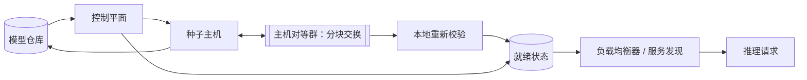

# 向 GPU 集群分发模型权重

[English](README.md) · [中文](README.zh.md)

<!-- meta:begin -->
| 题型 | 优先级 | 难度 | 岗位 | 考点 | 形式 | 轮次 |
| --- | --- | --- | --- | --- | --- | --- |
| 系统设计 | ★★★★☆ | 困难 | MLE · Infra Eng · SWE | bandwidth, peer-to-peer, chunking, versioning, readiness | 55 分钟 | 技术电面 · 现场面（VO） |
<!-- meta:end -->

## 题目

*模型仓库*（model repository）是一个对象存储，为每个训练出的模型版本保存一个*检查点*（checkpoint）：
模型推理所需的完整权重张量集合。一个检查点发布到仓库时，是固定数量的*分片文件*（shard files，体积较大、
可单独寻址的字节块，拼在一起构成整个检查点；之所以要分片，是为了不让单个文件超出存储系统的大小限制）加上
一份*清单*（manifest）：这份小文档列出每个分片文件，把检查点再切分成大小固定的*分块*（chunk，分块的边界
不必与分片文件的边界对齐），并记录每个分块的 SHA-256 哈希值，以及整个检查点唯一的版本号。

一个由 $N$ 台主机组成的*集群*（$`100 \le N \le 1{,}000`$）必须让每台主机都拿到某个检查点版本的完整、
经字节级校验的本地副本，然后才能用它对外提供推理服务。每台主机运行一个推理进程：一旦被告知激活某个版本，
它要么用该版本回答每一个请求，要么完全不对外提供该版本的服务——绝不会出现某个请求被两个版本混杂着回答，
或被一个仍在写入本地磁盘的版本回答的情况。每台主机与仓库都通过一块 10 Gbps 的网卡接入网络。本题涉及这条
链路的两种情形：

- *全双工*（full-duplex，本题默认情形，除非另有说明）：主机可以一边以 10 Gbps 接收，一边以 10 Gbps
  发送——两个方向互不占用对方的带宽。
- *共享*（shared）：主机的发送与接收流量共用同一条 10 Gbps 预算，因此它为帮助别的主机而发送出去的字节，
  会实实在在地压缩它接收自己剩余数据的速度。

不假设任何机架、可用区或网络拓扑：任意两台主机之间、以及主机与仓库之间，都能通过普通的点对点连接以
上述链路速率互相到达，如同都接在同一台没有网络层组播（multicast）的无阻塞交换机上——一次发送只会
到达一个接收方。单次发布过程中，集群里 1% 到 5% 的主机可能会失败，设计必须让幸存的主机
不依赖人工介入就能继续推进；一台失败后恢复的主机，或稍后新加入集群的主机，会用与最初发布完全相同的机制
追上当前已激活的版本。

本题的规模：

- $N$ 在 100 到 1,000 台主机之间，追问部分会扩展到 10,000 台。
- 一个 $S = 500$ GB 的检查点，存储为 200 个分片文件，每个 2.5 GB。
- 每台主机和仓库都是 10 Gbps 链路，两种情形都要考虑。

在设计范围内：在链路约束允许的前提下尽快把检查点字节从仓库送到每台主机、分块级别的完整性校验、版本清单
与从一个版本到下一个版本的原子切换（包括负载均衡器在任意时刻可以把请求路由到哪些主机上）、发现并从失败或
过慢的主机中恢复，以及不让分发流量拖累同一网卡上并发的推理流量。设计范围之外：分片文件是如何产生的
（训练与导出流水线）；主机如何把已校验的字节从本地磁盘加载进 GPU 显存（假设 `load(local_path) -> ready`
是一个耗时固定的黑盒，在版本通过校验后即可调用）；在两个都已激活的版本之间按百分比做灰度流量切换
（本题中每台主机一旦通过校验就整体切换到其目标版本——把一部分主机暂时留在旧版本上是叠加在此之上的编排
策略，追问部分会提到，但不在本题设计范围内）；以及对 API 调用本身的鉴权。

请给出：

1. 分发检查点所需时间的理论下界，两种链路情形都要给出；每台主机各自独立从仓库拉取的方案所需的时间；
   树状广播方案所需的时间；以及分块对等分发方案所需的时间——每种都要分别算出 $N = 100$ 和 $N = 1{,}000$
   时的数值。
2. 版本清单与每台主机分发状态的数据模型，以及核心的控制面 API 与面向主机的 API。
3. 所选定的分块对等分发方案的架构图，并给出一台主机从“新版本发布”到“该主机开始提供该版本的服务”这一路径
   的完整走查。
4. 深入讨论：(a) 完整性与版本管理——清单、主机在获准激活前如何完成校验，以及原子切换，包括负载均衡器
   如何得知某个版本可以把请求路由到哪些主机；(b) 故障处理——掉队者、失联的对等节点、可续传的分块级重试，
   以及不依赖中心协调者的恢复；(c) 如何不让分发流量挤占同一批主机上并发的推理流量，以及如何观测一次卡住
   的发布；(d) 在已知机架或可用区信息时如何利用它，以及提前为下一个版本预热。

## 参考解答

<details>
<summary>展开参考解答</summary>

开始设计前值得先确认两点：本题采用哪一种链路情形（本设计以全双工为默认情形，在结论会因此改变的地方
再重新推导共享链路的情形）；以及对象存储自身面向大量并发读取者的吞吐量，是否会成为独立于仓库所称
10 Gbps 出口带宽之外的另一个瓶颈（这里假设不会，10 Gbps 就是仓库一侧的约束上限）。

### 需求与规模

**设定。** $S = 500$ GB $= 500 \times 10^9$ 字节（200 个分片文件，每个 $2.5 \times 10^9$ 字节）。
一条 10 Gbps 链路每秒能传输 $B = 10 \times 10^9 / 8 = 1.25 \times 10^9$ 字节。在这样一条链路上传输
一份检查点的全部字节，因此需要

$$S / B = 500 \times 10^9 / 1.25 \times 10^9 = 400 \text{ s.}$$

**下界，全双工。** 两个独立的论证都得到 $S/B$ 这个结果。第一，每台主机都必须收到全部 $S$ 字节，而它的
下载速率被限制在 $B$ 以内——即便网络里的其他部分完全空闲也是如此——所以没有一台主机能在 400 秒之前完成。
第二，在 $t=0$ 时只有仓库持有检查点；仅仅把一份完整的拷贝推送到网络上，就要占用仓库自身以 $B$ 为上限的
链路 $S/B$ 秒，所以即便是一个位置最优的单一接收方，也不可能在 $t = 400$ 秒之前被完整送达。这两个论证都
与 $N$ 无关：更多的主机不会拉低这个下界，而下面的分块设计说明，也不必让它明显升高。

**下界，共享链路。** 在共享链路下，主机把一部分预算用来向对等节点上传，剩下能用来下载的预算就相应变少：
若主机 $i$ 在长度为 $T$ 的一次发布过程中下载了 $d_i$ 字节、上传了 $u_i$ 字节，则 $d_i + u_i \le BT$。
每台主机都必须完整收到检查点，所以在最好的情形下 $d_i = S$（没有主机会收到多余重复的字节），于是
$u_i \le BT - S$。任何主机收到的每一个字节，都恰好是由某一个发送方——仓库或另一台主机——发出的，所以
发送出去的总字节数必须能覆盖 $NS$ 这份总需求：

$$NS \\;\le\\; \underbrace{BT}\_{\text{仓库}} \\;+\\; \underbrace{N(BT - S)}\_{\text{各主机的上传}} \quad\Longrightarrow\quad T \\;\ge\\; \frac{2NS}{B(N+1)}.$$

（仓库自己从不下载，所以无论哪种链路情形，它完整的 $B$ 都可以用来发送。）当 $N \to \infty$ 时这个下界
趋于 $2S/B$：在共享链路上，主机每转发一个字节都要从同一份预算里付两次代价——一次用于接收，一次用于
再次发出——所以一个完全依赖对等节点协助的设计，至多能把全双工下界大致翻一倍，而不能追平它。当
$N=100$ 时：$`T \ge 2 \times 100 \times 400/101 \approx 792`$ 秒。当 $N=1{,}000$ 时：$`T \ge 2 \times
1{,}000 \times 400/1{,}001 \approx 799`$ 秒——两者都已经在渐近值的百分之一以内。

**朴素方案：每台主机都从仓库拉取。** 如果完全没有转发，仓库就是唯一的发送方，必须通过它那条容量固定的
链路推送出 $N$ 份完整拷贝——无论是依次以全速服务每台主机，还是把带宽拆成 $N$ 份同时服务所有主机，它需要
推送的总字节数都是一样的，$`NS`$：

$$T\_{\text{naive}} = N \cdot S / B.$$

$N=100$：$`100 \times 400 = 40{,}000`$ 秒（约 11.1 小时）。$`N=1{,}000`$：$`1{,}000 \times 400 =
400{,}000`$ 秒（约 4.6 天）——两种规模下都不可行，而且随集群规模的增大而线性恶化。

**树状广播，先存后发。** 把 $N$ 台主机排成一棵以仓库为根的完全 $k$ 叉树：仓库服务 $k$ 台一级主机，
每台一级主机再各自服务自己的 $k$ 台，依此类推。主机没法转发它还没有的数据，所以在*先存后发*
（store-and-forward，等到拿到整个文件再转发）的方式下，一台主机要等到自己拿到完整的检查点、也就是它的
父节点开始服务它之后 $S/B$ 秒，才能开始服务自己的 $k$ 个子节点。服务 $k$ 个子节点——无论是依次以全速，
还是同时以每个 $B/k$ 的速率——都是从一条容量固定的链路里推送出 $k$ 份文件的字节量，需要 $k \cdot S/B$；
每多一层都会给完成时间加上这么多。设深度为 $D$（满足 $k + k^2 + \dots + k^D \ge N$ 的最小 $D$，即到第
$D$ 层为止每台主机都已被安置）：

$$T\_{\text{tree,SAF}} = D \cdot k \cdot S/B.$$

用 $D \approx \ln N / \ln k$ 近似，让 $D \cdot k$ 最小就是让 $k/\ln k$ 最小，其导数
$(\ln k - 1)/(\ln k)^2$ 在 $k = e \approx 2.718$ 处为零——分支因子取 2 或 3 都接近最优，对本题的规模
来说两者恰好打平。取 $k=2$：$`N=100`$ 时需要 $D=6$（$`2+4+\dots+64 = 126 \ge 100`$，而五层加起来只有
62），所以 $T = 6 \times 2 \times 400 = 4{,}800$ 秒（80 分钟）。$`N=1{,}000`$ 时需要 $D=9$（九层累计
$1{,}022 \ge 1{,}000$），所以 $T = 9 \times 2 \times 400 = 7{,}200$ 秒（2 小时）。比朴素方案好得多，
但每一层仍然要为服务的每个子节点付出完整的 $S/B$，而集群越大，层数也越多。

**树状广播，流水线式。** 把检查点切成大小为 $c$ 的 $C = S/c$ 个分块，每个分块一到手就立刻转发，能去掉
“等整份文件”这项代价：一个分块现在只需要 $c/B$ 就能走完一跳，所以第一个分块到达深度 $D$ 大约要
$D \cdot c/B$，而不是 $D \cdot S/B$。流水线并不能去掉 $k$ 路瓜分的问题：一个节点唯一的上传链路仍然要
按某种轮转方式分给它的 $k$ 个子节点，所以任何一个子节点只有 $1/k$ 的时间能收到新分块——有效下载速率是
$B/k$，一旦父节点开始喂给它数据，它就需要 $S/(B/k) = k \cdot S/B$。当 $c$ 相对 $S$ 很小时，这个一次性
的深度项可以忽略，于是

$$T\_{\text{tree,pipelined}} \approx k \cdot S/B,$$

与 $N$ 无关——流水线去掉的正是那部分依赖深度的代价。取 $k=2$ 时这是 $800$ 秒，与集群规模无关：相比
先存后发的树是很大的改进，也不再随 $N$ 增长，但仍然是 $400$ 秒下界的两倍，因为每台主机依旧被限制在只能
使用父节点带宽的一部分。

**分块流水线链。** 把分支因子缩小到 $k=1$——一条严格的链：仓库 $\to$ 主机$`_1`$ $\to$ 主机$`_2`$
$\to \cdots \to$ 主机$`_N`$，每一跳只转发给下一跳——连这个瓜分问题也一并去掉了：一台主机的上传链路现在
只服务下游唯一的一台主机，能以全速 $B$ 运行。设分块传输时间为 $t_c = c/B$，仓库在 $(i-1)t_c$ 时刻发出
第 $i$ 个分块，每一跳再加一个 $t_c$ 的延迟，所以第 $i$ 个分块到达链上第 $j$ 台主机的时刻是
$(i+j-1)t_c$。最后一个分块（$`i=C`$）到达最后一台主机（$`j=N`$）的时刻，就是整个过程的完成时间：

$$T\_{\text{chain}} = (C + N - 1) \cdot t_c = \underbrace{C \cdot t_c}\_{=\\,S/B} + (N-1)\cdot c/B.$$

取 $c = 50$ MB（$`C = 10{,}000`$ 个分块，$`t_c = 40`$ 毫秒）：$`N=100`$ 时得到 $400 + 99 \times 0.04 =
403.96$ 秒——只比下界高百分之一。$`N=1{,}000`$ 时得到 $400 + 999 \times 0.04 = 439.96$ 秒——高出约百分之
十，而且分块越小这个差距还会进一步缩小。这已经在两种规模下都优于上面所有的树状方案，但一条链是单一的
依赖线：任何一台慢主机或失联主机都会卡住它后面的所有主机。

**分块对等群（swarm）。** 让每一台持有某个分块的主机，都能把它提供给*任何*缺这个分块的主机，而不只是
固定的下一跳，这样既保留了链“不瓜分、全速一跳”的特性——接收方可以从不同的发送方分别拉取不同的分块，
每个发送方都能给到最高 $B$ 的速率，而不必依赖某一个父节点的全力配合——又去掉了单一依赖线：一旦足够多的
主机持有了足够多不同的分块，一台主机就可以同时向多个对等节点获取自己缺的分块，让自己的下载饱和到
$B$，于是完成时间趋近同样的 $S/B$ 加上一个很小的爬坡项，不再系于任何一台主机的健康状况。本页余下部分
沿用的正是这个设计；下面估算核对中的仿真，衡量了它的一个简单确定性版本能有多接近这个下界。在共享链路下，
对等群无法突破上面推出的 $\approx 2S/B$ 下界——每个对等节点仍然要把同一份预算拆给自己的下载和自己转发
出去的部分——但同样的分块交换机制依然适用，一台主机如何在两者之间分配自己的预算是一个调度上的选择，
留到深入讨论 (c) 再展开。

```text
                                  N = 100   N = 1,000
朴素方案（从仓库拉取）          11.1 小时      4.6 天
树状广播，先存后发                80 分钟      2 小时
树状广播，流水线式（k = 2）        800 秒      800 秒
分块链                          403.96 秒   439.96 秒
下界，全双工                       400 秒      400 秒
下界，共享链路                     792 秒      799 秒
```

### 数据模型与 API

**Manifest（清单，每个已发布版本一份）** —— `version_id`、`created_at`、`status`
（`publishing | active | deprecated`）、`total_bytes`、`chunk_size`、`shards`：分片文件的有序列表
`{shard_id, path, size_bytes}`，`chunks`：分块的有序列表 `{chunk_id, shard_id, offset, length,
sha256}`，`manifest_sha256`（对有序的分块哈希列表整体求出的哈希值——主机刚取到一份清单后，会先校验这
一个值，只有通过了才信任清单里的其他内容）。

**HostState（每个正在传输或已完成的 `(host_id, version_id)` 组合各一行）** —— `host_id`、
`version_id`、`chunks_have`（长度为 $C$ 的位图）、`status`（`fetching | verifying | ready |
failed`）、`verified_at`、`activated_at`、`last_progress_at`（`chunks_have` 上一次发生变化的时刻，
供深入讨论 (c) 使用）。

**PeerSample（临时性数据——在主机之间以 gossip 方式交换，而不是持久保存，参见深入讨论 (b)）** ——
`host_id`、`version_id`、`chunks_have`、`as_of`。

控制面 API：

1. `POST /versions` —— `{shards: [{path, size_bytes}, ...], chunk_size}`：控制平面直接对仓库中的
   拷贝逐个分块求哈希，构建出 `Manifest`，返回 `{version_id, manifest_sha256, chunk_count}`，
   `status` 为 `"publishing"`。
2. `GET /versions/{version_id}/manifest` —— 完整的清单；每台主机在请求任何分块之前，都会先取一次
   这个清单。
3. `POST /versions/{version_id}/activate` —— 一旦集群中足够多的主机达到 `ready`（深入讨论 (a)），
   就把 `status` 置为 `active`；同一时刻至多只有一个版本处于 `active`。
4. `GET /versions/{version_id}/rollout` —— 每台主机的 `status` 与 `last_progress_at`，供深入讨论
   (c) 中的可观测性视图使用。

面向主机的 API：

1. `POST /hosts/{host_id}/versions/{version_id}/chunks/{chunk_id}` —— 主机上报收到了某个分块以及
   自己算出的哈希；如果不匹配，`chunks_have` 里对应的位就不会被置位（深入讨论 (b) 说明主机接下来会
   怎么做），并让该分块的一个损坏计数器加一，用来停止从一个持续出问题的发送方采样。
2. `GET /hosts/{host_id}/versions/{version_id}/peers` —— 对其他主机就该版本的 `chunks_have` 位图
   做一次有限规模、偏向最稀有分块的采样，用来决定下一个分块从谁那里拉取（深入讨论 (b)）。
3. `POST /hosts/{host_id}/versions/{version_id}/ready` —— 在 `chunks_have` 已满、且每个分块都已
   针对清单哈希独立重新校验过之后发出；把 `HostState.status` 置为 `ready`。
4. `GET /versions/active` —— 负载均衡器或服务发现在路由任何请求之前都会读取的接口：当前 `active`
   的 `version_id`，以及在该版本范围内哪些 `host_id` 处于 `ready`（深入讨论 (a)）。

### 架构



一次发布始于新检查点的分片文件落地到仓库、并调用 `POST /versions`；控制平面对仓库中的拷贝逐个分块
求哈希一次，发布 `Manifest`，并让少量*种子*主机直接对接仓库——数量足以把仓库自身 $B$ 字节/秒的链路
充分用满，又不必让它去服务整个集群，具体数值在深入讨论 (c) 中给出。每一台主机，无论是否为种子，都会先
取一次清单，然后反复向一批对等节点询问它们的 `chunks_have` 位图，从其中持有该分块的对等节点那里拉取
自己缺的最稀有分块（深入讨论 (b)）；一台主机一旦持有某个分块并针对清单哈希校验通过，就会立刻开始把这个
分块提供给自己采样到的对等节点，于是集群整体的服务能力，在最初几轮分块交换之内，就能从“只有种子在服务”
扩大到“几乎每台主机都在服务”。一台主机在 `chunks_have` 满了之后进入 `verifying`，针对本地磁盘上的内容
把每个分块再重新哈希一遍——这样能捕获网络传输之后（而不只是传输过程中）引入的损坏——只有全部分块都通过
才调用 `ready`；在此之前的任何状态，都无法通过 `GET /versions/active` 被看到。一旦有足够多的主机达到
`ready`，控制平面就把该版本置为 `active`，负载均衡器下一次读取 `GET /versions/active` 时，就会开始把
该版本的请求路由到这些主机；仍在提供旧版本服务的主机不受影响，继续提供服务，直到它自己独立达到新版本的
`ready`，同一次读取才会把它纳入进来。

### 深入话题

**(a) 完整性、版本管理与原子切换。** 一个分块的正确性会被检查两次：一次是接收方主机在传输完成后立刻
检查，这样一个坏分块可以在一次往返之内从另一个对等节点重新拉取（深入讨论 (b)）；另一次是在所有分块都已
就位、主机即将调用 `ready` 之前，再针对同一份清单哈希检查一遍——这能捕获来自本地磁盘的损坏、组装过程中
的一次位翻转，或者一个到达时校验通过、之后又被覆盖过的分块。清单自身的 `manifest_sha256` 会在两者之前
先被检查：一台主机如果取到的清单本身已经损坏，就不应该信任其中的任何一个分块哈希。

一台主机对某个版本的就绪状态，是 `GET /versions/active` 唯一暴露出来的信号，也正是它让这次切换保持
原子性。“切换”可以有两种定义方式：

- *一旦控制平面把版本标记为 active 就切换*：予以否决。一台主机可能在其推理进程把新权重加载进 GPU
  显存完成之前就被标记为 active（这一步在设计范围之外，但并非瞬时完成），于是某个请求可能落到一台
  用陈旧权重、加载了一半的权重、或者根本没有权重来回答的主机上。
- *按主机切换，以该主机自身的就绪状态为门槛*（选定）：控制平面的 `active` 标志只表明集群的*目标*
  版本；负载均衡器实际使用的路由集合，是另外单独维护的一组已经达到 `ready` 且加载完成的主机。一台主机
  要么完全处于新版本且可达，要么仍处于自己最后一个完整加载好的版本且可达——绝不会两者都是，也绝不会
  两者都不是。代价：两个版本的权重会短暂地同时存在于磁盘上，也短暂地同时出现在路由集合里，而不是整个
  集群在同一瞬间完成切换；旧版本的本地拷贝要等到所有主机都已迁出之后才会被回收，这也顺带给出了一条
  即时的回滚路径——如果新版本激活后健康检查恶化，只需停止推进 `active`，让仍在旧版本上的主机继续提供
  服务即可，不需要重新下载任何东西。

**(b) 故障处理：掉队者、失联的对等节点，以及不依赖协调者的恢复。** *掉队者*（straggler）指的是仍在
推进、但明显落后于集群其他部分的主机。根据接收方主机对自己正在拉取的那个对等节点观察到的现象，可以
分成三种情况：

- *单次分块传输失败或超时*，发送方本身没问题：接收方直接向另一个对等节点、或仓库，重新请求同一个
  分块即可。没有任何持久状态需要改变——只是那个分块在 `chunks_have` 里对应的位从未被置位过。
- *对等节点完全停止响应*——失联或被分区隔离。如果有一个中心协调者负责把分块分配给来源，它可以通过
  漏掉的心跳发现这一点并重新分配；在没有协调者的情况下，每台主机本来就会按一个较短的周期，为自己每一个
  尚未完成的分块重新采样对等节点、重新挑选来源，所以一个失联的对等节点，只需等到下一次有人采样到它时，
  自然就会从流通中被剔除——它不会再作为一个选项出现，而任何已经在途、来自它的传输，也会像单次分块失败
  那样超时。除了每台主机本来就在运行的这套重试路径之外，不需要任何单独的故障检测步骤；而且用这种方式
  重新获取一个分块，也不必特意退回到仓库——到一个对等节点在发布过程中途失联的时候，它持有的那个分块
  通常已经在其他好几台主机上了。
- *对等节点只是慢，而不是失联*——仍在响应，只是低于线速。由于每台主机始终从采样到的、持有该分块的
  对等节点里挑最稀有的那个分块去拉取，一个慢的对等节点自然会被问得更少：更快的对等节点会在慢的那次
  传输完成之前，就已经供应出更多这份稀有分块的拷贝，于是一个掉队者拖累的只是它自己的贡献量，而不会
  卡住任何专门等它的主机——这正是一条链对每一跳都存在的那种依赖，也正是对等群的多来源拉取所要避免的。

*最稀有优先*的选择策略，是让这一切收敛而不是卡死的关键：始终拉取全局副本数最少的那个分块，能让集群里
每个分块的副本数大致保持均衡，于是一个对等节点的死亡，绝不会让某个分块变成孤儿——沦落到只剩极少数
幸存者持有、集群能否完成完全取决于能否联系上那几个幸存者的地步——因为从一开始，就没有哪个分块的传播
进度被允许明显落后于其他分块。整个集群同时失去某个分块*唯一*剩下的副本（所有持有者同时死亡），是对等
节点冗余本身无法解决的一种情况；仓库会在该版本的整个生命周期内保留原始的分片文件，专门作为这种情况下
的兜底，像任何一个对等节点一样应答对缺失分块的请求。

一台主机如果在发布过程中途死亡后重启，会从它最后一次持久化的 `chunks_have` 继续，而不是从头开始——
分块级别的进度会在每个分块通过校验时就写入本地磁盘保存，所以重启后只需重新校验磁盘上已经有的内容
（成本低：只是哈希，不是重新下载），再补齐缺的那部分即可。一台被直接替换掉的主机，会以一个空的
`chunks_have` 作为全新参与者加入，和一台刚启动、还在慢慢追赶的新主机没有区别，用同样的方式追上进度。

**(c) 针对在线流量的限流，以及可观测性。** 这里的每台主机，通常在下载下一个版本的同时，也已经在用
当前版本跑推理：同一块网卡既要承载检查点的分块流量，也要承载在线流量的请求与响应，一个不受限制的对等群
参与者，只要一有数据可传，就会用满自己完整的 $B$ 做分块交换，从而在那一刻挤占推理所需的带宽。因此分发
流量在每台主机上都会被限制在一个远低于 $B$ 的可配置上限之内——具体做法是在拉取分块与提供分块这两条路径
上单独设一个令牌桶，预算与推理流量使用的预算分开，而不是让两者不受控制地争抢同一条链路。这个上限是用
发布速度换取一个关于分发最多能从在线服务那里拿走多少带宽的保证；一台还没有在当前版本上服务任何流量的
主机（刚启动、还在加载）没有什么需要保护的，可以把分发上限设得更高一些，这也是为什么优先从空闲或正在
腾空的容量中挑选种子主机去直接对接仓库。

由于每台主机都会上报 `chunks_have` 进度和一个 `status`，一次发布的整体形态无需靠猜测容量就能看清：
发布视图（`GET /versions/{version_id}/rollout`）按 `status` 对主机分桶，并在 `fetching` 这一桶内部
再按距离上次 `last_progress_at` 的时长细分——一台位图连续好几倍于预期单分块耗时都没有增长的主机，会被
标记为*卡住*，而不只是慢，从而不需要提前知道这台主机能达到的吞吐量，就能区分“仍在工作、只是落后于
计划”和“完全没有进展”。当一次发布到 `ready` 的用时的第 95 百分位，远超上面需求与规模一节给出的估算，
或者卡住的数量没有在减少，这就是提醒运维人员出了不只是普通掉队问题的信号——可能是清单有问题、某一类
主机存在硬件故障、或者限流上限在整个集群范围内设得过低——在此之后再去排查单台主机。

**(d) 扩展：拓扑感知与预热。** 以上内容都假设没有拓扑信息，但如果机架或可用区归属是已知的，把深入
讨论 (b) 中的对等节点采样优先偏向同机架的对等节点——同机架选项用尽后再退回到任意对等节点——可以减少
跨机架边界的分块传输数量（在实践中，跨机架链路往往是更容易超订的那一条），同时不改变上面按主机计算的
数字（每台主机始终只使用自己那条 $B$ 字节/秒的链路，无论对端是谁）；这份收益体现为共享上行链路上更小
的压力，而不是本节模型里更短的完成时间。一次预期会按可预测节奏发生的发布——比如每隔几个小时就有一个新
检查点版本——也可以提前开始：发布清单之后，让主机把内容拉进一个*暂存*路径（永远不会进入 `verifying`
或 `ready`，并且比正式发布限流更严，按 (c) 的规则），从上一个版本刚完成激活时就开始，这样等到下一个
版本真正要发布的时候，大多数主机已经持有了它大部分的分块，(b) 里的恢复路径只需要补上发生变化的部分。

### 追问

- 从 1,000 台主机扩展到 10,000 台，不会改变上面任何一个公式——对等群的完成时间在爬坡项之外与 $N$
  无关——但确实意味着需要更大的对等节点采样规模和 gossip 扇出，才能让最稀有优先在全集群范围内保持
  准确，也意味着在对等群积累到足够多流通中的分块、能够自我维持之前，早期负载中会有更大一部分落在
  种子主机身上。
- 检查点膨胀到数 TB 规模不会改变设计本身，只会改变数字：占主导的 $S/B$ 项线性增长，而爬坡与 gossip
  开销仍然由 $N$ 和分块数量决定，与 $S$ 本身无关。
- 如果某个分块反复从同一个发送方那里校验失败，而不只是一次，就把这个发送方标记为可疑，不再把它采样
  为来源——但不直接把它整台踢出集群，因为问题也可能只是它本地那份拷贝损坏了，而不是恶意行为——直到它
  自己在 `ready` 重新校验时，要么排除嫌疑，要么坐实问题。
- 一台处于 NAT 或防火墙之后、无法接受未经请求的入站连接的主机，依然可以作为一个拉取方参与：这里的对等
  协议本来就只让主机主动*索取*分块，从不接受未经请求的推送，所以一台只能发起出站连接的主机不需要任何
  特殊处理。
- 灰度式的部分发布——把一部分集群留在旧版本上，超过其余部分都已 `ready` 的那一刻，先观察指标再完成
  切换——可以直接叠加在深入讨论 (a) 的按主机就绪门槛之上：控制平面只需暂缓推进 `active`（或者把它的
  作用范围限定在一个指定的主机子集），而不需要改变单台主机达到 `ready` 的任何逻辑。

<details>
<summary>估算核对（可运行）</summary>

```python
import math
import random

# ---- setup ----
S = 500e9                      # checkpoint size, bytes
shard_count, shard_size = 200, 2.5e9
assert shard_count * shard_size == S
B = 10e9 / 8                   # 10 Gbps, in bytes/second
assert B == 1.25e9
T_bound_fd = S / B
assert T_bound_fd == 400.0

# ---- lower bound, shared link ----
def shared_link_bound(N, S=S, B=B):
    return 2 * N * S / (B * (N + 1))

assert round(shared_link_bound(100)) == 792
assert round(shared_link_bound(1000)) == 799
assert T_bound_fd < shared_link_bound(100) < shared_link_bound(1000)
assert math.isclose(shared_link_bound(10**9), 2 * S / B, rel_tol=1e-6)

# ---- naive ----
def naive_time(N, S=S, B=B):
    return N * S / B

assert naive_time(100) == 40_000.0
assert round(naive_time(100) / 3600, 1) == 11.1
assert naive_time(1000) == 400_000.0
assert round(naive_time(1000) / 86400, 1) == 4.6

# ---- tree broadcast, store-and-forward ----
def tree_depth(N, k):
    total, D = 0, 0
    while total < N:
        D += 1
        total += k ** D
    return D

assert tree_depth(100, 2) == 6
assert tree_depth(1000, 2) == 9

def tree_saf_time(N, k, S=S, B=B):
    return tree_depth(N, k) * k * (S / B)

assert tree_saf_time(100, 2) == 4_800.0
assert tree_saf_time(100, 2) / 60 == 80.0
assert tree_saf_time(1000, 2) == 7_200.0
assert tree_saf_time(1000, 2) / 3600 == 2.0

# optimal branching factor minimizes k / ln(k); its derivative (ln k - 1) / (ln k)^2 is zero at k = e
def broadcast_cost_shape(k):
    return k / math.log(k)

assert broadcast_cost_shape(3) < broadcast_cost_shape(2)              # 3, closer to e, edges out 2
assert broadcast_cost_shape(2) < broadcast_cost_shape(5)               # both beat a much larger fan-out
assert broadcast_cost_shape(3) < broadcast_cost_shape(6)
assert tree_saf_time(100, 2) == tree_saf_time(100, 3)                 # yet the integer depths tie at N=100
assert tree_saf_time(1000, 2) == tree_saf_time(1000, 3)               # and at N=1,000

# ---- tree broadcast, pipelined ----
def tree_pipelined_time(k, S=S, B=B):
    return k * (S / B)

assert tree_pipelined_time(2) == 800.0

# ---- chunked pipelined chain ----
chunk_size = 50e6
C = int(S // chunk_size)
assert C == 10_000
assert chunk_size * C == S
t_c = chunk_size / B
assert round(t_c, 3) == 0.04

def chain_time(N, C=C, t_c=t_c):
    return (C + N - 1) * t_c

assert round(chain_time(100), 2) == 403.96
assert round(chain_time(1000), 2) == 439.96
assert chain_time(1000) / T_bound_fd < 1.10          # within 10% of the bound even at N = 1,000
assert naive_time(1000) > tree_saf_time(1000, 2) > tree_pipelined_time(2) > chain_time(1000) > T_bound_fd

print("all requirements-and-scale numbers check out")


# ---- discrete-round simulation of naive, tree (store-and-forward and pipelined) and the swarm ----
# One round is the time to move one chunk across one link at full rate B. Each round, every node
# (repository = node 0, hosts = 1..N) may be the SOURCE of at most one chunk transfer and every host
# the DESTINATION of at most one -- the full-duplex, one-chunk-per-link-per-round idealization the
# analytical formulas above assume. "swarm" lets any node with a chunk offer it to any host lacking
# it; "tree" restricts a host to receiving only from its fixed parent in a complete k-ary tree;
# "naive" restricts sending to the repository alone. store_and_forward=True additionally requires a
# sender to hold every chunk before it may send any of them.
def simulate(N, C, k, topology, store_and_forward, seed):
    rng = random.Random(seed)
    full = frozenset(range(C))
    have = [full] + [set() for _ in range(N)]         # have[0] is the repository, always complete
    holders = [{0} for _ in range(C)]                  # holders[c]: node ids currently holding chunk c
    avail_count = [1] * C
    parent_of = [0] + [(h - 1) // k for h in range(1, N + 1)]

    def has_all(node):
        return len(have[node]) == C

    rounds = 0
    hosts = list(range(1, N + 1))
    while any(len(have[h]) < C for h in hosts):
        rounds += 1
        rng.shuffle(hosts)                             # NOTE: order, not any set, drives the match --
        used, deliveries = set(), []                    # deterministic under both CI hash seeds
        rarity_order = sorted(range(C), key=lambda c: avail_count[c]) if topology == "swarm" else None
        for r in hosts:
            if len(have[r]) == C:
                continue
            if topology == "naive":
                if 0 in used:
                    continue
                missing = full - have[r]
                if missing:
                    used.add(0)
                    deliveries.append((r, next(iter(missing))))
            elif topology == "tree":
                s = parent_of[r]
                if s in used or (store_and_forward and not has_all(s)):
                    continue
                avail = have[s] - have[r]
                if avail:
                    used.add(s)
                    deliveries.append((r, next(iter(avail))))
            else:  # swarm: rarest-first among chunks reachable from an unused, eligible holder
                missing = full - have[r]
                if not missing:
                    continue
                for c in rarity_order:
                    if c not in missing:
                        continue
                    picked = None
                    for s in holders[c]:
                        if s != r and s not in used and (not store_and_forward or has_all(s)):
                            picked = s
                            break
                    if picked is not None:
                        used.add(picked)
                        deliveries.append((r, c))
                        break
        for r, c in deliveries:
            have[r].add(c)
            holders[c].add(r)
            avail_count[c] += 1
        assert rounds <= 200_000, "did not converge"
    return rounds


N_sim, C_sim, k_sim = 100, 80, 4
naive_rounds = simulate(N_sim, C_sim, k_sim, "naive", True, seed=1)
tree_saf_rounds = simulate(N_sim, C_sim, k_sim, "tree", True, seed=2)
tree_pipe_rounds = simulate(N_sim, C_sim, k_sim, "tree", False, seed=3)
swarm_rounds = simulate(N_sim, C_sim, k_sim, "swarm", False, seed=4)

assert naive_rounds == N_sim * C_sim                                            # exact: one chunk/round
saf_formula = tree_depth(N_sim, k_sim) * k_sim * C_sim
assert 0.9 * saf_formula <= tree_saf_rounds <= saf_formula
assert k_sim * C_sim <= tree_pipe_rounds <= 1.6 * k_sim * C_sim
assert C_sim <= swarm_rounds <= 1.25 * C_sim
assert naive_rounds > tree_saf_rounds > tree_pipe_rounds > swarm_rounds

# stable across seeds and across CI's two hash-randomization seeds: only int hashing is used, and
# hash(n) == n for the small ints this simulation works with, so set iteration order never varies
for seed in range(6):
    assert C_sim <= simulate(N_sim, C_sim, k_sim, "swarm", False, seed=seed) <= 1.25 * C_sim

print(f"simulation: naive {naive_rounds}, tree store-and-forward {tree_saf_rounds}, "
      f"tree pipelined {tree_pipe_rounds}, swarm {swarm_rounds} rounds to reach every host "
      f"(bound: {C_sim})")
print("all estimate-check numbers check out")
```

</details>

</details>
