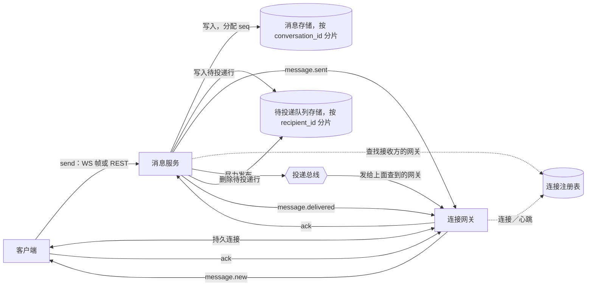

# 一对一聊天系统

[English](README.md) · [中文](README.zh.md)

<!-- meta:begin -->
| 题型 | 优先级 | 难度 | 岗位 | 考点 | 形式 | 轮次 |
| --- | --- | --- | --- | --- | --- | --- |
| 系统设计 | ★★★★☆ | 中等 | SWE · MLE | websocket, presence, offline-delivery, message-ordering, kafka-vs-redis | 55 分钟 | 技术电面 · 现场面（VO） |
<!-- meta:end -->

## 题目

设计只在两个人之间收发消息的后端：不支持群聊，也不支持频道。*会话*（conversation）是某一对特定用户之间的全部往来消息；每一对用户只有一个会话，从其中一方给另一方发出第一条消息的那一刻起就存在。每个用户同一时间只从一台设备连接。消息正文是最多 4 KiB 的纯文本。

双方都在线时，一条消息必须以低延迟到达接收方的屏幕。如果消息发出时接收方不在线，系统必须把消息保留下来，在接收方下一次连接时投递，接收方不需要主动去问。在同一个会话内，双方看到的消息顺序必须一致——即服务器接受这些消息的顺序，不论是哪一方发出的——即使客户端的连接恰好以另一种顺序把消息送达，也要在展示之前完成顺序上的调和。发送方成功提交过的消息绝不能被存两次，即使客户端在没收到回复后重试了请求；已经展示给接收方的消息也绝不能再展示一次，即使底层的传输把它重复投递了。

发送方会被告知一条消息已经送达——*送达回执*（delivery receipt）——即接收方的客户端已经确实收到了它，而不论接收方是否已经看过。接收方是否看过一条消息——*已读回执*（read receipt）——不在范围内。每个用户还能看到，与自己聊天的对象当前是否在线；这个*在线状态*（presence）信号允许比真实断线滞后一段时间，滞后多久由你的设计给出的检测时限决定，它是给界面用的提示，系统里其他任何地方都不会把它当作要核对的保证。

为下面的规模设计：

- 注册用户 250,000,000 人，其中 50,000,000 人是当日活跃用户。
- 一个活跃用户平均每天发送 24 条消息。
- 峰值流量约为日均的 3 倍，分散在各个时区各自的晚间时段，不像办公协作工具那样集中在某一地区的工作时段。
- 峰值时，日活跃用户中有 8% 同时在线连接。
- 双方都在线时的端到端投递延迟目标：第 95 百分位低于 300 毫秒。
- 可用性目标：99.9%。
- 会话历史永久保留。

范围内：仅限两个用户之间的一对一消息收发；双方在线时的实时投递；消息发出时接收方离线也能可靠送达；每个会话的消息有唯一的顺序；去重，无论是重试的发送还是被重复投递的推送都不会产生重复消息；送达回执；在线状态；以及承载客户端连接的这一层的水平扩展。范围外：群聊和频道；每个账号超过一台连接的设备；对消息历史做搜索；任何形式的附件（图片、文件、语音）；端到端加密——只作为追问提及。

要产出：

1. 需求与规模估算：平均和峰值的消息速率、并发连接数，以及为承载这些连接需要多少台实例（说明你对单个实例能承载多少条连接的假设）、消息存储的年增长量（说明你对一条已存储消息大小的假设）。
2. 数据模型——包括会话、消息，以及你选择用什么方式保存一条尚未送达接收方的消息——和 API：客户端持久连接上交换的帧，以及在没有打开的连接时用于发送、翻阅一个会话的历史记录、并在离开一段时间后补齐消息的 REST 接口。
3. 一张架构图，并沿着一条消息从发送方客户端到接收方客户端的路径走一遍，覆盖接收方已经在线和接收方不在线这两种情况。
4. 深入话题：(a) 承载客户端连接的这一层——客户端如何建立连接，以及在承载连接的实例不止一个时，系统如何找到属于某个接收方的那条连接；(b) 投递语义——你的设计实际提供的投递保证是什么、如何确认，以及是什么阻止了重复消息到达用户；(c) 为不在线的接收方保留消息的队列，以及接收方重新连接后会发生什么；(d) 在线状态——如何检测断线，这个信息又如何送到需要它的人手里；(e) 把消息从发送方这一侧带到接收方那一侧的投递总线——专门比较 Kafka 和 Redis 在这个角色上的表现，说明这个设计更适合哪一个、为什么，以及在什么情况下另一个会是更好的选择。

## 参考解答

<details>
<summary>展开参考解答</summary>

动手设计之前值得先确认：当“单设备”这条约束理应成立、用户却又打开第二条连接时会发生什么（下面假设：新连接会替换旧连接，服务器随即关闭旧连接），以及发送方是否需要恰好看到一次送达回执，即便底层的确认机制本身可能不止触发一次（下面假设是——客户端对这个信号做去重的方式，和它对消息做去重的方式一样）。

### 需求与规模

**消息速率。** $50{,}000{,}000$ 名日活跃用户，每人每天发送 24 条消息：

$$50{,}000{,}000 \times 24 = 1{,}200{,}000{,}000 \text{ 条消息/天，}$$

$$\text{平均 QPS} = \frac{1{,}200{,}000{,}000}{86{,}400} \approx 13{,}889 \text{ 条消息/秒。}$$

消费者聊天的峰值不像办公协作工具的工作时段峰值那么陡峭，因为使用时间分散在各个时区各自的晚间，而不是集中在某一地区的工作日；按 3 倍的峰均比，峰值吞吐量约为 $41{,}667$ 条消息/秒。因为一个会话只有一个接收者，这个速率同时也是投递速率和写入消息存储的速率——不像基于频道的设计，这里没有哪条消息会因为成员数而在发出时被放大。

**连接与承载它们的这一层。** 峰值时，$`50{,}000{,}000`$ 名日活跃用户中有 8% 同时在线连接：$`4{,}000{,}000`$ 人。单设备的前提让这个数字直接就是并发连接数，不需要再乘以人均设备数。按每台实例预算 200,000 条连接——受限于单连接的心跳记录开销，而不是原始的 socket 内存，现代事件循环服务器能撑住的连接数远不止于此——裸峰值需要 $\lceil 4{,}000{,}000/200{,}000\rceil=20$ 台；再加上应对滚动发布和负载不均的 20% 余量，机群规模为 $24$ 台。

**存储。** 一条已存储的消息需要：一个全局唯一的消息 id（16 字节）、它所属会话的 id（16 字节）、一个按会话计的序列号（8 字节）、发送方的 id（8 字节）、随行保存以便识别重试请求的客户端幂等键（16 字节）、服务器时间戳（8 字节），以及正文——按 4 KiB 的上限，平均文本量约 128 字节，多数消息都比这个上限短得多。合计 $200$ 字节/消息：$`1{,}200{,}000{,}000\times200\text{ B}=240{,}000{,}000{,}000`$ B，即每天 $240$ GB。按每年 $365$ 天算，是 $87{,}600$ GB，复制之前约 $87.6$ TB/年；按 3 倍复制，约 $262.8$ TB/年——规模大到需要分片，但也不至于超出一个分片良好的关系型存储所能承受的范围。

**在线状态信令的代价。** 每个已连接的客户端每 15 秒发一次轻量心跳；这个用户的在线状态记录（以用户 id 为键）携带的 TTL 是心跳间隔的两倍，30 秒——所以一条已经沉默的连接，会在最后一次心跳之后的 30 秒内被判定为离线。如果每次心跳都把*最后在线时间*写进持久化的用户记录，代价是 $4{,}000{,}000/15\approx266{,}667$ 次写入/秒——约为峰值消息速率的 $6.4$ 倍——而这个值在状态发生变化之前根本没人会读；下面的设计只在转为离线的那一刻写一次。

把每一次在线状态的变化都推送给一份感兴趣联系人的名单，这个方案在选择之前也值得先算一笔账。按利特尔法则，以平均 $1{,}000$ 秒的连接时长计，连接的到达速率——稳态下也是离开速率——是 $4{,}000{,}000/1{,}000=4{,}000$/秒，峰值时状态转换约为 $8{,}000$ 次/秒。把每一次转换都推给平均 40 个可能想知道的人——所有最近有会话打开着的人——代价是 $8{,}000\times40=320{,}000$ 次推送/秒，约为峰值消息速率的 $7.7$ 倍，只为传递一个“这个人现在在不在线”的信号，而这个信号只在真正需要的那一刻查一下（见下面在线状态的深入话题）就能以远低于这个代价的开销得到。

### 数据模型与 API

**Conversation（会话）** —— `conversation_id`（由两位参与者构建而成，见下文）、`user_a`、`user_b`（这一对参与者，存储时保证 `user_a < user_b`）、`last_seq`（发出的最新序列号，和每条新消息在同一个事务里递增）、`created_at`。分片键：`conversation_id`。

`conversation_id` 由两位参与者的 id 排序后构建——`f"{min(user_a, user_b)}:{max(user_a, user_b)}"`——所以无论谁先发消息，得到的值都一样；每一对用户只对应一行，不需要查找，也不会有冲突。

**Message（消息）** —— `conversation_id`、`seq`（按会话计的位置，不留空洞——推进方式和 `Conversation.last_seq` 相同，在同一个事务里完成）、`message_id`（全局唯一、按时间大致有序的 id，脱离具体会话单独指代一条消息时使用）、`sender_id`、`client_msg_id`（发送方的幂等键，和 `(conversation_id, sender_id)` 一起保证唯一）、`body`、`server_ts`。这里没有单独的投递状态字段：一条消息是否已经投递，完全由 `PendingDelivery` 里是否还有对应的行来表示，这样两者就不会各自维护、彼此不同步。分片键：`conversation_id`——和它所属的 `Conversation` 行同一个分片，所以推进 `seq` 是一次单分片事务。

**PendingDelivery（待投递队列）** —— 每一条接收方尚未确认的消息对应一行：`recipient_id`、`conversation_id`、`seq`（一个指针，不是正文的副本——正文在排空这一行时才从 `Message` 里读出）、`expires_at`（TTL，见离线队列的深入话题）。主键为 `(recipient_id, conversation_id, seq)`。分片键：`recipient_id`——特意选了和 `Message` 不同的分片键，因为它的访问模式不一样：“用户 X 在所有会话里还欠着的一切”，而不是“这个会话的消息”。

**ConnectionRecord（连接记录）**（存放在一个快速的外部键值存储里，不是上面的关系型存储；这就是本文其余部分所说的连接注册表）—— `presence:{user_id}` → `{instance_id}`，TTL 30 秒，每次心跳都刷新。一条记录回答两个问题：这个用户是否在线（键是否存在），如果在线，是哪个实例持有他的连接（值）——供任何需要向他推送的地方使用。这是和深入话题里讨论的投递总线不同的关切，即便两者可能跑在同一套集群上。

客户端持久连接（WebSocket）上的 API，客户端 → 服务器：

1. `send {client_msg_id, recipient_id, body}` —— 服务器根据 `(sender_id, recipient_id)` 找到或创建会话；客户端发送时完全不需要知道、也不需要缓存 `conversation_id`。
2. `ack {conversation_id, seq}` —— 接收方确认已经在本地可靠收到某一条消息。
3. `heartbeat {}` —— 每 15 秒发送一次。
4. `presence.query {user_id}` —— 只为用户当前打开的会话对端按需查一次（不是订阅；见在线状态的深入话题）。

服务器 → 客户端：

1. `message.new {conversation_id, seq, message_id, sender_id, body, server_ts}` —— 一次实时推送。
2. `message.sent {conversation_id, seq, message_id, client_msg_id, server_ts}` —— 确认发送方自己那次 `send`，并回带 `client_msg_id`，好让超时后重发的客户端能把回复和本地对应的占位消息对上。
3. `message.delivered {conversation_id, seq}` —— 接收方一确认，就发给发送方。
4. `backlog {items: [{conversation_id, seq, message_id, sender_id, body, server_ts}], more}` —— 一连上就发送，把排队等待这个用户的消息排空；`more` 标记是否还有下一页。
5. `presence.result {user_id, online}` —— 对 `presence.query` 的回复。

REST，供没有打开连接的客户端使用，也用于任何不依附于某条连接的操作：

1. `POST /v1/messages` —— `{client_msg_id, recipient_id, body}` → `{message_id, conversation_id, seq, server_ts}`。和 `send` 帧走同一个处理逻辑，`client_msg_id` 上的幂等保证也一样。
2. `GET /v1/conversations` —— 调用者的全部会话，各自带上对端、`last_seq` 和预览——供启动时加载使用。
3. `GET /v1/conversations/{conversation_id}/messages?before_seq=&limit=` —— 分页的历史记录，从新到旧。
4. `GET /v1/queue` —— 调用者在所有会话里排队等待的（未投递）消息；是 `backlog` 的 REST 版本，供轮询而非保持连接的客户端使用，或者在只应用了上一批的一部分之后重新拉取。
5. `POST /v1/messages/{message_id}/ack` —— `ack` 帧的 REST 版本。
6. `GET /v1/presence/{user_id}` —— `presence.query` 的 REST 版本。

### 架构



一次 `send`——如果发送方有打开的连接就走这条连接，否则走 REST——到达消息服务；消息服务根据
`(sender_id, recipient_id)` 解出 `conversation_id`，在这个会话所在的分片上开一个事务，递增 `last_seq`，把新的
`Message` 行连同得到的 `seq` 一起插入。提交之后，它给发送方回复 `message.sent`——300 毫秒这个目标就是照这一刻来
衡量的，因为这是发送方自己屏幕上真正在等的东西；接收方那边可能还差一步。回复之前，在同一个请求里，它还会给接收方写
一行 `PendingDelivery`——写在接收方的分片上，和会话的分片不是同一个，所以这是第二次、独立的写入，不属于第一次写入
的那个事务；至于是什么保证了它总归会发生，即便两次写入之间发生了崩溃，留到下面投递语义的深入话题里再说。

待投递行写好之后，消息服务去连接注册表里查接收方的用户 id。如果查到一条还活着的记录，消息服务就把消息发布到投递总线
上，指向那条记录里的网关，尽力而为；那个网关再把消息作为 `message.new` 转发给接收方的连接。如果接收方的客户端应用
了它并回复 `ack`，消息服务就删掉这行 `PendingDelivery`，并把 `message.delivered` 推给发送方。如果注册表里没有这个
接收方的记录——说明他不在线——或者发布丢了，或者送到了一条早已关闭的连接上，这条路径上什么都不会发生，也不需要发生
什么：待投递行还在那里。等到这位接收方下一次连接时，就会被找到。新连接一注册好，网关就立刻向消息服务要一切排队中的
消息；消息服务在接收方的分片上读 `PendingDelivery`，把每条引用的消息正文从 `Message` 里取出来，打包成一个或多个
`backlog` 帧发回去。客户端应用每一项的方式和处理实时推送完全一样，确认的方式也一样，这会删掉那一行，如果原来的发送
方还连着，同样会触发 `message.delivered`——一条靠重连投递的消息，在发送方那边看起来和一条实时投递的消息一模一样，
只是晚了一点。

### 深入话题

**(a) 承载客户端连接的这一层。** 选用 TLS 上的 WebSocket，而不是长轮询。这里的需求在本质上就是推送形状的——已
连接的接收方必须在消息一到就被告知——而且是双向的，因为同一个客户端还要发 `send`、`ack`、`heartbeat`；一条
WebSocket 就能在单个连接上把这些全部承载起来。长轮询用一种近似的方式模拟推送：客户端保持一个 HTTP 请求挂起，直到
服务器有东西可给，然后立刻再开一个——每一轮都要重新付出建立连接和请求头的开销；在 $4{,}000{,}000$ 个并发客户端的
规模下，光是这么多请求不停地重新打开，本身就会给边缘层带来不小的负载，而它承载真正消息流量的能力并不比 WebSocket
更好。

每台网关实例都在内存里维护一张表，把连到它自己的那些 `user_id` 映射到各自存活的连接对象——只用来把一次推送、或者
一次心跳带来的 TTL 刷新，交给这台实例本地已经握着的那个 socket。更难的问题在别处：消息服务代表它正在处理的发送方
去发布消息时，是和每一个网关都不同的独立进程，完全不知道接收方——如果在线的话——被哪一个网关握着。这正是连接注册表
要回答的问题。网关在客户端连接时写入 `presence:{user_id} -> {instance_id}`，TTL 30 秒，每次心跳都刷新，正常断开
时就删除；任何需要联系这个用户的地方，读的都是同一个键。

另一种方案是一致性哈希：每台实例都能凭 `user_id` 的哈希值，再结合一份“哪些实例还活着”的共享视图，算出一个用户应该
属于哪台实例，完全不需要查找。这确实去掉了注册表这次读——但也只是理论上如此：没有什么能阻止客户端的负载均衡器把它
连到哈希算出的那台实例以外的地方，所以一致性哈希本质上是一种放置策略，需要一个协调服务（etcd 或 ZooKeeper）告诉每
台实例它在哈希环上分到的那一段，机群每次扩缩容或者某台实例挂掉，都要走一次再均衡，在新的分配还没传播开之前，一部分
连接算出来的持有者是过时的。而对着架构里已经为在线状态而存在的那个存储做一次注册表查询，只是一次亚毫秒级的读取，靠
简单地覆盖或让键过期就能应付机群的变动，完全不需要再均衡协议——这就是这里选它的原因。一致性哈希只有在查找本身、而
不是它替代掉的那套协调，才是瓶颈的时候才划算，而一个只为每个在线用户保存一条短命键的小型键值存储，显然不是那种瓶颈。

**(b) 投递语义。** 这个设计端到端实际提供的保证是至少一次：在接收方的客户端确认之前，`PendingDelivery` 的行不会
被删除，而投递总线本身完全不被信任是无损的，所以同一条消息确实可能不止一次到达客户端——最常见的情形是一次实时推送
之后又来了一次 `backlog` 重投，因为那次实时推送的 `ack` 本身丢了。真正阻止用户看到重复内容的，是客户端按
`(conversation_id, seq)` 做的去重：一条到达的内容——不管是实时推送还是 backlog 里的——只要它的 `seq` 是客户端在
这个会话里已经应用过的，就会被确认，因为确认一条客户端已经有的内容永远是安全的，但它绝不会被再渲染一次。要换成承诺
恰好一次——从一开始就不投递第二份——就需要服务器和客户端不额外多走一个来回，就某次投递尝试是否已经被观察到达成一
致，而这正是不稳定网络会让协调变昂贵的地方；至少一次加上一次廉价的、纯本地的去重检查绕开了这个问题，也是这个设计
采用的方式。

另一个独立的幂等键管住了另一个方向。发送方第一次尝试 `send` 时选定一个 `client_msg_id`，往后这同一次尝试的每次
重试都沿用它（最常见的情形是超时没收到回复——客户端分不清是请求丢了还是只是回复丢了），服务器在
`(conversation_id, sender_id, client_msg_id)` 上强制唯一；一次插入如果和已经提交过的行撞上了，就会被识别为重
试，直接返回那一行的 `{message_id, seq}`，而不是分配一个新的，这样一个到达服务器两次的请求永远不会变成两条消息。
这个键和基于 `seq` 的去重解决的是不同的问题，谁也替代不了谁：`client_msg_id` 挡住的是一次重试的 `send` 被存两
遍，这时候连 `seq` 都还没分配、无从比较；`seq` 去重挡住的，是一条已经存好的消息在重新投递给接收方时被展示两遍。

同样的幂等性也补上了架构走查里提到的那个两次写入的缺口。如果消息服务在提交完 `Message` 行、但 `PendingDelivery`
行还没落地之前崩溃，消息本身已经存在了，却没有任何东西替它的投递占着位置，而这时也没有请求可以重试了。这个问题的
解决办法不依赖某个请求还活着：一个持续运行的后台扫描，不断检查每个会话分片上最近提交的 `Message` 行，只要发现某
一行的 `(recipient_id, conversation_id, seq)` 没有对应的 `PendingDelivery` 行，就补插一行——和原本的写入路径
本该做的插入完全一样，在同一个主键上是幂等的，所以对着一行已经存在的记录跑一遍（绝大多数情况正是如此）什么都不会
发生。`Message` 是某条消息已经被接受这一事实本身、持久保存下来的记录；`PendingDelivery` 是从这个事实派生出来
的、记录还欠着什么的索引，而这次扫描做的，就是让这份派生索引最终和事实保持一致，不管究竟有没有哪一次写入路径完整
跑完。

顺序只在会话内部有意义——这里从不定义、也不需要一个会话里的消息和另一个会话里的消息之间的顺序，如果硬要给出这样
一个顺序（比如让全系统所有会话共用一个计数器），就会逼着每一条消息、不论属于哪个会话，都挤过同一条串行的写入路
径，去满足一个这道题从未要求过的保证。在同一个会话内部，`seq` 天生就没有空洞，但客户端收到自己的两条消息时仍然
可能乱序——比如一次实时推送可能跑到还在补一个更早的空洞的 `backlog` 前面——所以客户端为每个会话维护一个
`next_expected` 计数器，遇到一条 `seq` 超前的到达就先缓冲，而不是立刻展示；一旦某次到达补上了缓冲区最前面的位
置，就展示它，并把计数器推过所有现在连续可用的 `seq`，顺带把缓冲区里已经攒着的一并级联处理掉。一个当下没有任何
在途消息能补上的空洞，靠的是和别的空洞一样的机制补上：发送方那次写入已经保证了这一行存在，所以重连时的
`backlog`——或者，在一条从未断过的连接上，一次低于客户端水位线的周期性补齐调用——迟早会把它补给客户端。

**(c) 离线队列与重新连接。** `PendingDelivery` 就是这个设计里全部的离线投递机制：只要一条消息还欠着接收方，对
应的行就会存在，不管原因是什么——因为接收方离线而从未推送过，推送过但在这条不可靠的总线上丢了，还是推送过、也展
示过，却因为客户端在 `ack` 发出之前崩溃而从未确认。这三种情形最后都落在同一个地方，也用同一种方式恢复，这正是
“把接收方尚未确认的一切都重新发一遍”和“排空队列”会是同一个操作、而不是两个操作的原因。

一行 `PendingDelivery` 携带一个 14 天的 `expires_at`。过期并不会删除消息本身——按需求里定的，`Message` 行是永
久保留的——它只是让快速补齐这条路径不再在下一次连接时把这条特定的消息翻出来；离开超过这个时间的客户端得靠别的办
法找到它。`GET /v1/conversations` 会返回每个会话当前的 `last_seq`，客户端就拿它和本地已有的最大 `seq` 比较，
对任何落后超过 14 天的会话，改为通过 `GET /v1/conversations/{id}/messages?before_seq=` 往回翻页——和翻看普通
历史记录用的是同一个接口。14 天相对 30 秒的在线状态 TTL 相当宽裕——约是它的 $14\times86{,}400/30=40{,}320$
倍——因为离线队列存在的意义是扛过一次真正的长时间缺席，而不是一次短暂的重连间隙，它的代价只是每条待投递消息一行
很小的记录，绝不会是接收方最终会看到的那些内容本身的体量。

有两种方案没有被采用。依赖投递总线自身的重放——把消息留在总线里，重连的客户端从它上次消费到的位置继续——会把正
确性绑死在前面挂的那一种总线技术上，需要为 $50{,}000{,}000$ 名日活跃用户里的每一个都在某处维护一个持久的消费
位置，而不是一张按“谁真的还欠着什么”为键的小表，还把总线自身的运维保留期和某个用户的未读状态混成了一回事。一个
独立于总线之外的专用队列，正是让总线一开始就可以被当作尽力而为来对待的前提——下面投递总线深入话题里的权衡就建立
在这一点上。把每条消息的完整正文都复制进它的 `PendingDelivery` 行，而不是在排空时从 `Message` 里读一次指针指
向的内容，这个方案也被否决了：它把大多数消息存了两遍，换来的好处仅仅是在排空时省下一次带索引的读取——而这种读取
只会发生在没能实时投递的那些消息上，只是峰值 $41{,}667$ 条消息/秒里、在注册表真正被查询的那一刻所占的一小部
分，不是全部速率。

**(d) 在线状态。** 一个已连接的客户端每 15 秒发一次 `heartbeat`；持有这个连接的网关每次都把该用户在连接注册表
里的 TTL 刷新到 30 秒。“在线”就是这个键存在；“离线”不是谁发出的一条消息，而是这个键在 30 秒无人刷新之后不再存
在——只在下一次有人读它的时候才会被发现，而不是在离线那一刻就被广播出去。这里没有用 TCP 自带的 keepalive：它默认要等到小时级的空闲时间之后才会发出第一次探测（Linux 上默认是 2
小时），即使按连接用 `TCP_KEEPIDLE` / `TCP_KEEPINTVL` 把这个时间调短，一次探测确认的也只是对端的内核还在
应答，而不是对端的应用还在工作——客户端卡死了，或者操作系统把某个标签页强制切到后台，只要进程本身还在，
它的 TCP 协议栈仍会应答 keepalive 探测，哪怕这个进程早已停止做任何事情，包括不再发送这个设计真正要读取的
心跳。用应用层自己的心跳、由服务器自己判超时，给出的才是这个设计真正需要、也真正能掌控的那个时限。

这份注册表刻意不做的一件事，是主动把状态变化广播给任何人。`presence.query` 只是懒惰地读它一次，为的是用户当前
确实打开着的某个会话的对端——受限于一个人同一时间能打开的会话数，基本上不会超过几个——而不是推给一份订阅者名
单，还得在每一次连接和断开时去维护、去扇出。需求那一节里其实已经算过这个替代方案的账：峰值约 $320{,}000$ 次推
送/秒，对上峰值 $41{,}667$ 条消息/秒，为的只是传递一个“这个人现在在不在线”的信号——而这个信号只要一被问起就能
立刻得到答案，过时程度也不会超过这个设计里其他地方都接受的那 30 秒。发送路径本身完全不需要在线状态检查：它总是
先写好 `PendingDelivery`，不管注册表会怎么回答，之后才去查注册表，决定要不要再尝试一次实时推送。在这里，在线状
态只是一个界面上的便利，正如需求里描述的那样，从来不是投递能否成立的依据。

**(e) 投递总线——Kafka 对比 Redis。** 在总线被碰到之前，所有持久化的事情早就做完了：`message.sent` 据以确认
的那次写入，以及保证最终一定送达的 `PendingDelivery` 行，都先提交进了数据库。总线唯一的工作，是让一个已连接的
接收方比等到下一次重连更早拿到一份实时副本——这是叠加在一个即便没有它也已经正确的设计之上的一次延迟优化。这就改
变了问题的性质：总线不需要持久、不需要有序，甚至不需要可靠，因为下游没有任何东西信任它具备这些性质中的任何一
条——总线丢掉的一条消息，和一个接收方压根就没在线时一样可以被恢复，因为两种情形都原封不动地留下了那行
`PendingDelivery`。真正要挑的，是一种只做一件事的机制：把一条小消息尽可能快地送到当下握着某个特定用户连接的那
一台网关实例，把悄悄丢掉它当作一种可以接受的失败方式。

Redis——Pub/Sub，或者想多一点冗余就用 Streams——很适合这份工作。一个频道说到底不过是持有它的那个节点上的一份
订阅者 socket 列表；一个没有订阅者的频道——这在任何时刻都是注册用户里的绝大多数——除了算一次哈希、发现它是空的
之外不花任何代价，所以给每个在线用户各开一个频道基本上是免费的，发布也是个个位数毫秒级的操作。按 `recipient_id`
哈希分片的少数几个节点，就能从容覆盖峰值 $41{,}667$ 次发布/秒——每条消息一次，最多发到一个接收方的频道——只要
接收方群体分散到哪怕一个小小的集群上，单个节点对这么小的负载能撑住的吞吐量，都比任何一个分片实际会看到的流量高
出一个数量级甚至更多。Pub/Sub 只投递给发布那一刻正订阅着的对象，否则就丢掉消息，这在这里不花任何代价，因为真正
的重投保证已经由 `PendingDelivery` 提供了；在它之上再叠一层 Streams 自带的持久化和消费者组重放，就等于在一个
本来完全不需要提供持久性的组件上，把持久性的成本又付了一遍。

Kafka 是一套持久化、分区、带复制的日志，为数量有限、吞吐很高、由一组组读者消费的主题而生，不是为寻址数以亿计的
单个用户而生。想用 Kafka 得到 Redis 那种“找到当下握着用户 X 连接的那个网关”的效果，同样按每用户一个主题去做，
在这个用户规模下根本行不通：不管一个主题有没有真正承载过流量，每一个主题都会带来实打实、固定的集群元数据（分区
分配、副本集合、同步副本集状态），而这些元数据每个 broker 和控制器都必须持有。在 $250{,}000{,}000$ 名注册用户
之下——任何一个都可能成为投递目标，不管今天是否活跃——哪怕按每个主题约 20 KB 这样保守的开销估算，乘出来也是
$250{,}000{,}000\times20\text{ KB}=5$ TB 的元数据，集群光是让这些主题存在，就得先扛住这些，一条消息都还没流
动过。换成 Kafka 本该有的用法——在一个主题上开数量有限的分区，把 `recipient_id` 哈希分布到这些分区上——一台网
关即便只握着数百万个可能接收方里的几十万个，也仍然得从这片分区空间的大部分里去消费，才能捞到发给自己的消息，读
到的流量远远超过它本地实际投递的量；而且网关机群每一次扩缩容或者发布，都会触发一次消费者组再均衡，重新分配到的
那些分区会先暂停——这对一条本该持续投递消息的路径来说是一种干扰，而且是每次发布都会发生，不只是出故障的时候。

值得说准确的是它的内部机制：一个*分区*（partition）是一段有序、只能追加的日志；顺序只在一个分区内部有定义，同
一个主题的不同分区之间从不存在顺序——这和这个设计自己“顺序只在会话内部有意义”的形状完全一样，原因也一样：一个
单一的全局顺序会逼着每一次写入都挤过同一条串行路径。*消费者组*（consumer group）是一组消费者进程，把一个主题
的分区分摊到各个成员身上，同一时刻每个分区只归一个成员所有；一个*组协调者*（group coordinator）broker 跟踪成
员关系，只要有成员加入、离开，或者被判定为已经失联，就会触发一次*再均衡*（rebalance）——把分区在还存活的成员之
间重新分配——重新分配到的那些分区，在这个过程完成之前都会暂停消费。持久性来自复制：每个分区都会被复制到多个
broker 上，*同步副本集*（in-sync replica，ISR）是其中滞后在某个界限之内、跟得上的那些副本；一次 `acks=all`
的写入，只有等 ISR 里的每个成员都拿到了才会被确认，如果一个分区的 leader broker 挂了，就会从剩下的 ISR 成员里
选出新的 leader——选一个已经掉出 ISR 的副本当 leader，就等于接受数据已经丢了，只有显式打开“非干净选主”
（unclean leader election）才可能发生。*日志压缩*（log compaction）是一种保留模式：不按时间或大小过期，而是
永远只保留每个键最新的一条记录——这对一份每条消息都各自要紧、谁也不该被后来者悄悄替换掉的日志来说是不合适的，但
对一个职责是“每个键的当前状态”的主题就很合适，比如说，如果一个设计想要一份持久、带复制的、按 `user_id` 为键的
在线状态副本，而不是这里用的这种更轻量的 TTL 键，日志压缩就是合适的选择。

对这套系统而言，选择是 Redis：持久性已经在别处解决了，总线不需要再提供一遍，而按用户寻址正是 Redis 的频道所擅
长、Kafka 的主题／分区模型所不擅长的。换成 Kafka 更合适的情形是：日志本身就是产品需求的一部分，而不只是一种投
递手段——下游有东西需要重放几个小时甚至几天的消息流，比如重建一个搜索索引，或者喂给一条分析流水线——又或者投递
目标天生数量有限、粒度粗，是有限数量、各自带着很多订阅者的频道，这正好发挥分区“很多消费者共享一条有序日志”的长
处，而不是与它对着干。

### 追问

- 多设备：把 `PendingDelivery` 的范围从单纯的 `recipient_id` 改成 `(recipient_id, client_id)`，连接注册表也
  改成按 `(user_id, client_id)`，这样每台设备各自独立确认；给每个账号能注册的设备数设个上限，以此限制一条消息
  现在要付出多少次实时推送和注册表查询。
- 已读回执：加一个由客户端驱动的 `read_upto {conversation_id, seq}` 信号，按 `(user_id, conversation_id)` 存
  一个游标，而不是按每条消息存，并且沿用 `message.delivered` 已经在用的那条确认通道发给发送方——只是信号更粗
  一些，不是一套新机制。
- 端到端加密：`body` 变成服务器从不打开的密文；`seq`、去重和顺序都作用在信封上，不受影响，但多设备这时候还需要
  每台设备都持有、或者被分发到一个会话的密钥，而不只是在连接注册表里占一个位置。
- 一个格外活跃的账号——比如一个不断和大量不同用户对话的企业或客服账号——不会制造出一行热点的 `Conversation`，
  因为它的每个会话都有各自不同的 `conversation_id`，各自独立地哈希分布；但如果恰好有很多人在差不多的时间回复
  它，确实可能把大量行集中到 `PendingDelivery` 的同一个分片上；可以用按接收方设写入速率上限，或者给这一个热点
  接收方加一个哈希后缀、拆到不止一个物理分片上来限制这一点。
- 一次区域性故障，让相当一部分已连接的机群同时断开又重新连上，会变成对 `PendingDelivery` 和 `Message` 的一阵
  `backlog` 读取突发；由于重连和那个周期性扫描本来就共用同一套简单的、走索引的查询，扛住这阵突发只是一个容量
  问题——把这些分片按稳态读负载的若干倍去配置——而不需要另外一条代码路径。

<details>
<summary>估算核对（可运行）</summary>

```python
import math
import random
from collections import Counter

# ---- message rate ----
registered_users = 250_000_000
dau = 50_000_000
assert dau / registered_users == 0.2

msgs_per_user_per_day = 24
total_msgs_per_day = dau * msgs_per_user_per_day
assert total_msgs_per_day == 1_200_000_000

avg_qps = total_msgs_per_day / 86_400
assert round(avg_qps) == 13_889

peak_factor = 3
peak_qps = avg_qps * peak_factor
assert round(peak_qps) == 41_667

# ---- connections and the tier that holds them ----
peak_online_frac = 0.08
peak_connections = dau * peak_online_frac
assert peak_connections == 4_000_000

conns_per_instance = 200_000
instances_bare = math.ceil(peak_connections / conns_per_instance)
assert instances_bare == 20
headroom = 0.2
instances_total = math.ceil(instances_bare * (1 + headroom))
assert instances_total == 24

# ---- storage ----
id_bytes = 16 + 16 + 8 + 8 + 16 + 8   # message_id, conversation_id, seq, sender_id, client_msg_id, server_ts
avg_body_bytes = 128
row_bytes = id_bytes + avg_body_bytes
assert id_bytes == 72
assert row_bytes == 200

daily_bytes = total_msgs_per_day * row_bytes
daily_gb = daily_bytes / 1e9
assert daily_gb == 240.0

annual_gb = daily_gb * 365
annual_tb = annual_gb / 1000
assert round(annual_tb, 1) == 87.6

replication = 3
annual_tb_replicated = annual_tb * replication
assert round(annual_tb_replicated, 1) == 262.8

# ---- presence signaling cost ----
heartbeat_interval_s = 15
presence_ttl_s = 2 * heartbeat_interval_s
assert presence_ttl_s == 30

naive_last_seen_writes_per_s = peak_connections / heartbeat_interval_s
assert round(naive_last_seen_writes_per_s) == 266_667
assert round(naive_last_seen_writes_per_s / peak_qps, 1) == 6.4

avg_session_s = 1_000
connect_rate = peak_connections / avg_session_s          # Little's law: arrivals = number in system / mean time
assert connect_rate == 4_000
transition_rate = connect_rate * 2                        # a connect and a disconnect each flip presence
assert transition_rate == 8_000

avg_contacts_pushed = 40
presence_push_avoided = transition_rate * avg_contacts_pushed
assert presence_push_avoided == 320_000
assert round(presence_push_avoided / peak_qps, 1) == 7.7

# ---- offline-queue TTL vs. presence TTL ----
inbox_ttl_days = 14
ttl_ratio = inbox_ttl_days * 86_400 / presence_ttl_s
assert ttl_ratio == 40_320

# ---- Kafka topic-metadata cost of one topic per user ----
kafka_topic_overhead_bytes = 20_000
kafka_metadata_bytes = registered_users * kafka_topic_overhead_bytes
kafka_metadata_tb = kafka_metadata_bytes / 1e12
assert kafka_metadata_tb == 5.0

print("all requirements-and-scale numbers check out")


# ---- delivery simulation: per-conversation order, no shown duplicates, full offline recovery ----
class ChatClient:
    """One recipient's local view: reconciles out-of-order, possibly-repeated arrivals into one
    gapless, ordered, duplicate-free display sequence per conversation."""

    def __init__(self):
        self.next_expected: dict[int, int] = {}   # conversation_id -> next seq to display
        self.buffered: dict[int, dict[int, bool]] = {}   # conversation_id -> {seq: held}
        self.applied: dict[int, list[int]] = {}    # conversation_id -> displayed seqs, in display order
        self.redundant = 0                          # arrivals already displayed or already buffered

    def receive(self, conversation_id: int, seq: int) -> None:
        ne = self.next_expected.setdefault(conversation_id, 1)
        buf = self.buffered.setdefault(conversation_id, {})
        applied = self.applied.setdefault(conversation_id, [])
        if seq < ne or seq in buf:
            self.redundant += 1
            return
        buf[seq] = True
        while ne in buf:
            applied.append(ne)
            del buf[ne]
            ne += 1
        self.next_expected[conversation_id] = ne


def run_delivery_trial(seed: int, n_conversations: int = 4, n_messages: int = 25,
                        p_offline: float = 0.4, p_push_drop: float = 0.3,
                        p_push_duplicate: float = 0.2, p_spurious_redrain: float = 0.15) -> Counter:
    """Sends n_messages in each of n_conversations, interleaved in random order, through a model
    of the message service -- which always writes a pending row before attempting a live push --
    and a flaky bus that can drop or duplicate that push, to one ChatClient; an unconditional final
    drain of whatever is still pending models a reconnect, exactly this design's own guarantee."""
    rng = random.Random(seed)
    next_seq = {c: 1 for c in range(n_conversations)}
    pending: dict[int, dict[int, bool]] = {c: {} for c in range(n_conversations)}
    client = ChatClient()
    stats: Counter = Counter()

    order = [c for c in range(n_conversations) for _ in range(n_messages)]
    rng.shuffle(order)

    for c in order:
        seq = next_seq[c]
        next_seq[c] += 1
        pending[c][seq] = True                     # always written before any push is attempted
        stats["sent"] += 1

        if rng.random() > p_offline:                # the recipient is connected right now
            stats["push_attempts"] += 1
            copies = 0
            if rng.random() > p_push_drop:
                copies = 2 if rng.random() < p_push_duplicate else 1
            else:
                stats["push_dropped"] += 1
            for _ in range(copies):
                stats["push_delivered_copies"] += 1
                client.receive(c, seq)
                pending[c].pop(seq, None)            # ack on receipt, whether or not newly displayed

        if rng.random() < p_spurious_redrain:        # models an extra reconnect mid-stream
            stats["spurious_redrains"] += 1
            for s in sorted(pending[c]):
                stats["drain_deliveries"] += 1
                client.receive(c, s)
            pending[c].clear()

    for c in range(n_conversations):                 # the final, unconditional reconnect drain
        for s in sorted(pending[c]):
            stats["drain_deliveries"] += 1
            client.receive(c, s)
        pending[c].clear()

    for c in range(n_conversations):
        assert client.applied[c] == list(range(1, n_messages + 1)), (seed, c, client.applied[c])
        assert pending[c] == {}
    stats["redundant"] = client.redundant
    return stats


totals: Counter = Counter()
for seed in range(30):
    totals.update(run_delivery_trial(seed))

assert totals["sent"] == 30 * 4 * 25
assert totals["push_dropped"] > 0            # the bus genuinely lost some live pushes
assert totals["drain_deliveries"] > 0        # the offline-queue drain path was genuinely exercised
assert totals["redundant"] > 0               # a redelivery genuinely reached the client more than once

print("delivery simulation confirms per-conversation order, no shown duplicates, and full offline recovery")
```

</details>

</details>
