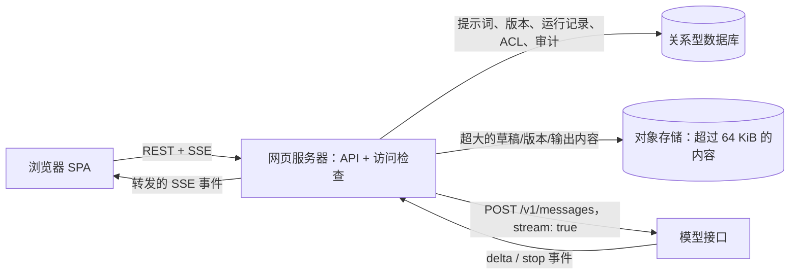

# 提示词 Playground（产品与数据设计）

[English](README.md) · [中文](README.zh.md)

<!-- meta:begin -->
| 题型 | 优先级 | 难度 | 岗位 | 考点 | 形式 | 轮次 |
| --- | --- | --- | --- | --- | --- | --- |
| 产品与 API 设计 | ★★★★☆ | 中等 | SWE · MLE | schema-design, versioning, permissions, streaming, concurrency-control, product-design | 55 分钟 | 现场面（VO） |
<!-- meta:end -->

## 题目

设计一个基于浏览器的 Playground，让某个客户组织内的开发者为一个托管的语言模型编写、运行并迭代提示词（prompt），然后保存、分享并测试他们留下来的版本。*提示词*（prompt）是用户创建的具名对象。它包含一段系统提示词（system prompt，纯文本）、一个有序的消息列表（`{role, content}`，`role` 取 `user` 或 `assistant` 之一；该列表必须以一条 `user` 消息开头，并严格交替角色——这也是模型接口本身要求的形状）、一组*变量*（variable）——形如 `{{name}}` 的占位符，可以出现在系统提示词或任意一条消息的内容里，每个变量可以带一个可选的默认值——以及一组模型参数：`model`（取自一份固定的模型标识符目录）、`temperature`（一个 0 到 1 之间、含两端的浮点数）、`max_tokens`（一个正整数，上限为 8,192）和最多 4 个 `stop_sequences`（字符串）。变量替换就是把每一处 `{{name}}` 原样替换成它绑定的值；一个绑定值如果本身包含 `{{` 或 `}}`，会原样插入，不会被递归地再次替换。一个提示词当前、可编辑的内容是它的*草稿*（draft）。把草稿以一个标签保存下来会创建一个*版本*（version）：草稿在那一刻内容的不可变快照，此后任何操作都不会再改变它。一次*运行*（run）是针对某个具体版本、或者针对当前草稿的一次模型调用，需要为其文本中出现且没有默认值的每一个变量提供一个取值——结果逐个 token 流式返回浏览器，并在结束、失败或被取消时被记录下来；一次缺少这样一个变量取值的运行请求会被直接拒绝，指出缺少的是哪些变量，请求也不会到达模型接口。*测试用例*（test case）是保存在某个提示词下的一组具名变量取值，用来让这个提示词的每一个版本都针对同样的输入重新运行一遍。*分享*（share）把某个提示词上一个选定的权限级别，授予另一个用户、整个组织，或者任何持有链接的人：至少包含查看和运行它的能力，也可以选择性地包含编辑其草稿并保存新版本的能力。

模型通过一个已有的 HTTP 接口访问，`POST /v1/messages`，请求体是 JSON：`{model, system, messages, temperature, max_tokens, stop_sequences, stream}`。当 `stream: true` 时，它返回一个分块的响应，依次带有一系列 `{type: "delta", text}` 事件（携带新生成的文本），最后是一个 `{type: "stop", reason, input_tokens, output_tokens}` 事件，其中 `reason` 是 `"end_turn"`、`"max_tokens"` 或 `"stop_sequence"` 之一。在流式传输开始之前，这个接口可能直接拒绝请求，返回 HTTP `429`（限流）或 `503`（过载）；一旦流式传输已经开始，失败会用一个 `{type: "error", message}` 事件代替 `stop` 事件来结束这一系列事件。这个接口按输入和输出的 token 数计费，调用方一关闭连接，生成就会停止。

编辑器页面一次只显示一个提示词：一个系统提示词输入框、消息列表、一个变量面板（为每个 `{{name}}` 预填它的默认值，并允许当前这次运行覆盖其中任意一个），以及一个针对 `model`、`temperature`、`max_tokens` 和 `stop_sequences` 的参数面板。点击“运行”按钮会把模型的回复流式传输进编辑器旁边的一个只读面板。“对比”操作会并排打开若干个这样的运行面板，每一个都可以独立配置（不同的已保存版本、模型或参数组合，全部针对同一组变量取值运行），于是它们的输出会并排流式显示出来。侧栏列出已登录用户能够访问到的提示词；打开其中一个会加载它当前的草稿，以及它已保存版本的历史列表。“保存”操作会把当前草稿标注为一个新版本。“分享”操作会把这个提示词上的某个权限级别，授予一位同事、整个组织，或者（通过链接）任何其他人。“测试用例”面板列出一个提示词已保存的输入集合，可以选择其中一部分、或者全部，一次性针对某个版本运行。

这次设计的规模：

- 250,000 个跨客户组织的注册开发者账号，其中 15,000 个在任意一天是活跃用户。
- 一个活跃用户在迭代时平均每天运行一个提示词约 15 次，并把其中约 2 次迭代保存为一个具名版本。
- 一个注册用户平均拥有约 12 个提示词，一个提示词在其生命周期内平均积累约 6 个已保存版本。
- 使用高峰集中在大多数客户工作时间共有的一个 12 小时窗口内，承载了一天中约 72% 的运行量；假设在这个窗口的平均速率之上，最繁忙的那一分钟还有 2 倍的突发系数。
- 模型以约每秒 50 个 token 的速度流式输出，一次运行的输出平均为 400 个 token。
- 一个提示词的序列化内容（系统提示词、消息、变量和参数放在一起）平均为 1.5 KB；系统能接受的最大内容为 8 MiB。

范围内：上面的创建、运行、迭代、保存、分享和评估流程；背后的数据模型和 REST API；两位同事同时编辑同一个提示词时的版本管理与并发控制模型；分享的权限模型，包括组织级别和个人级别，以及一次分享如何被撤销和恢复；一个序列化内容非常大的提示词如何被接受、存储，并在编辑时保持响应；以及按用户和按组织的成本与速率控制，加上需要为审计记录什么。范围外：对请求做鉴权、并在到达网页服务器的每个请求上附带已验证用户 id 和组织 id 的身份服务本身（假设两者都已经就位）；模型接口自身的实现、批处理或服务基础设施；在测试用例的输出之上构建一套自动打分流水线（这里的测试用例是一份用来重新运行的已保存输入，不是一个评分器——评测流水线是一个追问）；以及两个人对同一份草稿进行实时的、逐字符的协同编辑——只有两次独立保存互相冲突时会发生什么在范围之内。

要产出：

1. 核心用户流程：创建一个提示词、运行它、迭代并并排比较多次运行、保存一个版本、分享它，以及构建并重新运行一组测试用例。
2. 一个数据模型——提示词、版本、运行记录、测试用例，以及分享背后的表——包括主键、外键，以及上面每个流程所需要的索引，加上核心 REST API 的请求和响应形状。
3. 一张覆盖浏览器、网页服务器、关系型数据库和模型接口的架构图，标出大内容存放在哪里，并沿着这条路径把一次流式运行走一遍。
4. 深入话题：(a) 流式返回一次运行，以及并排运行多个；(b) 版本管理模型——可变草稿、不可变版本、两位同事同时保存时的并发控制，以及删除一个仍被别处引用的版本会发生什么；(c) 分享与权限模型，包括组织级别和个人级别，以及撤销；(d) 超大提示词——内容存放在哪里、客户端如何保持响应——以及按用户和按组织的成本与速率控制，还有系统记录了什么。

## 参考解答

<details>
<summary>展开参考解答</summary>

设计之前值得先确认两点：一次运行的输出是否会像聊天轮次那样自动带入下一次运行（假设不会——一次运行只读取该版本或草稿自己保存的消息；要接着某个话题继续，需要把回复当作一条新的 `assistant` 消息手动复制进去再运行一次，这让这个 Playground 始终是一个针对单次调用做迭代的工具，而不是一个聊天客户端），以及一个用户账号是否可能属于不止一个组织（假设不会——这是按坐席收费的开发者工具的常见情况，也正因如此，权限模型里的“组织范围”对每个请求才有唯一、无歧义的含义）。

### 需求与规模

**运行速率。** 按 15,000 个日活用户、每人每天迭代时运行一个提示词约 15 次计算，
$15{,}000 \times 15 = 225{,}000$ 次运行/天，全系统平均约 $225{,}000 / 86{,}400 \approx 2.60$ 次/秒。其中
72%、即 162,000 次运行，落在大多数客户共有工作时间的 12 小时（43,200 秒）窗口内，窗口内平均恰好
$162{,}000 / 43{,}200 = 3.75$ 次/秒；假设最繁忙的那一分钟相对窗口平均值还有 2 倍的突发系数，设计峰值为
$3.75 \times 2 = 7.5$ 次/秒发起。一次运行的输出平均流式传输 $400 / 50 = 8$ 秒（400 个 token，速度每秒 50
个）。由 Little 定律 $L = \lambda W$，该峰值下同时打开的流数量约为 $7.5 \times 8 = 60$——一台配置普通的
应用服务器完全承受得住；这个系统有意思的部分不在于它的请求速率。

保存比运行要稀疏得多：按每个活跃用户每天保存 2 个版本计算，$15{,}000 \times 2 = 30{,}000$ 次保存/天，平均
约 $30{,}000 / 86{,}400 \approx 0.35$ 次/秒——比运行速率低一个数量级，这符合预期，因为只有一部分迭代值得
被命名并留存下来。

**版本与运行记录的存储量。** $250{,}000$ 个用户人均 12 个提示词，合计
$250{,}000 \times 12 = 3{,}000{,}000$ 个提示词；按每个提示词在其生命周期内平均积累 6 个已保存版本计算，
$3{,}000{,}000 \times 6 = 18{,}000{,}000$ 个版本。每条版本记录包含它的内容（平均 1.5 KB 的草稿，按 1,500
字节预算）加上元数据——父指针、作者、标签、时间戳、模型与参数、声明的变量——按 300 字节预算，合计每个版本
1,800 字节；$18{,}000{,}000 \times 1{,}800 \approx 30.2$ GiB 的版本存储量。一条运行记录是元数据（300
字节，与版本记录同样的预算）加上它的变量绑定（约 100 字节），再加上完整的输出文本——400 个 token 按每个约
4 字节计算是 1,600 字节，合计每条运行记录 2,000 字节；$225{,}000$ 次运行/天就是 $450{,}000{,}000$
字节/天，约 429 MiB/天，按稳定的运行速率一年约 $\approx 153$ GiB——这是迄今为止增长最快的一张表，也是保留期
或归档策略首先要针对的对象（深入话题 (d)）。

**规模上的落差。** 一个提示词的平均大小（1.5 KB）和系统能接受的最大值（8 MiB）相差大约四个数量级。按每个
token 约 4 字节计算，8 MiB 大约是 2,100,000 个 token——远远超出任何模型的上下文窗口，所以一个接近这个大小
的提示词，不会是某一次运行会整段发送出去的东西；它是用户正在精简的、粘贴进来的参考材料，这个设计必须在这个
过程中保持编辑器的响应（深入话题 (d)）。

### 数据模型与 API

**Organization（组织）**——`org_id`、`name`、`monthly_budget_micros`（对模型调用的支出上限，深入话题
(d)）、`created_at`。**User（用户）**——`user_id`（身份服务签发的 id）、`org_id`、`display_name`、
`created_at`；鉴权本身留在身份服务里，这个设计假设一个用户恰好属于一个组织，如上文所确认。

**Prompt（提示词）**——`prompt_id`、`org_id`、`owner_id`、`title`、`draft`（JSONB：
`{system_prompt, messages, variables, model, params}`）、`draft_ref`（可为空；一旦其序列化后的大小超过内联
阈值，就会设置它来代替内联的 `draft`，深入话题 (d)）、`draft_bytes`、`draft_etag`（每次写草稿都会自增，深入
话题 (b)）、`latest_version_id`（可为空，指向 `PromptVersion` 的外键，在第一次
保存之前为空）、`created_at`、`updated_at`、`deleted_at`（可为空，软删除）。

**PromptVersion（提示词版本）**——不可变。`version_id`、`prompt_id`、`seq`（一个按保存顺序计数的整数，1、
2、3……，`UNIQUE(prompt_id, seq)`）、`parent_version_id`（可为空，指向 `PromptVersion` 的外键：这个版本的
草稿上一次是从哪个版本加载的，深入话题 (b)）、`author_id`、`label`（可为空，用户
给定）、`body` / `body_ref` / `body_bytes`（与草稿相同的内联或引用拆分方式）、`created_at`、`deleted_at`
（可为空，深入话题 (b)）。

**Run（运行）**——`run_id`、`prompt_id`、`version_id`（可为空，指向 `PromptVersion` 的外键；为空表示这次
运行针对的是当前的草稿）、`requested_by`、`model`、`params`（实际使用的参数的一份拷贝，而不是通过
`version_id` 实时读取，深入话题 (b)）、`variables`（提供的绑定值）、`status`
（`streaming | completed | failed | cancelled`）、`output_text` / `output_ref` / `output_bytes`、
`input_tokens`、`output_tokens`、`cost_micros`、`latency_ms`、`error`（可为空）、`test_case_id`（可为空，
外键）、`batch_id`（可为空，当这次运行是某个测试用例评测批次的一部分时设置）、`started_at`、`finished_at`。

**TestCase（测试用例）**——`test_case_id`、`prompt_id`、`name`、`variables`、`notes`（可为空）、
`created_at`。

**AclEntry（访问控制项）**——一条直接的、从主体（principal）到角色的授权（深入话题 (c)）。`acl_id`、
`prompt_id`、`principal_type`（`user | org`）、`principal_id`、`role`（`viewer | editor | owner`）、
`granted_by`、`created_at`；`UNIQUE(prompt_id, principal_type, principal_id)`。

**ShareLink（分享链接）**——一种承载在令牌上的授权，面向那些事先不会被解析成某个主体的接收者。`token`
（主键，128 位随机数）、`prompt_id`、`version_id`（可为空——固定某个确切版本；不设置则解析到
`latest_version_id`）、`scope`
（`public | authenticated`）、`role`（`viewer | editor`；只有当 `scope = 'authenticated'` 时 `editor`
才合法，深入话题 (c)）、`expires_at`（可为空）、`revoked_at`（可为空）、`created_by`、`created_at`。

**AuditLog（审计日志）**——只追加写入。`audit_id`、`org_id`、`actor_id`、`action`（深入话题 (d) 列出了完整
的集合）、`target_type`、`target_id`、`metadata`（一小段与动作相关的 JSON 载荷）、`created_at`。

索引，每一个都对应上面的一种查询：`Prompt`——`(org_id, updated_at DESC)` 用于一个组织的提示词浏览页，
`(owner_id, updated_at DESC)` 用于“我的提示词”。`PromptVersion`——`UNIQUE(prompt_id, seq)` 这条唯一约束
已经足以支撑按顺序排列的版本历史，因为 `seq` 与 `created_at` 同步递增，不需要再建第二个索引。`Run`——
`(prompt_id, started_at DESC)` 用于一个提示词的运行历史，`(version_id, started_at DESC)` 用于对比视图和
评测视图里“这个版本的每一次运行”，以及一个建在 `(batch_id) WHERE batch_id IS NOT NULL` 上的部分索引，
用于收集某一个评测批次，因为大多数运行都是临时发起的，从不设置这个字段。`TestCase`——`(prompt_id)`。
`AclEntry`——`(principal_type, principal_id)`：“我、或者我的组织能访问到的每一个提示词”这个查询是从这
一侧连接过去的，而不是从 `Prompt` 那一侧，除了“我的提示词”之外，产品展示的每一个提示词列表都要经过它
（“我的提示词”由上面那个索引覆盖）。`ShareLink`——`(prompt_id)` 用于一个提示词自己的“管理分享”面板；
`token` 上的主键已经能支撑公开的解析路径。`AuditLog`——`(org_id, created_at DESC)` 用于组织管理员的审计
视图，`(target_type, target_id, created_at DESC)` 用于查看某一个对象的完整历史。

**核心 API。** 下面每一个按提示词作用域的调用都会按调用方已解析出的访问权限过滤（深入话题 (c)）；对于一个
调用方无法访问的提示词 id，返回的是 `404` 而不是 `403`，这样一次猜测不会泄露这个 id 究竟是否存在。

1. `POST /v1/prompts`——创建。请求体 `{title}`；返回一个空白的
   `{prompt_id, draft, draft_etag, created_at}`，模型与参数为默认值，内容为空。
2. `GET /v1/prompts`——列出调用方能访问到的提示词，分页，按更新时间从新到旧；只返回摘要信息——
   `{prompt_id, title, owner, updated_at, latest_version_seq}`——从不返回草稿或版本内容。
3. `GET /v1/prompts/{id}`——一个提示词的元数据加上它当前的草稿；草稿如果在对象存储里（深入话题 (d)），
   会以 `{draft_ref, draft_bytes, download_url}`（一个签名 URL）的形式解析，而不是直接内联返回。
4. `PATCH /v1/prompts/{id}/draft`——替换草稿。需要 `If-Match` 头，携带上次读到的 `draft_etag`。请求体
   `{system_prompt, messages, variables, model, params}`——是整份草稿，不是局部合并（深入话题 (b)）。
   返回 `{draft_etag, updated_at}`，或者 `412 Precondition Failed` 并附上当前的草稿和 `draft_etag`。
5. `POST /v1/prompts/{id}/versions`——把草稿保存为一个新版本。需要和编辑草稿一样的 `If-Match`（深入话题
   (b)）。请求体 `{label?}`；返回 `{version_id, seq, created_at}`。
6. `GET /v1/prompts/{id}/versions` / `GET /v1/prompts/{id}/versions/{version_id}`——按从新到旧列出
   （`{version_id, seq, label, author, created_at, body_bytes, deleted_at}`），或者取回某一个版本的完整
   内容。
7. `DELETE /v1/prompts/{id}/versions/{version_id}`——软删除（仅所有者）。返回
   `{deleted_at, latest_version_id}`（深入话题 (b)）。
8. `POST /v1/prompts/{id}/versions/{version_id}/restore`——清空 `deleted_at`；如果这个版本已经被彻底
   清除，返回 `404`（深入话题 (b)）。
9. `POST /v1/prompts/{id}/runs`——发起一次运行；响应是一个流。请求体
   `{version_id?, variables, model?, params?}`——省略 `version_id` 表示运行当前的草稿，`model` /
   `params` 可以覆盖该版本自己的取值，用于做一次临时对比。目标文本用到、没有默认值、`variables` 里也没有
   对应取值的变量，会让这次请求在任何内容被发往上游之前就以 `422 {missing_variables: [...]}` 失败。响应：
   转发 `POST /v1/messages` 自身的
   `delta` / `stop` / `error` 事件，并在最前面加上一个 `{type: "started", run_id}` 事件。取消没有单独
   的接口——由客户端中止底层请求（深入话题 (a)）。
10. `GET /v1/prompts/{id}/runs` / `GET /v1/runs/{run_id}`——运行历史，可按 `version_id`、`test_case_id`
    或 `batch_id` 过滤；或者取回某一条运行记录的完整内容。
11. `POST /v1/prompts/{id}/test_cases`、`GET /v1/prompts/{id}/test_cases`、
    `DELETE /v1/prompts/{id}/test_cases/{id}`——创建（`{name, variables, notes?}`）、列出、删除。
12. `POST /v1/prompts/{id}/versions/{version_id}/evaluate`——针对这个版本运行一批测试用例。请求体
    `{test_case_ids?}`；省略时运行全部测试用例，上限 20 个。返回 `{batch_id, run_ids}`；
    `GET /v1/prompts/{id}/runs?batch_id=` 会在结果陆续完成时把它们汇总起来。
13. `POST /v1/prompts/{id}/acl` / `DELETE /v1/prompts/{id}/acl/{acl_id}`——授予或撤销某个主体的角色
    （仅所有者）。
14. `POST /v1/prompts/{id}/share_links`——创建。请求体 `{scope, role, version_id?, expires_at?}`；当
    `scope: "public"` 时 `role: "editor"` 会被拒绝。返回 `{token, url, ...}`。
15. `DELETE /v1/prompts/{id}/share_links/{token}` / `POST /v1/share_links/{token}/restore`——撤销与恢复
    （仅所有者）。
16. `GET /v1/share/{token}`——校验这个令牌，并签发一个短期有效、范围受限的凭证，用于上面这些普通接口。

### 架构



点击“运行”会把 `POST /prompts/{id}/runs` 发送给网页服务器——它是浏览器唯一的对话方，浏览器从不直接和数据
库、对象存储或模型接口打交道。服务器解析调用方对这个提示词的访问权限（深入话题 (c)，做了短暂缓存），加载
目标版本或草稿——如果内容是内联的就从数据库读取，否则就对对象存储做一次范围读取，配合缓存下来的字节长度
（深入话题 (d)）——把提供的变量绑定代入系统提示词和消息里，然后向 `POST /v1/messages` 发起自己的
`stream: true` 请求。它会在上游第一个字节到达之前就写入一条 `status: "streaming"` 的 `Run` 记录，这样运行
过程中即便崩溃也会留下记录，随后立刻向浏览器发出 `{type: "started", run_id}`。模型接口的每一个 `delta`
事件都会作为独立的 SSE 事件转发给浏览器，并被追加进一个大小限制在几 KB 的内存缓冲区，而不是完整的输出——
这样每条打开的运行占用的内存是常数，不会随着已经流式传输了多少内容而增长。最后的 `stop` 或 `error` 事件被
转发出去，缓冲区里剩下的内容被刷新，完整的输出——内联存放，或者在超过大小阈值时写入对象存储——连同它的
token 计数和费用一起被写入 `Run` 记录，`status` 变成它的终态。如果浏览器提前中止了请求，服务器会看到自己
那一侧的连接被关闭，转而中止它对模型接口的请求——这样不会有任何东西继续生成，也不会有任何东西继续为一个
没人看着的标签页计费——并把这次运行标记为 `cancelled`。

### 深入话题

**(a) 流式返回一次运行，以及并排运行多个。** 一旦一次运行开始，模型接口自己的连接就是单向的，所以浏览器
与网页服务器之间的连接也是单向的：用普通 `fetch` 响应上的 Server-Sent Events，而不是 WebSocket，因为请求
发出之后就再也不需要向另一个方向传输任何东西。`EventSource` 无法携带 `POST` 请求体，所以客户端改用
`response.body.getReader()` 读取响应，自己解析出一个个事件，并把还没收完整的末尾事件留到下一次读取时再
拼上。取消就是对这次 `fetch` 调用 `AbortController.abort()`；服务器看到连接被关闭，转而中止自己对模型
接口的请求，这才是真正停止计费生成的那一步——如果只是跳出转发循环、而上游的调用还开着，模型就会继续生成
没有任何人会看到的 token。

对比不需要任何新协议：对比视图为每一列发起一次普通的 `POST /runs`，并独立渲染每一列的流，每一列都有自己
本地的 `{status, buffered text}`，这样某一列变慢或失败都不会拖累其他列。唯一新出现的问题，是要限制一个
用户同时能打开多少次运行——把所有打开的列、所有打开的标签页合在一起算：这个设计把它限制在 4——同一个用户
发起的第 5 个并发 `POST /runs` 会在到达模型接口之前就被 `429` 拒绝（深入话题 (d)）——对比视图自身的宽度
也被设计成同一个数字，这样一次完整的对比不会把自己限流。

**(b) 版本管理模型。** 处理两个人同时改动同一个提示词，有两种机制：用一个版本号或 `ETag` 来检测，一旦有
更新的写入已经落地就拒绝过期的写入；或者干脆从不覆盖，把每一次改动都当作独立的一行追加进去，把“当前状
态”看作是对这份日志做一次折叠（fold）。这个设计在两个不同的层次上把两种机制都用上了，而不是给所有场景都
选定一种。草稿是一个单一的可变槽位，没有一种自然的方式可以在不引入针对结构化内容的真正冲突消解逻辑的情况
下合并两次编辑，所以它用的是第一种机制：
`PATCH /prompts/{id}/draft` 要求带上一个 `If-Match` 头，携带上次读到的 `draft_etag`，服务器把这次写入做
成一条条件更新语句，
`UPDATE prompt SET draft = ?, draft_etag = draft_etag + 1, updated_at = now() WHERE prompt_id = ? AND draft_etag = ?`；
如果影响了 0 行，说明别人的写入先一步落地了，服务器于是重新读取这一行，返回 `412 Precondition Failed`，
并附上当前的草稿和 `draft_etag`。落败的那个标签页会把自己的改动和当前的草稿并排展示出来，给出三个选择：
放弃自己的改动、覆盖它（带着新的 `draft_etag` 重新发送，这时候就是有意的覆盖），或者把自己的改动另存为一
个新版本而不是丢掉它——绝不会出现悄悄覆盖的情况，而这正是这个版本检查所排除掉的：如果没有它，第二次
`PATCH` 会直接获胜，第一个标签页的改动就会消失，两边都不会收到任何提示。

一个已保存的版本完全不需要这些，因为写入之后再也没有任何东西会修改它：`POST /versions` 会读取草稿（同样
要求 `If-Match`，这样一次保存就不可能提交一份已经被某次并发编辑替换掉的草稿状态），插入一条新的、不可变
的记录——这是同一个选择里追加写入的那一面，用在了唯一一种丢掉一次写入会构成真正倒退的状态上，因为一个版
本正是用户已经决定值得留存下来的东西。`parent_version_id` 把一个版本链接到它的草稿上一次加载时所来自的那
个版本——这也是历史视图或差异视图要遍历的链条；它只是记账用的信息，不是一把锁，所以两个版本完全可以共享
同一个父版本。

删除一个版本——仅限所有者——设置的是它的 `deleted_at`，而不是把这一行删掉：它会从这个提示词提供的新建运行
或分享所用的选择器里消失，如果它正好持有 `latest_version_id`，提示词的指针就会移动到下一个最近的、未被
删除的版本，如果一个都不剩就是 `null`。任何已经引用着它的东西都不会因此坏掉。一次运行的 `model`、
`params` 和输出，是在运行发生的那一刻就写下来的，而不是每次展示时都通过 `version_id` 实时读取——这正是为
了让一条运行记录在它对应的版本消失之后依然有意义：如果靠实时联表查询，一旦版本消失，“这次运行当时到底用
的是什么”就会变得无法回答，而这对一条存在的意义就是要比产生它的东西活得更久的记录来说，是最糟糕的失效方
式。一条固定了这个版本的分享链接（设置了 `ShareLink.version_id`）会继续正常解析：固定版本的意思就是“分
享这份确切、不可变的内容”，而一个版本从新的选择器里消失，是一个可发现性上的决定，不是访问权限上的决定。
恢复会清空 `deleted_at`；这个版本会重新出现在选择器里，如果此后没有保存过更新的版本，它还会重新变回
`latest_version_id`。只有一个后台任务会做彻底删除——针对 `deleted_at` 超过 30 天的记录，如果存在对象存
储中的内容也会一并删除；`runs.version_id` 和 `prompt_version.parent_version_id` 都被声明为
`ON DELETE SET NULL`，这样这个清理任务就不会因为还有某一行指着它而失败，任何仍然固定着这个被清除版本的
分享链接，也会在同一个任务里被强制撤销，因为一个令牌不能继续解析到已经不存在的内容。

**(c) 分享与权限。** 有两种机制来授予访问权限，分别对应两种不同的场景。`AclEntry` 指名一个在这个系统里已
经拥有身份的主体——一个具体的 `user_id`，或者一整个 `org_id`——授予它一个角色，这是面向那些会继续使用自己
账号的同事、或者整个客户组织的机制。一条 `principal_type = 'org'` 的记录，正是让“分享给我的团队”只需要
一条记录、而不是每个成员一条的原因，而且它会自动覆盖之后加入这个组织的任何人；解析一个调用方的访问权限，
就是按 `(principal_type, principal_id)` 同时查找他自己的 `user_id` 和他的 `org_id`，取两者授予的角色中
较高的一个——对本人的 editor 授权和对其所在组织的 viewer 授权，解析结果是 `editor`。`ShareLink` 则是一种
承载能力——持有这 128 位的 `token` 本身就意味着获得了访问权限，面向那些完全不会被解析成某个账号的接收
者，无论是因为他们不在这个组织里，还是因为给一个 URL 就是比去查找他们更快。访问一个链接，会在调用方自己
`AclEntry` 记录已经授予的权限之上叠加它的 `role`，绝不会比原来更低，所以一个较强的既有授权，不会因为跟随
了一个较弱的链接而被削弱。

三个角色，顺序是 `viewer < editor < owner`。`viewer` 可以打开一个提示词、浏览它的版本和运行历史，并且可
以发起运行——运行对提示词自身的内容而言是只读的，而让一个被分享的接收者真正试一试这个提示词、而不只是看
一看，正是分享它的大半意义所在。`editor` 在此之上还能编辑草稿、保存版本、创建测试用例，以及创建自己的分
享链接。只有 `owner` 能删除这个提示词或它的版本，并管理其他主体的 `AclEntry` 记录；一个提示词可以有不止
一个所有者，但 `ShareLink` 永远不能授予 `owner`，而且当 `scope: "public"` 时 `role: "editor"` 会被拒绝
——一个不需要登录就能打开的链接绝不能拥有改动一个真实组织的提示词的能力，所以一个公开链接不管创建者请求
什么角色，都会被限制在 `viewer`。

撤销一条 `AclEntry` 就是一次普通的删除。撤销一条 `ShareLink` 是设置 `revoked_at`，而不是删掉这一行，所以
之后恢复它只需要清空这一列、把同一个 URL 重新交回去，而不需要重新生成并重新分发一个新的——这是所有者暂停
一个链接时正确的默认做法，而不是针对一个他们怀疑已经泄露的令牌，那种情况应该直接删掉这一行、再创建一个
全新的。因为每一次打开提示词、每一次运行都要检查访问权限，这项检查用一个较短的 TTL（这里是 30 秒）做了
缓存，而不是每次请求都去查 `AclEntry` 和 `ShareLink`；一次撤销会立刻写穿这个缓存，所以一个刚被撤销的主体
还能进来的这段窗口，取决于有没有调用方在撤销发生前恰好已经拿到了一个缓存下来的“可以”——最多也就是这个
TTL 的时长。每次请求都做完全同步的检查，会用热路径上的负载换来这份陈旧——30 秒已经短到这个设计宁愿接受
缓存。一个热门链接不需要任何新的基础设施：一个版本的内容一旦保存就不再变化，所以它背后的对象存储内容、
以及一个令牌解析出来的 `{prompt_id, version_id, role}`，都可以放心地长期缓存，不论有多少个不同的访客在
发起请求。

**(d) 超大提示词、成本与速率限制，以及系统记录了什么。** 一个提示词的 `draft`，或者一个版本的 `body`，会
以 JSONB 的形式内联存储，上限是 64 KiB——远高于 1.5 KB 的平均值，所以绝大多数记录都不会离开数据库，但又
足够小，不至于因为其中某一条格外大，列出或打开满满一屏的记录就有拉取到几 MB 内容的风险。超过这个阈值之
后，内容会被移到对象存储：这一行保留 `body_ref`——形如
`prompts/{prompt_id}/versions/{version_id}/body` 的一个键，由这一行自己的 id 确定，不是内容哈希——以及
`body_bytes`，始终有值，这样不需要真的去取内容就能知道它的大小。用一个确定性的键、而不是内容寻址的键，意
味着两份完全相同、各 3 MB 的粘贴内容存成两个不同的版本时会被存两份，而不会被去重——这里可以接受，因为大到
超过 64 KiB 的提示词通常是特定的、不太可能逐字节重复的粘贴材料，一个共享 blob 所需要的引用计数换来的收益
抵不上它的记账成本。浏览器从不直接写对象存储：每一个请求
仍然都经过网页服务器——这是固定部署给它的唯一对话方——一旦内容超过阈值，服务器只是改写到对象存储而不是数
据库；保存一份 8 MiB 的草稿会比保存一份 1.5 KB 的草稿花更长时间，但不需要走一条新的路径。

编辑器在 8 MiB 时保持响应的方式，和任何文本编辑器处理一个大文件的方式一样：它对渲染做虚拟化，DOM 里只挂载
系统提示词或消息列表当前可见的那一小段窗口，而一个内容是 `body_ref` 的版本或草稿，会用一次 HTTP 范围请求
去取当前可见区域对应的字节，而不是整个拉进一个 JSON 响应里。这也回答了一个用户同时打开好几个大提示词标签
页的情况——内存里任何一个标签页保留的都不会超过一屏的内容，所以浏览器内存的大小取决于打开了多少个标签
页，而不取决于其中的提示词有多大；四个标签页各自完整加载一个 8 MiB 的提示词会是 32 MiB，而虚拟化渲染正是为
了避免真的需要这些内存。

成本在两个粒度上被控制。一个持续补充的按用户令牌桶，限制单个账号能以多快的速度发起运行；深入话题 (a) 里
的并发运行上限——每个用户最多 4 个同时在飞——则限制了不论速率多快，这份额度同时能打开多少。`Organization`
上按组织设置的 `monthly_budget_micros`，会对照一个在每次运行的 `cost_micros` 结算时于同一个事务里更新
的 `spent_micros` 做检查，用来限制总支出：一旦达到上限，新的运行会被拒绝，返回 `429` 和
`{reason: "org_budget_exceeded"}`，而不是一个笼统的限流响应，这样客户端就能向组织管理员展示一个支出上
限，而不是一个转瞬即逝的“请重试”。按每百万输入 token 3 美元、每百万输出 token 15 美元这样的示意性定价，
一次平均 500 个输入、400 个输出 token 的运行大约花费 0.75 美分；按这个设计每天 225,000 次运行计算，大约
是每天 1,688 美元，每月约 50,625 美元的模型开销总量——这才是这个系统真正需要一个阀门的数字，因为在这样
的请求速率下，数据库和网页服务器都远远谈不上吃紧。

每一条运行记录本身就是执行日志：它在第一个字节流回来之前就已经写入，之后只会把它的终态字段填上，一旦
`status` 离开 `streaming` 就再也不会被编辑，所以运行历史本身已经是一条持久的、按请求记录的审计轨迹——谁
运行了什么、用了什么参数、针对什么输入、产生了什么输出、花费了多少。一条独立的 `AuditLog` 记录，会为每一
个不是运行、但仍然会改变其他主体能看到什么、或者会不会因此失去访问权限的动作而追加——`version.save`、
`version.delete`、`version.restore`、`acl.grant`、`acl.revoke`、`share.create`、`share.revoke`、
`share.restore`——记录下操作者、所在组织、动作本身、目标对象，以及一小段与动作相关的载荷，比如被授予的
角色，或者被撤销的链接的 id。读取这两种日志都遵循和其他一切相同的访问规则：一个提示词自己的运行历史，谁
能查看这个提示词谁就能看到；而按组织过滤后的完整 `AuditLog`，只有这个组织的所有者才能看到。

### 追问

- 同时针对许多版本和多个模型运行几十个测试用例，是一种扇出（fan-out），这个设计里同步的评测调用——一次
  最多 20 个测试用例、一次只针对一个版本——撑不住这种规模；一个批量评测器会把完整的笛卡尔积都排进一个工
  作进程池，按 `batch_id` 存下汇总的通过/失败或打分结果，而不是让调用方同时等着一大堆流式运行跑完。
- `parent_version_id` 给出的是一条有序的链条，不是一份差异。比较两个版本需要把 `system_prompt` 和
  `messages` 当作结构化内容来做差异比较，而不是当作扁平文本，因为调整一条消息的顺序和重写它的内容，是两
  种不同的改动。
- 导出为代码，是把一个版本的 `body` 和 `params` 渲染成 `POST /v1/messages` 所要求的确切形状，并提供一个
  可以复制粘贴的 curl 命令和几种 SDK 代码片段——这是一个已保存的版本唯一需要离开这个系统、变成一次真正、
  独立的 API 调用的地方。
- `AuditLog` 表已经记录了每一个动作；把它做成一个供组织管理员搜索的视图，配上一个保留窗口和导出功能，就
  是“记录了一个动作”和“能回答出是谁在什么时候把一个提示词分享到了组织之外”之间的区别。

<details>
<summary>估算核对（可运行）</summary>

```python
active_users, runs_per_active_user = 15_000, 15
daily_runs = active_users * runs_per_active_user
assert daily_runs == 225_000

avg_run_qps = daily_runs / 86_400
assert round(avg_run_qps, 2) == 2.60

saves_per_active_user = 2
daily_saves = active_users * saves_per_active_user
assert daily_saves == 30_000
avg_save_qps = daily_saves / 86_400
assert round(avg_save_qps, 2) == 0.35

window_share, window_hours = 0.72, 12
window_runs = daily_runs * window_share
window_seconds = window_hours * 3600
assert window_runs == 162_000
assert window_seconds == 43_200
window_avg_qps = window_runs / window_seconds
assert window_avg_qps == 3.75

burst_factor = 2
peak_qps = window_avg_qps * burst_factor
assert peak_qps == 7.5

avg_output_tokens, tokens_per_sec = 400, 50
avg_stream_seconds = avg_output_tokens / tokens_per_sec
assert avg_stream_seconds == 8.0

# Little's law: L = lambda * W
peak_concurrent_streams = peak_qps * avg_stream_seconds
assert peak_concurrent_streams == 60.0

registered_users, prompts_per_user = 250_000, 12
total_prompts = registered_users * prompts_per_user
assert total_prompts == 3_000_000

versions_per_prompt = 6
total_versions = total_prompts * versions_per_prompt
assert total_versions == 18_000_000

avg_body_bytes, avg_metadata_bytes = 1_500, 300
avg_version_bytes = avg_body_bytes + avg_metadata_bytes
assert avg_version_bytes == 1_800

GiB, MiB = 1024 ** 3, 1024 ** 2
total_version_bytes = total_versions * avg_version_bytes
assert round(total_version_bytes / GiB, 1) == 30.2

run_metadata_bytes, bytes_per_token, variables_bytes = 300, 4, 100
output_bytes = avg_output_tokens * bytes_per_token
assert output_bytes == 1_600
avg_run_bytes = run_metadata_bytes + output_bytes + variables_bytes
assert avg_run_bytes == 2_000

daily_run_bytes = daily_runs * avg_run_bytes
assert daily_run_bytes == 450_000_000
assert round(daily_run_bytes / MiB) == 429
annual_run_bytes = daily_run_bytes * 365
assert round(annual_run_bytes / GiB) == 153

max_prompt_bytes = 8 * 1024 * 1024
max_prompt_tokens = max_prompt_bytes / bytes_per_token
assert round(max_prompt_tokens / 1_000_000, 1) == 2.1

open_tabs = 4
assert open_tabs * max_prompt_bytes / MiB == 32.0

avg_input_tokens, price_in_per_million, price_out_per_million = 500, 3, 15
cost_per_run_dollars = (avg_input_tokens * price_in_per_million
                        + avg_output_tokens * price_out_per_million) / 1_000_000
assert round(cost_per_run_dollars * 100, 2) == 0.75            # cents
daily_cost_dollars = daily_runs * cost_per_run_dollars
assert round(daily_cost_dollars) == 1_688
monthly_cost_dollars = daily_cost_dollars * 30
assert monthly_cost_dollars == 50_625.0

print("all requirements-and-scale numbers check out")

# --- (b) optimistic concurrency on the mutable draft, keyed on draft_etag ---

class StaleETag(Exception):
    def __init__(self, current_etag, current_content):
        self.current_etag = current_etag
        self.current_content = current_content


def patch_draft(draft, if_match, new_content):
    """Reference model of PATCH /prompts/{id}/draft. draft is {"etag": int, "content": ...}."""
    if if_match != draft["etag"]:
        raise StaleETag(draft["etag"], draft["content"])
    return {"etag": draft["etag"] + 1, "content": new_content}


base = {"etag": 5, "content": "v5 body"}
tab_a = patch_draft(base, if_match=5, new_content="A's edit")
assert tab_a == {"etag": 6, "content": "A's edit"}

try:
    patch_draft(tab_a, if_match=5, new_content="B's edit")     # B still holds the etag it first read
    assert False, "a stale If-Match must be rejected, never silently overwritten"
except StaleETag as e:
    assert e.current_etag == 6 and e.current_content == "A's edit"

tab_b_retry = patch_draft(tab_a, if_match=6, new_content="B's edit, rebased")   # B refetches, then retries
assert tab_b_retry == {"etag": 7, "content": "B's edit, rebased"}

# property: under any interleaving of N racing writers, each retrying once with the fresh etag on
# conflict, the draft's etag increases by exactly one per accepted write and no two writers ever land
# on the same etag -- a silent last-write-wins would instead let two writers both "succeed" at once
import random
random.seed(0)
for _trial in range(200):
    writers = [{"held_etag": 0, "tries_left": 2} for _ in range(random.randint(2, 6))]
    random.shuffle(writers)
    draft, accepted = {"etag": 0, "content": "start"}, 0
    for writer in writers:
        while writer["tries_left"] > 0:
            writer["tries_left"] -= 1
            try:
                draft = patch_draft(draft, if_match=writer["held_etag"], new_content=f"writer-{id(writer)}")
                accepted += 1
                break
            except StaleETag as e:
                writer["held_etag"] = e.current_etag        # refetch; the loop retries once
    assert draft["etag"] == accepted

print("draft concurrency control: stale writes are rejected, never silently dropped")

# --- (c) effective role from ACL rows (user- and organization-scoped) plus an optional share-link role ---

ROLE_RANK = {"viewer": 1, "editor": 2, "owner": 3}


def effective_role(acl_rows, user_id, org_id, link_role=None):
    """acl_rows: an iterable of (principal_type, principal_id, role). None if nothing applies."""
    best = None
    for principal_type, principal_id, role in acl_rows:
        granted = (principal_type == "user" and principal_id == user_id) or \
                  (principal_type == "org" and principal_id == org_id)
        if granted and (best is None or ROLE_RANK[role] > ROLE_RANK[best]):
            best = role
    if link_role is not None and (best is None or ROLE_RANK[link_role] > ROLE_RANK[best]):
        best = link_role
    return best


assert effective_role([], "u1", "o1") is None
assert effective_role([("org", "o1", "viewer")], "u1", "o1") == "viewer"
assert effective_role([("user", "u1", "editor"), ("org", "o1", "viewer")], "u1", "o1") == "editor"
assert effective_role([], "u1", "o1", link_role="editor") == "editor"
assert effective_role([("org", "o1", "viewer")], "u1", "o1", link_role="viewer") == "viewer"
assert effective_role([("user", "u1", "owner")], "u1", "o1", link_role="viewer") == "owner"   # link never downgrades
assert effective_role([("user", "u9", "owner")], "u1", "o1") is None          # a grant for a different user

random.seed(1)
principals = [("user", "u1"), ("user", "u2"), ("org", "o1"), ("org", "o2")]
roles = list(ROLE_RANK)
for _trial in range(300):
    rows = [(*random.choice(principals), random.choice(roles)) for _ in range(random.randint(0, 5))]
    link_role = random.choice(roles + [None])
    got = effective_role(rows, "u1", "o1", link_role)
    # independent brute force, written straight from the stated rule: scan every applicable grant plus
    # the link role and take the highest
    candidates = [r for t, p, r in rows if (t == "user" and p == "u1") or (t == "org" and p == "o1")]
    if link_role is not None:
        candidates.append(link_role)
    want = max(candidates, key=ROLE_RANK.get) if candidates else None
    assert got == want

print("effective-role resolution matches the stated rule on every generated case")
```

</details>

</details>
