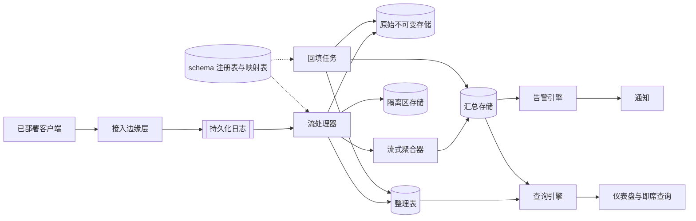

# 带 schema 演进的遥测数据管道

[English](README.md) · [中文](README.zh.md)

<!-- meta:begin -->
| 题型 | 优先级 | 难度 | 岗位 | 考点 | 形式 | 轮次 |
| --- | --- | --- | --- | --- | --- | --- |
| 系统设计 | ★★☆☆☆ | 困难 | SWE · Data Eng · Infra Eng | ingestion, schema-evolution, stream-processing, partitioning, access-control, pii | 55 分钟 | 技术电面 · 现场面（VO） |
<!-- meta:end -->

## 题目

设计支撑公司自有客户端软件的遥测（telemetry）平台：一个桌面应用、一个移动应用，以及嵌入在其他内部产品中的 SDK，每个实例都持续上报*遥测事件*（telemetry event）——记录某件已发生之事（使用了某个功能、某个任务完成、发生了一次错误）的离散条目，此外还有周期性的数值型度量（一个耗时、一个队列深度）。每个事件用 `telemetry_name` 命名其上报的逻辑指标（如 `sync_completed`、`search_performed` 等），携带一组*维度*（dimension）——用于筛选和分组的带类型标签，例如 `platform` 或 `client_version`——并且，如果是一次度量，还带有一个或多个数值型*度量*（measure）。内部团队（产品分析、on-call SRE、客服、安全与合规）通过持续刷新的实时仪表盘、即席 SQL 式查询，以及监视滚动聚合值并在越过阈值时呼叫值班人员的告警来读取这些数据；一个团队能看到某个事件的哪些字段，取决于该字段的敏感程度。

这次设计的规模：

- 24,000,000 个已部署客户端实例，平均每个每天上报 180 次事件——全平台每天 4,320,000,000 次事件——平均每个事件序列化后 500 字节（一份紧凑的信封加负载数据）。
- 流量的峰均比大致为 4 倍：已安装的客户端集中在几个时区的工作时间内活跃，且客户端按固定间隔刷新本地缓冲区，这会让大量客户端的突发流量同步出现。
- 保留期：原始的、按接收即存的事件存储保留 30 天；整理后的按事件类型分表保留 400 天（13 个月）以支持趋势分析。被归类为敏感（见下文）的字段无论表本身的保留期如何，都会在整理表中于 30 天后被清除或哈希处理。
- 全产品线大约注册了 4,000 个不同的规范遥测名称，同时有 2,000 条告警规则处于激活状态。
- 当一个字段的值能够识别或可归因于某个人或某个账号（例如混入自由文本错误信息中的邮箱地址、一个原始设备标识符），而不是描述聚合层面的产品行为时，该字段就被归类为敏感。

客户端发送的每个事件都携带一份固定的信封：

```py
class TelemetryEvent:
    event_id: str        # client-generated; identical across a retried send of the same logical event
    client_id: str        # stable per installed client instance
    client_version: str
    schema_version: int   # the registered schema version this payload's shape conforms to
    telemetry_name: str   # as sent by the client -- may be an old, non-canonical variant
    event_time: int        # unix ms, the client's own clock, when the event happened
    dimensions: dict[str, str | int | float | bool]
    measures: dict[str, float]
```

- `event_id` 由客户端选定一次，此后每次重发同一个逻辑事件时原样带上（一次网络重试，或离线客户端重新连接后重放本地缓冲区）；两个共享同一个 `event_id` 的事件是同一次发生，只计一次。
- `event_time` 是客户端自己的时钟，不被信任：它可能有偏差，也可能完全错误。平台会为每个事件单独打上 `receive_time` 戳，即接入层首次接受该事件时平台自己的时钟读数；`receive_time` 在每个接入节点上单调递增，且始终接近当前时刻。
- `schema_version` 标明客户端认为自己的负载符合 `telemetry_name` 所对应的哪个已注册字段列表版本；它本身并不保证 `telemetry_name` 是注册表当前认可的*规范名称*（canonical name，注册表为一个指标保留的那一个正式名称，其余的每一种拼法都是它的*变体*）——这正是下面追问的内容。
- 客户端在本地对事件分批，按固定间隔或大小阈值（取先到者）刷新一批；一次批量发送是至少一次语义——客户端会重发没有收到确认的批次。

范围内：接入 API 及其鉴权；持久化日志与流处理（校验、去重、富化、乱序与延迟数据处理）；原始存储与整理存储两层，及其分区与保留策略；查询引擎的访问控制层与 PII 处理；基于流式聚合的告警；schema 注册表、其兼容性规则，以及下面的追问。范围外：仪表盘或 BI 工具本身的用户界面（假设它调用查询引擎的 API）；异常检测或其他基于机器学习的告警；跨团队的计费或成本分摊；客户端 SDK 在上述约定之外的传输与重试逻辑。

**追问。** 相当一部分已部署客户端处于短期内无法升级的旧版本。不同客户端版本对同一个逻辑事件的上报方式并不一致：例如一次后台同步完成事件，当前客户端会以 `sync_completed` 送达接入 API，而三个不同的旧版本分别会送来 `SyncCompleted`、`sync-completed`、`evt_sync_done`；还有一些版本虽然正确地发送了 `telemetry_name: sync_completed`，却仍把其耗时度量命名为 `duration_ms`（毫秒），而不是当前 schema 所用的 `duration_seconds`。请设计 schema 如何演进，以及下游数据——既包括现在到来的事件，也包括已经写入的历史数据——如何在统一的名称、字段与单位下保持正确，需要覆盖：

1. 已知变体下到来的事件被归并为单一的规范指标，而不是分裂成多个；
2. 一旦某个变体被识别出来，已经按该变体写入的数据可以被更正，而不必重新处理所有数据；
3. 事件最初发送时的名称（以及任何单位换算）与规范记录一同保留，使一次映射决策可被审计或撤销；
4. 两个只是表面相似的遥测名称绝不会被悄悄归并为一个指标；
5. 映射规则可以随时间新增、修改和废弃，且需说明这类变更对正在运行的实时查询与对已存储历史数据分别产生的效果。

要产出：

1. 需求与规模估算：接入吞吐与带宽、持久化日志的分区方式、流处理层的规模、原始/整理/汇总三层各自的存储量，以及评估现有告警规则集的开销。
2. 数据模型（存储形态的事件信封、schema 注册表、名称映射表、告警规则、汇总聚合）及 5-6 个核心 API。
3. 一张架构图，把接入与缓冲、流处理与存储、查询与告警区分开，并沿一个事件走一遍。
4. 深入话题：(a) 接入、持久化日志的分区与流处理——至少一次投递下的去重，以及乱序与延迟事件；(b) 原始存储与整理存储的划分、分区与合并、查询引擎，以及基于流式聚合的告警，包括高基数维度；(c) schema 注册表、兼容性规则，以及上面的命名变体追问；(d) 按字段分类的访问控制、PII 处理与保留策略。每个话题至少比较两种方案，说明你会选哪个，并给出代价。

## 参考解答

<details>
<summary>展开参考解答</summary>

设计之前值得先确认一点：旧客户端是否终将可以被强制升级、从而停止发送某个已废弃的变体（即一个强制开关，kill-switch），还是只要它还在被安装使用，就必须被无限期支持下去。本设计假设更难的那种情况——不存在强制升级——因此任何一个已识别的变体，只要它还在上报流量，就会持续被支持；对一条映射规则执行“废弃”操作，也就始终只表示将其标记为对新流量不再生效，而绝不是在它的流量还未归零时就删除它。

### 需求与规模

**事件速率。** $24\times10^6$ 个客户端，按每个客户端每天 180 次事件计算，全平台每天产生
$24\times10^6 \times 180 = 4.32\times10^9$ 次事件，平均每秒 $4.32\times10^9 / 86{,}400 = 50{,}000$
次事件。按 4 倍的峰均比，设计目标定在 $50{,}000 \times 4 = 200{,}000$ 次事件/秒。

**接入带宽。** 按每个事件 500 字节计算，峰值接入速率为 $200{,}000 \times 500\text{ B} = 100\times10^6$
B/s，即 100 MB/s（约合 800 Mbps）——对于负载均衡器后面一层普通服务器构成的接入边缘层来说并不算高，因此接入本身不是瓶颈；接下来要确定规模的是持久化日志，以及负责消费它的流处理层。

**流处理资源池。** 对一个事件做校验、查找它的映射与 schema、检查去重索引并做富化，是按事件计的 CPU 密集型工作，而不是一次会阻塞在慢速远程服务上的调用，因此它按每核吞吐量而非 Little 定律来定规模：按每核每秒 $5{,}000$ 次事件预算，峰值负载需要 $\lceil 200{,}000 / 5{,}000 \rceil = 40$ 个核；为 GC 暂停、分区再均衡以及偶尔一次较慢的映射表重新加载预留 50% 的余量，取整后为 $\lceil 40 \times 1.5 \rceil = 60$ 个核。

**持久化日志分区。** 仅从带宽考虑，需要的分区并不多：按每分区 4 MB/s 的保守预算，$`\lceil 100 / 4 \rceil = 25`$ 个分区即可覆盖峰值字节数。但分区数量同时也限制了有多少个工作进程能并行读取该日志——同一时刻，一个分区在一个消费组内最多只能被一个工作进程读取——而 60 个核至少需要 60 个分区才能获得完全的并行度；向上取整到下一个 2 的幂，得到**64 个分区**，留出 $64 \times 4 = 256$ MB/s 的余量，为峰值的 2.56 倍。日志按 `client_id` 的哈希分区，而不是按 `telemetry_name`：数以百万计的不同客户端能把负载均匀摊开，不会有某一个热门指标挤满某个分区，代价是同一个客户端、不同指标的事件会共享同一个分区——这无妨，因为下游没有任何环节需要某个指标独占一个分区（深入话题 (a)）。

**去重索引。** 客户端离线后最长可能间隔一天才重放本地缓冲区，因此去重窗口取 24 小时：每条索引项（`event_id` 的 16 字节哈希，加上用于过期判断的 8 字节 `receive_time`）按事件数计算，得到稳态索引规模约为 $4.32\times10^9 \times 24\text{ B} \approx 103.7$ GB，其分片方式与日志一致，使一次重发事件的查找总能落在当初处理过原始事件的那个分片上。

**存储。** 一天事件未压缩的体积为 $4.32\times10^9 \times 500\text{ B} = 2.16$ TB/天。三层存储各自采用不同的压缩比与保留期：

| 层级 | 压缩比 | TB/天 | 保留期 | 总量 |
| --- | --- | --- | --- | --- |
| 持久化日志 | 3 倍（行式存储） | 0.72 TB | 3 天 | 2.16 TB |
| 原始不可变存储 | 4 倍 | 0.54 TB | 30 天 | 16.2 TB |
| 整理表 | 8 倍（列式存储，字典编码） | 0.27 TB | 400 天 | 108 TB |

告警读取的汇总聚合体积则小得多：将注册的 $4{,}000$ 个规范名称每个都按每分钟最多 50 个活跃维度组合封顶（深入话题 (b)），得到 $4{,}000 \times 50 = 200{,}000$ 条汇总行/分钟；按每行约 100 字节计算，即 20 MB/分钟、28.8 GB/天，在与整理表相同的 400 天保留期下为 11.52 TB。原始、整理、汇总三层存储合计约为 $16.2 + 108 + 11.52 \approx 135.7$ TB；日志的 2.16 TB 属于临时性的过程存储，不计入这三者的合计。

**告警评估开销。** 每 30 秒重新评估一次 $2{,}000$ 条激活规则，相当于每秒 $2{,}000 / 30 \approx 66.7$ 次评估——代价很低，因为每次评估只读汇总存储的一行，而不是事件流本身。若改为直接读取原始或整理数据，则每次评估都要从头重新聚合自己的窗口：在峰值时，一个 30 秒窗口内有 $200{,}000 \times 30 = 6{,}000{,}000$ 个事件，还要乘以 $2{,}000$ 条规则——汇总层存在的意义正是让告警永远不必付出这个代价。

### 数据模型与 API

**TelemetryEvent（整理后）**——`event_id`、`client_id`、`client_version`、`schema_version`、
`raw_telemetry_name`（原样记录客户端发送的名称）、`canonical_telemetry_name`、`mapping_rule_id`（客户端本就发送规范名称时为空）、`event_time`、`receive_time`、`dimensions`（只保留 `schema_version` 对应 schema 中声明的字段）、`measures`（数值已换算为规范单位）、`extra_fields`（已注册 schema 未声明的任何负载字段，予以保留而非丢弃）。原始存储保存的是映射与单位换算*之前*的同一形状——只有 `raw_telemetry_name`，没有 `canonical_telemetry_name` 或 `mapping_rule_id`——因此映射规则变化时它永远不需要跟着改变。

**EventSchema（注册表）**——`canonical_name`、`schema_version`、`fields`（一组 `{name, type, unit, classification, required}`）、`compatibility`（`backward | breaking`）、`owner_team`、`status`（`active | deprecated`）、`created_at`；一个规范名称曾经拥有过的每个版本各占一行。

**NameMapping**——`mapping_id`、`raw_name`、`canonical_name`、`field_transforms`（一组 `{raw_field, canonical_field, value_transform}`，不需要重命名或换算任何字段时为空）、`status`（`active | deprecated`）、`added_by`、`added_at`、`note`；在 `raw_name` 上唯一。

**AlertRule**——`rule_id`、`canonical_name`、`filter`、`aggregation`（`count | sum | avg | p95`）、`measure`、`window_seconds`、`threshold`、`comparison`、`notify_target`、`owner_team`、`status`。

**RollupRow**——`canonical_name`、`dimension_bucket`（或者深入话题 (b) 中基数封顶之外保留的 `"__other__"`）、`window_start`、`window_grain`（`1m`）、`count`、`sum`、`updated_at`（用于区分一次重新聚合与实时流式路径的写入）。

核心 API：

1. `POST /v1/ingest`——`{client_id, client_version, schema_version, events: [{event_id, telemetry_name, event_time, dimensions, measures}, ...]}`，按每个客户端的凭据鉴权。只检查信封形状与鉴权是否通过；一个未被识别的 `telemetry_name` 仍会被接受（深入话题 (c)）。返回 `202 {accepted: n}`。
2. `POST /v1/schemas/{canonical_name}/versions`——`{fields, compatibility}` → `{schema_version}`；若按声明的 `compatibility` 规则与当前版本不兼容，返回 `409`（深入话题 (c)）。
3. `POST /v1/mappings`——`{raw_name, canonical_name, field_transforms?, note}` → `{mapping_id, status: "active"}`，并调度深入话题 (c) 中范围受限的回填。`PATCH /v1/mappings/{mapping_id}`——`{status?, field_transforms?}` 编辑或废弃一条规则；废弃会让该 `raw_name` 下的新事件停止被归并（重新进入隔离区），但不影响它此前已经映射过的数据。
4. `POST /v1/query`——`{canonical_name, filters, group_by, aggregation, time_range}` → 若干行，按请求的粒度在整理表或汇总表上执行；每一列在查询开始规划之前都会先对照调用方的访问策略逐一检查（深入话题 (d)）。
5. `POST /v1/alerts`——`{canonical_name, filter, aggregation, measure, window_seconds, threshold, comparison, notify_target}` → `{rule_id, status: "active"}`。
6. `GET /v1/mappings/coverage?since=`——`{by_raw_name: [{raw_name, canonical_name_or_null, event_count}, ...], mapped_fraction}`——用于查看哪些未映射的名称需要新增规则，哪些已废弃变体的流量已经归零（深入话题 (c)）。

### 架构



客户端的本地缓冲区把一批事件刷新到 `POST /v1/ingest`，该接口检查客户端凭据、校验信封形状、打上 `receive_time` 戳，并将每个事件追加到按 `client_id` 哈希分区的持久化日志中。一个流处理工作进程读取该日志，对每个事件依次：用 `event_id` 检查去重索引，丢弃重复项；在 `NameMapping` 中查找 `raw_telemetry_name`——命中则解析出 `canonical_telemetry_name` 并应用相应的 `field_transforms`，未命中则保持未映射状态；再按声明的 `schema_version` 对照 `EventSchema` 校验此时已规范化（或仍是原始状态）的负载，把 schema 未识别的字段移入 `extra_fields` 而不是丢弃。无论映射是否成功，该工作进程都会把一份副本写入按 `receive_time` 日期分区的原始存储——原始存储既是审计留痕，也是未来任何一次回填的输入。一个映射成功的事件还会作为 `TelemetryEvent` 行写入按 `event_time` 日期与 `canonical_telemetry_name` 分区的整理表，并更新流式聚合器中正在进行的窗口，其更新受深入话题 (a) 的水位线规则约束；一个未映射的事件则会进入按 `raw_telemetry_name` 归类的隔离区存储，使其流量保持可见、不丢失任何数据。一个窗口关闭后，聚合器写入对应的 `RollupRow`，告警引擎下一次 30 秒轮询会为注册在该名称下的每条 `AlertRule` 读取它，在越过阈值时通知 `notify_target`。仪表盘或即席查询通过 `POST /v1/query` 到达查询引擎，该接口按请求的粒度对整理表或汇总表进行查询规划，并剥离或聚合掉调用方访问策略不允许查看的任何列。另外，当审核人员通过 `POST /v1/mappings` 新增或编辑一条 `NameMapping` 规则时，回填任务只读取原始存储中该 `raw_name` 对应的记录，重新推导受影响的整理行与汇总窗口，不触碰任何其他 `raw_name` 的数据。

### 深入话题

**(a) 接入、日志分区与流处理。** 接入边缘层是无状态的一层：检查客户端凭据，检查这批数据能否解析、每个事件是否携带必需的信封字段（`event_id`、`telemetry_name`、`event_time`），打上 `receive_time` 戳，并追加到日志中。它只拒绝未通过这些结构性检查的批次——鉴权失败、报文无法解析、缺少必需字段——并用 `4xx` 状态码指明批次中出问题的事件下标。一个 `telemetry_name` 是平台从未见过的事件并不是客户端的过错，因此不会被拒绝：它会被接受，并在下游处理，见深入话题 (c)。

*日志分区。* 有两个候选分区键：

- *按 `telemetry_name` 哈希*（只能是其原始、发送时的形式，因为日志所能看到的就是这个）：把同一个指标的事件聚集到同一个分区，对于只想回放这一个指标的消费者来说似乎很方便。已否决：同一个逻辑指标会因为有多少种命名变体就分散到多少个分区，聚集的效果反而被打散；同时极少数高流量指标会把负载集中在自己那几个分区上，其余分区却闲置——这正是需求估算中的选择要避免的那种倾斜。
- *按 `client_id` 哈希*（采用）：数以百万计的不同客户端能把负载均匀摊开，与哪些指标更热门无关，且这个分配关系在映射规则变化时也从不改变。代价：没有哪个分区把某一个指标的事件聚在一起，因此只想要某一个指标历史数据的消费者——比如回填任务——要读原始存储而不是日志；日志本身从不作为查询对象，只是存储前一段短暂存在的缓冲区。

*去重。* 日志投递是至少一次的：一个工作进程在读到消息之后、提交消费位点之前崩溃，重启后会再次看到这条消息，这还只是叠加在客户端自身重试之上的情况。这两种情况其实是同一个问题——同一个 `event_id` 不止一次到达某个工作进程——一种机制即可同时覆盖：在写入任何地方之前，工作进程先对去重索引执行一次条件插入（仅当不存在时插入，分片方式与日志一致以保证检查本地可完成）；插入冲突就说明这个 `event_id` 已被处理过，工作进程随即丢弃这条消息。这次插入必须发生在它所保护的那些写入*之前*而不是之后——一个先写存储、之后才向去重索引插入的工作进程，完全可能在两步之间崩溃，届时没有任何东西能阻止被重新投递的消息落地两次。

*乱序与延迟事件。* 流处理器为每个正在进行的汇总窗口分别维护一条水位线——目前为止见过的最大 `event_time`，减去 10 分钟的容许延迟。一个领先于水位线的事件会直接更新其所属窗口的聚合值。一个在其窗口水位线已经过去之后才到达的事件，仍会被写入原始存储与整理存储，并按其真实的 `event_time` 合并进正确的历史分区（深入话题 (b) 说明整理存储如何在不重写整个文件的前提下做到这一点），但它不会重新打开已关闭的汇总窗口——只会让 `late_event_count` 计数器加一。一旦该计数超过一个较小的阈值，或者到了每天固定的时间点（以先到者为准），一个重新聚合任务就会基于整理存储重新计算该窗口，并覆盖写入已存储的 `RollupRow`，其键为 `(canonical_name, dimension_bucket, window_start)`，因此这次覆盖是幂等的：运行两次得到的是同一个值，而不是重复计数。这样做，是用实时告警中一点点可见的低估，换取永远不必为等待最后一个可能的迟到者而让窗口一直开着。一个与 `receive_time` 相差超过 7 天（无论方向）的 `event_time`——一个明显错乱的时钟，而不是普通的延迟——会被整体排除在水位线跟踪与汇总之外，但仍会按其真实的 `event_time` 存档以便审计，这样一个坏掉的时钟就无法强行重新打开一个旧窗口，也无法在实时告警中注入一个虚假的尖峰。

**(b) 原始存储与整理存储的划分、查询引擎与告警。** *分区。* 原始存储按 `receive_time` 的日期分区：`receive_time` 在接入时一次性赋值、此后从不修改，因此分区是真正的仅追加。整理表则改为按 `event_time` 的日期与 `canonical_telemetry_name` 分区，因为这正是查询所过滤的对象（“上周二的 `sync_completed` 事件”）。改为按 `receive_time` 给整理存储分区的做法已被否决：$`D`$ 日的一个延迟事件可能在 $D$ 日之后的任何一天才被接收，因此针对 $D$ 日的查询将无法限定要扫描哪些 `receive_time` 分区，恰恰在最需要分区裁剪的那部分数据上使其失效。按 `event_time` 分区的代价是，一个延迟事件必须合并进一个可能已经写过文件的逻辑分区，因此整理表采用一种逻辑分区由一份可变的不可变文件清单（manifest，而不是文件本身）构成的表格式：一次延迟写入只是在 $D$ 日的清单里添加一个新的小文件，而不必重写 $D$ 日已有的文件。

*合并（compaction）。* 每次流处理的刷新（每隔几秒一次）都会为其涉及的每个分区新增一个小文件，因此持续活跃的一天下来会积累成千上万个小文件——逐一打开的开销很大，作为列式数据压缩效果也很差。一个合并任务会在某个分区日期的次日运行，那时其大部分数据已经落地（深入话题 (a) 中的水位线与每日延迟数据重新聚合都已有机会运行过），把它的小文件合并成数量少得多、压缩良好的大文件；之后若有一次回填（深入话题 (c)）触碰到某个分区，该分区会在第二天被再次合并，而不是被留在碎片化状态。

*高基数维度。* 像 `client_id` 这样的维度，或者恰好嵌有此类信息的自由文本字段，有数以百万计的不同取值；如果对每一种组合都预先聚合出一条汇总，汇总存储的体积将与整理存储相当，汇总也就失去了意义。汇总路径转而对每个规范名称按窗口内的流量只保留前 50 个维度组合——需求估算部分已经假定了这一封顶值——超出部分统一归入共享的 `"__other__"` 桶。这个上限只作用于常驻运行的汇总路径：整理存储与原始存储保留每一个维度的完整精度，因此一次即席查询仍可以在有限的日期范围内按 `client_id` 分组，其查询开销与它实际扫描的行数成正比，而不是汇总路径原本要为尚无人问津的数据持续支付的那种无上限开销。如果某条告警规则确实需要针对一个本被封顶的维度按取值分别触发，它会为自己注册一条范围窄得多、只按 `(canonical_name, dimension)` 这一对键值建立的专属 `RollupRow`，只为这一条规则单独付出代价，而不必为所有人解除共享汇总的上限。

*查询引擎。* 当一次 `POST /v1/query` 请求需要某个维度的完整精度、需要汇总未预先计算的聚合方式，或者查询的日期范围超出了汇总的保留期时，它会针对整理表规划执行；当所请求的分组方式是汇总已经跟踪内容的子集时——这覆盖了大多数仪表盘面板——它会针对汇总存储规划执行，开销要低几个数量级。两条路径都会先按 `canonical_telemetry_name` 与日期做裁剪，然后才扫描具体的行。

*告警。* 告警引擎每 30 秒的一轮扫描会先按 `canonical_name` 对激活的 `AlertRule` 分组，使同一次汇总读取能服务于所有关注该名称的规则，再针对每条规则各自的 `window_seconds` 与 `filter` 重新计算其 `aggregation`。一条规则维护一个小小的 `ok | firing` 状态，只在转入 `firing` 的那一刻通知 `notify_target`，此后若持续处于该状态则改为更慢的重复通知（每 30 分钟一次）——否则一个恰好卡在阈值之上的指标会每 30 秒呼叫同一个人一次。由于评估只读取汇总存储，一条规则也就继承了深入话题 (a) 中关于延迟数据的取舍：由仍在其容许延迟期内的事件所导致的越限，在这些事件落地或每日重新聚合运行之前都不可见——这是一种可接受的、有界的延迟，而不是正确性上的缺陷。

**(c) schema 注册表、兼容性与命名变体追问。** *注册表与兼容性。* 每个规范名称累积的 `EventSchema` 行数与它曾拥有过的 `schema_version` 数量一致；一个版本一旦注册，就永不被编辑或删除，因此一个旧客户端的负载始终按它所声明的确切版本校验，而不是按当前最新的版本。`POST /v1/schemas/{canonical_name}/versions` 只有在每一处改动相对上一个形状都是增量且无损时（新增一个带默认值的可选字段、把某个数值类型放宽、新增一个枚举取值），才会以 `compatibility: backward` 接受一个新版本；其余任何改动都以 `compatibility: breaking` 注册——这会开启一个新版本，但每个更早的版本仍能像以前一样被正确解析。一个规范字段名在跨版本之间从不被复用于两种不同的单位或类型——真正不同的度量会获得一个新的字段名（新增 `duration_seconds`，而不是取代已退役的 `duration_ms`）——因此一个整理表的列无论由哪个 `schema_version` 产生，含义始终固定不变；下文的映射机制负责把旧客户端的值从它的旧字段搬到新字段中。

*映射发生在何处。* `NameMapping` 的查找与应用发生在流处理阶段，早于一行整理数据或一次汇总更新被写出之前。另一种做法——把 `raw_name` 的解析推迟到查询时（整理表保留发送时的原始名称，每次读取时由一个视图与 `NameMapping` 做连接）——已被否决，不作为主要机制：查询时连接会让每一个消费者——包括告警所依赖的流式聚合器——都必须了解这张映射表，而流式路径已经物化出来的一条 `RollupRow` 无法靠事后运行的连接来修正，因此无论如何告警看到的都仍是一个被拆散的指标。处理阶段映射同时避免了这两个问题：整理表与汇总永远只包含规范名称，每一个下游消费者因此天然简单。它的代价是，修改一条规则并不能追溯性地修正已经在旧决策下写出的数据——这正是下文回填机制存在的原因，也正是每一行被映射过的数据都同时保留 `raw_telemetry_name` 与 `mapping_rule_id` 的原因，从而使这个映射决策始终可见、可撤销，而不是一旦生效就被丢弃。为了不让热路径上出现逐事件的网络调用，每个工作进程都在本地缓存 `NameMapping` 与 `EventSchema`，每 30 秒刷新一次；一条规则对新事件生效需要经过这个窗口，而不是瞬时生效，在此期间到达的事件会先进入隔离区，之后由处理事后新增规则的同一套回填机制一并处理——正确性依赖的是回填把这个缺口补上，而不是依赖瞬时刷新。

*未知事件。* 一个 `raw_telemetry_name` 既匹配不到任何 `NameMapping` 行、也匹配不到任何 `EventSchema.canonical_name` 的事件，既不会被丢弃也不会被拒绝——拒绝它等于把一个自身并无过错的旧客户端当作发送了畸形数据来对待，而丢弃它则会无声无息地损失一部分遥测数据。它会进入以 `raw_telemetry_name` 与日期为键的隔离区存储，保留其完整负载，直到某条规则将其映射为止。

*覆盖率、废弃与回填。* `GET /v1/mappings/coverage` 按 `raw_name` 报告它对应了多少事件、是否能解析出一个规范名称；`mapped_fraction` 是已解析名称的计数除以总数。某个 `raw_name` 的未映射流量持续上升，就是在告诉负责团队需要为一个新变体新增规则；一条 `deprecated` 映射的流量趋近于零，则是在告诉他们可以放心不再关注它了——不过按本方案开头的假设，只要还有流量残留，就不应删除这条规则。`PATCH /v1/mappings/{mapping_id}` 可以废弃一条规则（该 `raw_name` 下的新事件会重新进入隔离区，但不影响它已经产出的任何一行数据），也可以编辑 `field_transforms`（比如修正一处错误的单位换算），后者会让规则保持 `active`，并把它此前影响过的每一行都重新纳入待重新处理的范围，效果与新增一条规则完全一样。这两类改动都会排入一次范围恰好限定在该 `raw_name` 上的回填：它通过一个按 `raw_name` 建立的索引——而不是全表扫描——扫描原始存储中 `raw_telemetry_name = <该名称>` 的记录，按新规则重新推导每一行对应的整理数据（若规则已废弃，则将其打回隔离区），并只重新计算这些数据所涉及的那些汇总窗口，原地覆盖每一条 `RollupRow`——按深入话题 (a) 的方式，这是幂等的。因此重新处理的规模只受限于某一个 `raw_name` 的历史数据量，而不是整理存储的总体规模，这正是在这个规模下让一次映射变更仍然可行的原因；一个超出 30 天原始数据保留期的缺口则完全无法回填，因为它唯一的数据来源已不复存在，所以一个价值高的变体值得在其数据过期之前尽快被映射。

*为什么不用模糊匹配或聚类。* 用字符串相似度或一次无监督聚类来把 `raw_name` 匹配到 `canonical_name`，这个方案曾被考虑过，但已被否决，理由并不只是笼统的可能出错，而在于它出错的这两种方式并不对称。漏映射——一个变体没被映射——是可见的：它会在覆盖率报告中表现为一部分未映射的流量。误映射——把两个名称看起来相似、实则毫不相关的指标归并到了一起——却是不可见的：没有任何东西能把一行来自正确映射的规范数据，与一行由错误映射产生的数据区分开来，因此一次糟糕的模糊匹配会无声地污染一个指标的历史数据，等到数字看起来不对劲时，这个错误很可能早已被回填进了数周的整理数据里。相似度阈值随时间推移也并不稳定——重新训练一个模型，或者只是后来观察到了更多名称，都可能改变它对名称的归组方式，于是同一段历史在两次不同的运行中可能被映射成不同的结果，破坏了这套设计本应保证的审计留痕。因此 `NameMapping` 规则一律是针对 `raw_name` 的精确字符串匹配，由人——通常是负责该指标的团队，在查看覆盖率报告之后——审慎地新增，而不是被推断出来的。确定性的归一化处理（转小写、消除 `-`/`_`/大小写差异）至多只能预先填好一条建议规则供人确认，绝不会直接生效，因为即便是纯字面上的建议，也仍可能在一处真实的单位或语义差异上出错，正如 `duration_ms` 的例子所示。

**(d) 按字段分类的访问控制、PII 处理与保留策略。** `EventSchema` 中的每个字段都带有一个 `classification`：`public`（计数、`platform`、`client_version`）、`internal`（涉及业务但非个人敏感信息，对所属团队及更广的数据团队可见）、`restricted`（可能间接识别或归因到某个人，但并非每次出现都能直接识别到人——`client_id`、偶尔会嵌有用户名或邮箱地址的自由文本 `error_message`，正是上文需求里提到的那种情况），或 `pii`（只会是标识符本身、不承担其他用途的字段，因此完全不让人看到也没有别的代价——专门存放邮箱地址的一列、原始 IP）。一个角色的访问权限是两项检查的交集：它一共能查询哪些规范名称的命名空间（按所属团队划分——负责某个产品的客服工程师不应能浏览另一个产品的内部指标），以及在一个已允许的命名空间内它能看到哪些分类级别。只落实第一项——按规范名称做表级授权——已被否决：一行 `sync_completed` 数据里的大部分内容（`platform`、`duration_seconds`、`client_version`）都很平常，仅因同一个事件里也带了一个 `restricted` 字段就把整行数据挡在门外，会让客服工程师连他们日常需要的普通字段也拿不到。

`restricted` 字段在没有经过审批、留痕的用途（随查询一同记录的工单编号）时，绝不会按行级别返回；任何一次涉及此类字段的行级查询都会写入审计日志——谁、何时、涉及哪些列、多少行——无论访问是否被批准。它们仍可以在不需要特殊授权的情况下用于聚合查询的 `WHERE` 过滤条件或 `GROUP BY` 键，但字段本身的取值绝不会成为返回的列之一；让这一点成立的下限按的是不同账号数而不是行数：查询引擎统计每个被返回的分组里有多少个不同的 `client_id` 参与其中，把不足 25 个不同账号的分组一律并入 `"__other__"`，因此一次过滤或 `GROUP BY` 把某个分组收窄到只剩一个账号时——不论这一个账号产生过多少事件——都会和一个真有二十四个不同账号在内的过薄分组一样被隐去；直接按 `client_id` 分组、并把它的取值原样返回，则会被直接拒绝，因为那样等于把行级访问权限本来就要拦住的那个标识符投影了出来。`pii` 字段则完全无法通过通用查询引擎触达，无论行级还是聚合级别都不行；它们只存在于一套本设计范围之外的、范围很窄的合规工作流中。

*敏感字段的保留策略。* `restricted` 与 `pii` 的值会在 `event_time` 之后的第 30 天从整理存储中被清空或哈希处理，与该表本身 400 天的行保留期彼此独立：一个定时任务在每天的分区满 30 天后遍历该分区，只重写持有这些列的文件，采用与深入话题 (b) 处理延迟数据相同的可变清单表格式，因此这一行的其他列，以及它在 400 天历史中的位置，都不受影响。改为按行清除——满 30 天后整行丢弃——的做法已被否决：这会连同那一个敏感值一起，把原本合法有效的 370 天历史（`duration_seconds`、`platform`、各类计数）也一并扔掉，而且是对每一行曾经带过敏感字段的数据都是如此。

### 追问

- 一个维度（而不只是某个度量的单位）在不同客户端版本间的取值拼写发生变化时，需要在 `field_transforms` 中使用一张取值查找表，而不是一个标量乘数——这个机制可以推广，但每一张查找表都是各自独立的一小块数据治理工作。
- 一个流量占比过高的规范名称可以在接入阶段做采样（为每个事件存一个 `sample_rate`，以便聚合时按比例放大）；本设计并不假定每一个事件都要被永久保留。
- 一条按规则单独设立的专属汇总（深入话题 (b)）如果所依据的维度本身就是无界的（比如 `session_id`），仍然需要自己的基数防护——把一条规则从共享上限中豁免出来，并不等于把它从上限所要解决的那个问题中一并豁免。
- 把一个字段从 `internal` 重新归类为 `restricted`，从那一刻起对所有查询都会生效，但无法收回此前在更宽松分类下已经发放出去的结果——发现这类问题属于访问日志审查的范畴，而不是映射表要解决的问题。

第一个代码块重新计算需求与规模估算中引用的每一个数字。第二个代码块围绕深入话题 (c) 中的映射与回填机制构建了一个小型确定性模型——一个规范指标的三种事件名变体与一种字段级单位变体、一次重复投递、一个未映射的名称、一个延迟事件，以及两个与它只是表面相似的不同指标——并检验映射、去重、隔离、覆盖率、回填与废弃是否都按设计表现，其中包括验证一个基于朴素相似度的匹配器在同样这组名称上，会恰好犯下深入话题 (c) 所论证要避免的那种误合并错误；随后检验深入话题 (d) 中的列分类与聚合查询隐私下限。

<details>
<summary>估算核对（可运行）</summary>

```python
import math

N_CLIENTS, EVENTS_PER_CLIENT_PER_DAY = 24_000_000, 180
events_per_day = N_CLIENTS * EVENTS_PER_CLIENT_PER_DAY
assert events_per_day == 4_320_000_000
events_per_sec_avg = events_per_day / 86_400
assert events_per_sec_avg == 50_000
PEAK_FACTOR = 4
events_per_sec_peak = events_per_sec_avg * PEAK_FACTOR
assert events_per_sec_peak == 200_000

AVG_EVENT_BYTES = 500
bandwidth_peak_bps = events_per_sec_peak * AVG_EVENT_BYTES
assert bandwidth_peak_bps == 100_000_000
assert round(bandwidth_peak_bps * 8 / 1e6) == 800

PER_CORE_EVENTS_PER_SEC = 5_000
cores_raw = events_per_sec_peak / PER_CORE_EVENTS_PER_SEC
assert cores_raw == 40
cores_provisioned = math.ceil(cores_raw * 1.5)
assert cores_provisioned == 60

PARTITION_BUDGET_MB_S = 4
min_partitions_bw = math.ceil((bandwidth_peak_bps / 1e6) / PARTITION_BUDGET_MB_S)
assert min_partitions_bw == 25


def next_pow2(n):
    p = 1
    while p < n:
        p *= 2
    return p


partitions = next_pow2(max(min_partitions_bw, cores_provisioned))
assert partitions == 64
assert partitions * PARTITION_BUDGET_MB_S == 256
assert round(256 / (bandwidth_peak_bps / 1e6), 2) == 2.56

DEDUP_ENTRY_BYTES = 24
dedup_index_bytes = events_per_day * DEDUP_ENTRY_BYTES
assert round(dedup_index_bytes / 1e9, 1) == 103.7

daily_bytes_uncompressed = events_per_day * AVG_EVENT_BYTES
assert daily_bytes_uncompressed == 2_160_000_000_000
TB = 1e12
assert round(daily_bytes_uncompressed / TB, 2) == 2.16


def tier_totals(compression, retention_days):
    daily = daily_bytes_uncompressed / compression
    return daily / TB, (daily * retention_days) / TB


log_daily_tb, log_total_tb = tier_totals(3, 3)
assert round(log_daily_tb, 2) == 0.72 and round(log_total_tb, 2) == 2.16

raw_daily_tb, raw_total_tb = tier_totals(4, 30)
assert round(raw_daily_tb, 2) == 0.54 and round(raw_total_tb, 1) == 16.2

curated_daily_tb, curated_total_tb = tier_totals(8, 400)
assert round(curated_daily_tb, 2) == 0.27 and round(curated_total_tb) == 108

N_CANONICAL, ACTIVE_SERIES_PER_TYPE_PER_MIN = 4_000, 50
rollup_rows_per_min = N_CANONICAL * ACTIVE_SERIES_PER_TYPE_PER_MIN
assert rollup_rows_per_min == 200_000
ROLLUP_ROW_BYTES = 100
rollup_bytes_per_min = rollup_rows_per_min * ROLLUP_ROW_BYTES
assert rollup_bytes_per_min == 20_000_000
rollup_gb_per_day = rollup_bytes_per_min * 1_440 / 1e9
assert round(rollup_gb_per_day, 1) == 28.8
rollup_total_tb = rollup_gb_per_day * 400 / 1_000
assert round(rollup_total_tb, 2) == 11.52

total_tb = raw_total_tb + curated_total_tb + rollup_total_tb
assert round(total_tb, 1) == 135.7

N_ALERT_RULES, EVAL_INTERVAL_S = 2_000, 30
eval_qps = N_ALERT_RULES / EVAL_INTERVAL_S
assert round(eval_qps, 1) == 66.7
raw_scan_rows_per_eval = events_per_sec_peak * EVAL_INTERVAL_S
assert raw_scan_rows_per_eval == 6_000_000

print("all requirements-and-scale numbers check out")
```

```python
import difflib
from collections import defaultdict


class MappingRule:
    def __init__(self, raw_name, canonical_name, field_transforms=None, active=True):
        self.raw_name, self.canonical_name = raw_name, canonical_name
        self.field_transforms = field_transforms or {}
        self.active = active


class RawEvent:
    def __init__(self, event_id, raw_name, event_time, field, value):
        self.event_id, self.raw_name, self.event_time = event_id, raw_name, event_time
        self.field, self.value = field, value


def process(events, mappings, dedup_seen):
    """One pass of dedup -> mapping -> curated/quarantine. `accepted` is what raw storage keeps."""
    curated, quarantine, accepted = [], [], []
    for e in events:
        if e.event_id in dedup_seen:
            continue
        dedup_seen.add(e.event_id)
        accepted.append(e)
        rule = mappings.get(e.raw_name)
        if rule is None or not rule.active:
            quarantine.append(e)
            continue
        canonical_field, multiplier = rule.field_transforms.get(e.field, (e.field, 1.0))
        curated.append(dict(canonical_name=rule.canonical_name, canonical_field=canonical_field,
                             value=e.value * multiplier, event_time=e.event_time,
                             raw_name=e.raw_name, event_id=e.event_id))
    return curated, quarantine, accepted


def aggregate(curated_rows):
    agg = defaultdict(lambda: [0, 0.0])
    for r in curated_rows:
        key = (r["canonical_name"], r["canonical_field"], r["event_time"])
        agg[key][0] += 1
        agg[key][1] += r["value"]
    return agg


def coverage(events, mappings):
    total, mapped = defaultdict(int), defaultdict(int)
    for e in events:
        total[e.raw_name] += 1
        rule = mappings.get(e.raw_name)
        if rule and rule.active:
            mapped[e.raw_name] += 1
    return sum(mapped.values()) / sum(total.values()), dict(total), dict(mapped)


def backfill(raw_name, raw_store, mappings):
    scoped = [e for e in raw_store if e.raw_name == raw_name]   # a per-raw_name index, never a full scan
    return process(scoped, mappings, dedup_seen=set())


# `sync_completed` has three event-name variants and one field-level (unit) variant; `evt_sync_done` is a
# fourth event-name variant not yet mapped; `sync_started` and `sync_completed_v2` are distinct metrics
# that happen to look similar to `sync_completed`, and must never be folded into it.
mappings = {
    "sync_completed": MappingRule("sync_completed", "sync_completed",
                                   {"duration_ms": ("duration_seconds", 0.001)}),
    "SyncCompleted": MappingRule("SyncCompleted", "sync_completed"),
    "sync-completed": MappingRule("sync-completed", "sync_completed"),
    "sync_started": MappingRule("sync_started", "sync_started"),
    "sync_completed_v2": MappingRule("sync_completed_v2", "sync_completed_v2"),
}

main_batch = [
    RawEvent("e1", "sync_completed", 1, "duration_seconds", 10.0),
    RawEvent("e2", "sync_completed", 1, "duration_seconds", 20.0),
    RawEvent("e3", "sync_completed", 1, "duration_ms", 5_000.0),          # -> 5.0 s
    RawEvent("e4", "SyncCompleted", 1, "duration_seconds", 15.0),
    RawEvent("e5", "sync-completed", 1, "duration_seconds", 12.0),
    RawEvent("e2", "sync_completed", 1, "duration_seconds", 20.0),        # retried send of e2
    RawEvent("e6", "evt_sync_done", 1, "duration_seconds", 8.0),
    RawEvent("e7", "evt_sync_done", 1, "duration_seconds", 9.0),
    RawEvent("e8", "evt_sync_done", 2, "duration_seconds", 6.0),
    RawEvent("e9", "sync_started", 1, "v", 100.0),
    RawEvent("e10", "sync_completed_v2", 1, "v", 200.0),
]

dedup_seen = set()
curated, quarantine, accepted = process(main_batch, mappings, dedup_seen)
raw_store = list(accepted)   # raw storage keeps exactly what survived dedup, whether mapped or not

assert len(accepted) == 10 and len(curated) + len(quarantine) == 10          # the retried e2 is dropped once
assert sum(1 for e in accepted if e.event_id == "e2") == 1

agg = aggregate(curated)
assert agg[("sync_completed", "duration_seconds", 1)] == [5, 62.0]           # 10+20+5(=5000ms)+15+12
assert agg[("sync_started", "v", 1)] == [1, 100.0]                           # a distinct metric, not merged
assert agg[("sync_completed_v2", "v", 1)] == [1, 200.0]                      # a distinct metric, not merged
assert len(quarantine) == 3 and {e.raw_name for e in quarantine} == {"evt_sync_done"}

# a naive similarity-based matcher would make exactly the over-merging mistake exact-match mapping avoids.
# `sync_completed_v2` is a later, genuinely distinct metric; score it against what was already established.
established_canonical_names = {"sync_completed", "sync_started"}


def fuzzy_canonical(raw_name, threshold=0.85):
    norm = raw_name.lower().replace("-", "_")
    best, best_score = None, 0.0
    for c in established_canonical_names:
        score = difflib.SequenceMatcher(None, norm, c).ratio()
        if score > best_score:
            best, best_score = c, score
    return best if best_score >= threshold else None


assert fuzzy_canonical("SyncCompleted") == "sync_completed"                  # a real variant: fuzzy gets lucky
assert fuzzy_canonical("sync_completed_v2") == "sync_completed"              # WRONG: a distinct new metric, folded in
assert mappings["sync_completed_v2"].canonical_name == "sync_completed_v2"   # exact match + registration keeps it apart

# a rule that only fixes a field, not the event name, is a `NameMapping` whose raw_name == canonical_name
assert mappings["sync_completed"].raw_name == mappings["sync_completed"].canonical_name
assert mappings["sync_completed"].field_transforms["duration_ms"] == ("duration_seconds", 0.001)

# late event: keyed by its true event_time, excluded from the already-closed window, corrected idempotently
live_rollup = {k: list(v) for k, v in agg.items()}
key = ("sync_completed", "duration_seconds", 1)
late_curated, late_quarantine, _ = process(
    [RawEvent("e11", "sync_completed", 1, "duration_seconds", 100.0)], mappings, dedup_seen)
assert late_curated[0]["event_time"] == 1 and not late_quarantine
assert live_rollup[key] == [5, 62.0]                                          # unchanged until re-aggregated


def reaggregate(all_curated_rows, key):
    matching = [r for r in all_curated_rows
                if (r["canonical_name"], r["canonical_field"], r["event_time"]) == key]
    return [len(matching), sum(r["value"] for r in matching)]


corrected = reaggregate(curated + late_curated, key)
assert corrected == [6, 162.0]
live_rollup[key] = corrected
assert reaggregate(curated + late_curated, key) == corrected                  # idempotent: re-running is a no-op

# coverage before a rule exists for `evt_sync_done`: visible as unmapped volume, not silently lost
before_mappings = {k: v for k, v in mappings.items() if k != "evt_sync_done"}
frac_before, total_by_name, mapped_by_name = coverage(accepted, before_mappings)
assert total_by_name == {"sync_completed": 3, "SyncCompleted": 1, "sync-completed": 1,
                          "evt_sync_done": 3, "sync_started": 1, "sync_completed_v2": 1}
assert mapped_by_name.get("evt_sync_done", 0) == 0 and round(frac_before, 2) == 0.7

# adding the rule and backfilling: scoped to exactly this raw_name, corrects history, is idempotent
mappings["evt_sync_done"] = MappingRule("evt_sync_done", "sync_completed")
bf_curated, bf_quarantine, bf_accepted = backfill("evt_sync_done", raw_store, mappings)
assert bf_quarantine == [] and len(bf_accepted) == 3
assert sorted(r["value"] for r in bf_curated) == [6.0, 8.0, 9.0]
assert {r["canonical_name"] for r in bf_curated} == {"sync_completed"}
assert backfill("evt_sync_done", raw_store, mappings)[0] == bf_curated        # re-running reproduces the same rows

frac_after, _, mapped_after = coverage(accepted, mappings)
assert mapped_after["evt_sync_done"] == 3 and frac_after == 1.0

# deprecating a rule quarantines new traffic again without touching what it already produced
mappings["sync-completed"] = MappingRule("sync-completed", "sync_completed", active=False)
dep_curated, dep_quarantine, _ = process(
    [RawEvent("e12", "sync-completed", 1, "duration_seconds", 999.0)], mappings, set())
assert dep_quarantine and not dep_curated
assert agg[("sync_completed", "duration_seconds", 1)] == [5, 62.0]            # the earlier aggregate is untouched

print("mapping, dedup, late-data, coverage, and backfill all behave as designed")

# --- access control: column classification and the aggregate-query privacy floor ---
row = {"platform": "linux", "client_id": "c-42", "duration_seconds": 5.0}
classification = {"platform": "public", "client_id": "restricted", "duration_seconds": "public"}


def project(row, classification, allowed):
    return {f: v for f, v in row.items() if classification.get(f, "public") in allowed}


support_view = project(row, classification, {"public", "internal"})
assert "client_id" not in support_view and support_view["platform"] == "linux"
compliance_view = project(row, classification, {"public", "internal", "restricted"})
assert compliance_view["client_id"] == "c-42"


def aggregate_with_privacy_floor(rows, bucket_fn, id_fn, floor=25):
    """Buckets rows by a non-identifying dimension (bucket_fn) and reports a bucket's row count only
    once at least `floor` distinct ids (id_fn) contributed to it; a thinner bucket -- however many rows
    it holds -- folds into "__other__", so narrowing a bucket down to one account never earns it a
    visible row."""
    buckets, counts = defaultdict(set), defaultdict(int)
    for r in rows:
        b = bucket_fn(r)
        buckets[b].add(id_fn(r))
        counts[b] += 1
    out, suppressed = {}, 0
    for b in sorted(buckets):                      # a fixed order, independent of hash seed
        if len(buckets[b]) >= floor:
            out[b] = counts[b]
        else:
            suppressed += counts[b]
    if suppressed:
        out["__other__"] = suppressed
    return out


# GROUP BY platform over 30 distinct accounts, 2 events each: enough distinct accounts clears the floor
many_accounts = [{"platform": "linux", "client_id": f"c{i}"} for i in range(30) for _ in range(2)]
assert aggregate_with_privacy_floor(many_accounts, lambda r: r["platform"], lambda r: r["client_id"]) \
    == {"linux": 60}                                # 60 rows shown, gated on 30 distinct accounts, not row count

# WHERE client_id = 'c1', then GROUP BY platform: however many events, it is still a single account
one_account = [{"platform": "linux", "client_id": "c1"}] * 200
assert aggregate_with_privacy_floor(one_account, lambda r: r["platform"], lambda r: r["client_id"]) \
    == {"__other__": 200}                           # 200 rows from one account never get a visible bucket

# a mixed case: 27 distinct accounts on "linux" clear the floor, 3 distinct accounts on "windows" do not
mixed_accounts = ([{"platform": "linux", "client_id": f"c{i}"} for i in range(27)]
                   + [{"platform": "windows", "client_id": f"w{i}"} for i in range(3)])
assert aggregate_with_privacy_floor(mixed_accounts, lambda r: r["platform"], lambda r: r["client_id"]) \
    == {"linux": 27, "__other__": 3}

print("all checks passed")
```

</details>

</details>
